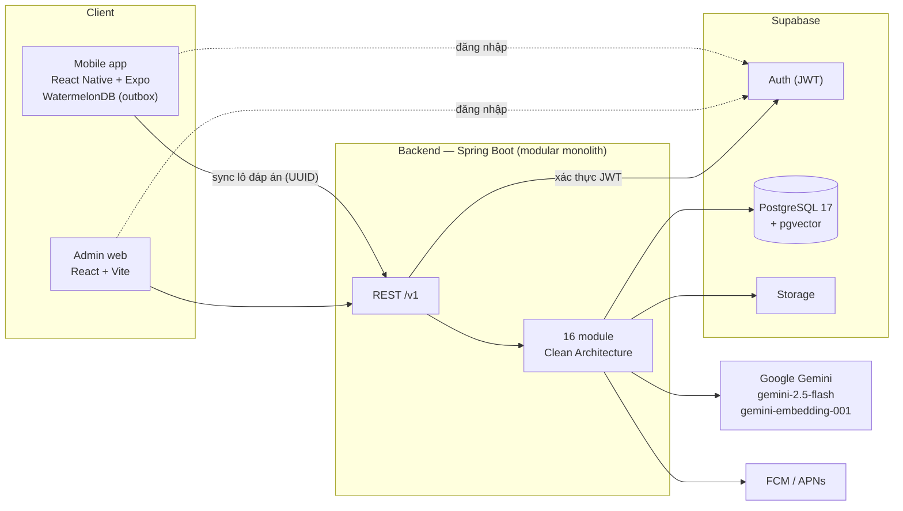

# PELA — Personalized English Learning Application

Đồ án SE121 (Đồ án 1) — UIT: **"Xây dựng ứng dụng học tiếng Anh cá nhân hoá tích hợp thuật toán Spaced Repetition và kỹ thuật RAG"**.

PELA là ứng dụng di động giúp người học tiếng Anh đi theo lộ trình CEFR được cá nhân hoá, ôn từ vựng bằng thuật toán SM-2 và luyện Writing được AI chấm điểm. Ứng dụng học được khi mất mạng và đồng bộ lại khi có kết nối; quản trị viên quản lý nội dung qua cổng web riêng.

## Tính năng chính

- **Lesson theo lộ trình CEFR** — bài kiểm tra đầu vào, lộ trình cá nhân hoá, Final Test.
- **Ôn tập từ vựng SM-2** — lịch ôn tự điều chỉnh theo kết quả, đánh dấu từ cần củng cố.
- **Daily / Weekly Challenge** — sinh theo luật, không cần AI, chạy được offline.
- **Writing chấm bằng AI** — Gemini chấm và nhận xét bài viết.
- **Tạo đề Writing bằng RAG** — truy hồi đề trong kho (pgvector) để AI tạo đề mới, luôn có đề dự phòng.
- **Listening** — bài nghe theo cấp độ.
- **Gamification** — Star, streak, bảng xếp hạng, kết nối bạn bè.
- **Offline-first** — dữ liệu cục bộ bằng WatermelonDB, đồng bộ qua outbox.
- **Admin portal** — quản lý nội dung, kho đề, cấu hình hệ thống và prompt AI.

## Kiến trúc tổng quan



## Tech stack

| Thành phần | Công nghệ |
|---|---|
| Backend | Java 21, Spring Boot 3.5, Spring Security (OAuth2 Resource Server), JdbcTemplate, Flyway, ArchUnit, JUnit 5, Testcontainers — Gradle (Kotlin DSL) |
| Mobile | React Native + Expo (dev build), TypeScript strict, React Navigation, Zustand, React Hook Form + Zod, i18next (vi/en), WatermelonDB |
| Admin web | React + TypeScript (Vite), TanStack Query, React Router, Zustand, React Hook Form + Zod |
| Frontend chung | pnpm workspace, `@pela/domain`, `@pela/api-contract`, `@pela/fixtures`, Vitest, dependency-cruiser |
| Hạ tầng | Supabase: PostgreSQL 17 + pgvector, Auth, Storage |
| AI | Google Gemini: `gemini-2.5-flash`, `gemini-embedding-001` (768 chiều) |
| Push | FCM / APNs |
| CI | GitHub Actions |

## Cấu trúc repo

```text
.
├─ backend/                 Spring Boot — package com.pela, 16 module
├─ frontend/                pnpm workspace
│  ├─ apps/mobile/          React Native (Expo)
│  ├─ apps/admin-web/       React + Vite
│  ├─ packages/domain/      TS thuần: SM-2, quy đổi Star, …
│  ├─ packages/api-contract/ DTO + Zod từ OpenAPI
│  └─ packages/fixtures/    test vector JSON dùng chung với backend
├─ supabase/
│  ├─ migrations/           Flyway (V1__init.sql = schema.sql)
│  └─ seed/
├─ docs/                    SRS, kiến trúc, sơ đồ, OpenAPI, ADR
├─ AGENTS.md                quy tắc cho AI agent
└─ CONTRIBUTING.md          quy trình làm việc của nhóm
```

## Chạy nhanh

Chuẩn bị: JDK 21, Node.js LTS, pnpm (`npm install -g pnpm@12.15.0`), Android Studio hoặc Xcode. Sao chép `.env.example` thành `.env` và điền giá trị (xem [CONTRIBUTING.md](CONTRIBUTING.md#getting-started)).

**Backend**

```bash
cd backend
./gradlew bootRun
```

Kiểm tra: `GET http://localhost:8080/v1/health` → `{"status":"ok"}`. Backend cần biến môi trường DB và Supabase để khởi động.

**Mobile** (dev build, không dùng Expo Go)

```bash
cd frontend
pnpm install
pnpm --filter mobile android
```

**Admin web**

```bash
cd frontend
pnpm --filter admin-web dev
```

## Tài liệu

- [docs/](docs/README.md) — SRS, kiến trúc, sơ đồ, OpenAPI, ADR
- [CONTRIBUTING.md](CONTRIBUTING.md) — Git workflow, quy ước code, test, Definition of Done
- [AGENTS.md](AGENTS.md) — quy tắc cho AI agent làm việc trong repo

## Nhóm thực hiện

| Họ tên | MSSV |
|---|---|
| Huỳnh Tịnh Văn | 24521978 |
| Hoàng Thị Thảo Uyên | 24521965 |

Giảng viên hướng dẫn: **ThS. Trần Thị Hồng Yến** — Trường Đại học Công nghệ Thông tin, ĐHQG-HCM.
Hạn nộp: 26/12/2026.
