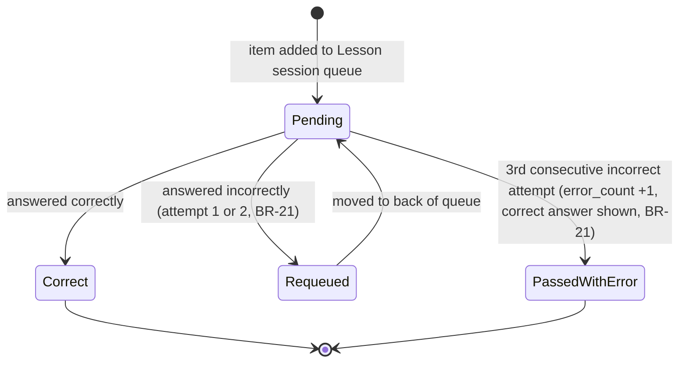

# Figure A-8

*Figure A-8. State diagram for the short-term, in-Lesson question queue, distinct from the long-term SM-2 review card lifecycle (Figure A-7).*

Vị trí trong SE121-SRS v4.0: Appendix A, mục A.8.

