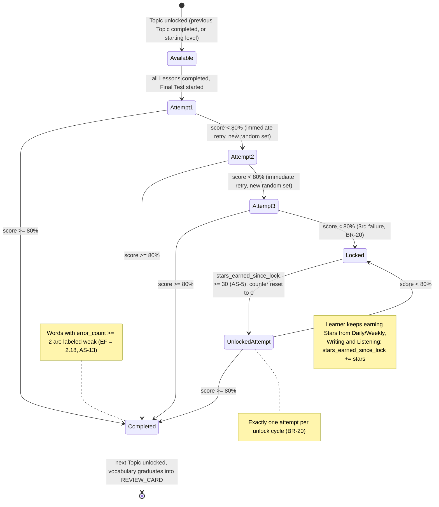

# Figure A-10

*Figure A-10. State diagram for the per-Topic Final Test attempt and lock cycle (BR-20, one attempt per unlock cycle), tracked by TOPIC_PROGRESS.*

Vị trí trong SE121-SRS v4.0: Appendix A, mục A.10.

