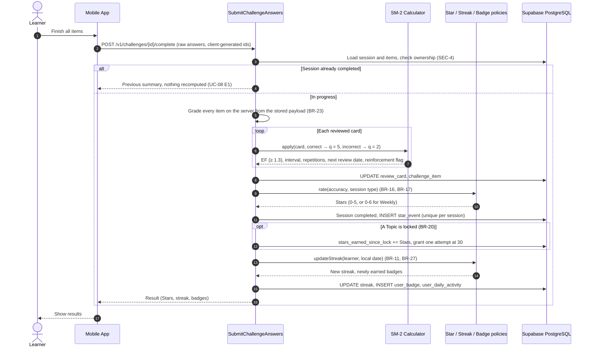

# Figure A-11

*Figure A-11. Sequence diagram for submitting a Daily or Weekly Challenge: server grading, SM-2 update, Stars and streak (BR-3, BR-10, BR-11, BR-23).*

Vị trí trong SE121-SRS v4.0: Appendix A, mục A.11.

