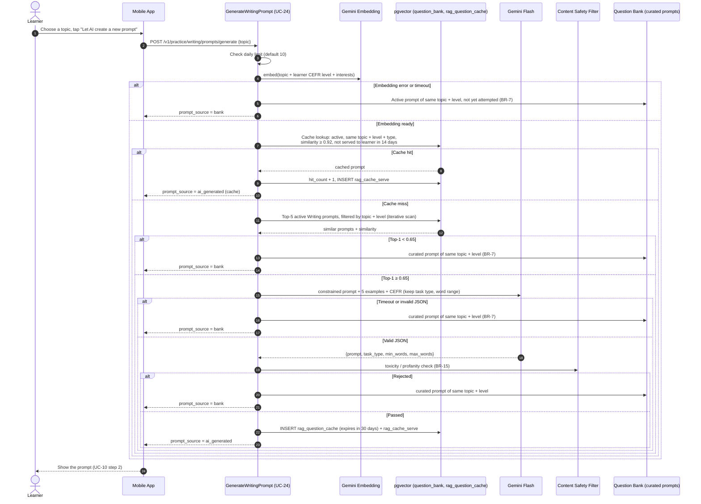

# Figure A-16

*Figure A-16. Sequence diagram for "Let AI create a new prompt": cache, Top-5 retrieval, generation and fallback (UC-24, BR-7, BR-8, BR-24, BR-25).*

Vị trí trong SE121-SRS v4.0: Appendix A, mục A.16.

