# PELA — Software Requirements Specification (SRS) — Release 4.2

> Bản Markdown của `SE121-SRS-HuynhTinhVan-HoangThiThaoUyen-v4.2.docx`, tạo để AI agent và người đọc tra cứu, tìm kiếm, so sánh thay đổi (diff) dễ dàng.
> **Bản .docx là bản chính thức nộp giảng viên.** Hai bản phải cùng nội dung; khi SRS đổi, cập nhật cả hai trong cùng một PR.
>
> - Ngày: 31/10/2026 · Nhóm: Huỳnh Tịnh Văn (24521978), Hoàng Thị Thảo Uyên (24521965) · GVHD: ThS. Trần Thị Hồng Yến
> - Quy ước mã: `UC-n` use case, `BR-n` business rule, `AS-n` assumption, `DE-n` dependency, `CO-n` constraint, FR dạng `Feature.Group.Item` (ví dụ `Admin.QuestionBank.Tts`), NFR dạng `PER-n`, `SEC-n`, `MNT-n`…
> - Sơ đồ: mã Mermaid đặt ngay dưới chú thích hình; file nguồn ở `docs/diagrams/`.
> - Thay đổi của bản 4.2: xem dòng 4.2 trong Revision History.

## Revision History

| Name | Date | Reason For Changes | Version |
|---|---|---|---|
| Hoang Thi Thao Uyen / Huynh Tinh Van | 9/7/2026 | Initialize and Add Introduction | 1.0 |
| Hoang Thi Thao Uyen | 9/11/2026 | Add System Features & User Flows | 2.0 |
| Huynh Tinh Van | 9/11/2026 | Add Data, Interface & Non-Functional Requirements | 2.0 |
| Hoang Thi Thao Uyen / Huynh Tinh Van | 9/17/2026 | Fixed typo (4.1.12); added RAG caching (BR-24/25); clarified EF formula on 3 consecutive misses (BR-26) | 3.0 |
| Hoang Thi Thao Uyen / Huynh Tinh Van | 10/13/2026 | Align with UI design, API specification and the Admin Portal flow; add UC-25…UC-31, BR-27…BR-35, AS-12…AS-15; move RAG to Writing prompt generation; rule-based Daily/Weekly Challenge; update data model, interfaces, quality attributes and analysis models | 4.0 |
| Hoang Thi Thao Uyen / Huynh Tinh Van | 10/15/2026 | Finalize Star rules: Writing star bands (BR-18), replay rule for Lessons and listening clips (BR-36), Final Test unlock sources and progress display (BR-20, UC-07); streak counts every learning session (BR-11); single weekly leaderboard time zone (BR-12); confirm AS-4, AS-5; correct AS-6; update Figures A-1, A-2, A-6, A-10 | 4.1 |
| Hoang Thi Thao Uyen / Huynh Tinh Van | 10/31/2026 | Listening exercises imported from a CSV file, with audio generated by AI text-to-speech (UC-19, BR-14, BR-34, BR-37, AS-16, CO-4, SI-1.4, Admin.QuestionBank, LISTENING_CLIP, IMPORT_JOB); listening clips listed in Admin-defined order without recommendations (Listening.Select.Source, UC-11); remove difficulty_level from Vocabulary, Question Bank, Listening clip and RAG question cache (DE-5); update Figures 2.1, 4.1 (a–c), A-13 | 4.2 |

# 1 Introduction

## 1.1 Purpose

This Software Requirements Specification (SRS) describes the functional and non-functional requirements for Release 1.0 of the Personalized English Learning Application (hereafter "the System" or "PELA"). It is intended to be used by the two members of the project team who will design, implement, test, and evaluate the System, and by the supervising lecturer as a basis for reviewing project scope and progress. Unless otherwise noted, all requirements specified here are committed for Release 1.0, to be delivered by 26/12/2026 per the approved project schedule.

## 1.2 Document Conventions

Functional requirements are grouped by feature and identified with a dotted mnemonic scheme, e.g. Auth.Register.Validate, so that a requirement can be traced back to its feature and functional group at a glance. Business rules referenced throughout this document are identified as BR-n and are collected in Section 2.6. Assumptions that fill a gap left open by the source business-flow description are identified as AS-n and are also collected in Section 2.5 so they can be revisited with the supervisor before implementation. Requirement priorities follow a three-level scale: High (must be delivered for Release 1.0), Medium (delivered if schedule allows), and Low (candidate for a future release).

## 1.3 Intended Audience and Reading Suggestions

This document is intended for: (1) the student developers, as the authoritative basis for design and implementation; (2) the supervising lecturer (GVHD), for reviewing scope, feasibility and grading criteria; and (3) any future contributor who needs to understand the system's intended behavior. Readers interested only in the product's purpose and scope should read Sections 1 and 2. Readers implementing a specific feature should read the corresponding subsection of Section 3, together with the related entities in Section 4.1 and interfaces in Section 5. Section 6 and Appendix A are most relevant during testing and architecture review.

## 1.4 Project Scope and Product Features

The Personalized English Learning Application is a mobile-first system (React Native, Android/iOS) with a companion web Admin portal (React, TypeScript) that helps self-learners build English proficiency from CEFR level A1 to C2 through the following coordinated mechanisms:

**CEFR-based onboarding & placement** — a short orientation survey plus an optional one-time placement test routes each learner into the correct starting level (A1–C2) instead of a one-size-fits-all curriculum.

**A structured Vocabulary Roadmap** — content is organized into Topics (20–30 words each), broken into Lessons, and capped by a Final Test that gates progression to the next Topic.

**SM-2 spaced repetition** — once a Topic is passed, its vocabulary graduates into a long-term review pool that schedules review at the point of maximum forgetting risk instead of at fixed intervals.

**Gamified microlearning** — short, interactive Daily and Weekly Challenges that replace static flashcards with a Star-rating system, streaks, and leaderboards.

**AI writing feedback** — grades short free-form writing with a fixed rubric, highlights grammar, spelling, word-choice, punctuation and repetition issues sentence by sentence, suggests more natural rewrites, and extracts up to three worth-learning words the learner misused so they can be added to the SM-2 review queue.

**RAG-grounded Writing prompts** — when the learner asks for a new Writing prompt, retrieves the most similar curated prompts of the same topic and CEFR level from the Question Bank (Supabase pgvector) and asks the LLM to write a new prompt that follows their structure, reducing off-level or off-topic prompts; if no curated prompt is similar enough, an existing curated prompt is served instead.

**AI-assisted content import** — Admins import listening exercises from a CSV file — transcript lines with Vietnamese translation, questions, answers and explanations — and the system generates the listening audio from the transcript with AI text-to-speech; Admins upload a Writing prompt file and the system extracts the prompts. Everything is reviewed and edited in a preview before saving.

Out of scope for Release 1.0: pronunciation exercises and speaking practice (DE-3); AI-generated items in Daily and Weekly Challenges, and Sentence Build exercises; an AI mode for Listening practice; uploading recorded audio for listening exercises (listening audio is generated from the imported transcripts); difficulty tiers within a CEFR level, and difficulty-based ordering or recommendation of listening clips and Writing prompts (DE-5); Admin dashboard metrics for daily active users, challenge completion rate, RAG cache-hit rate and AI fallback rate, and CSV export of usage reports (the underlying data is still recorded); an Admin screen for system settings and AI prompt templates (maintained by the development team in the database, MNT-3, MNT-4); tiered Admin roles, Admin account creation and Admin password reset in the portal (AS-15); social sign-in providers other than Google (CO-6).

## 1.5 References

- Wiegers, Karl. Cafeteria Ordering System Software Requirements Specification (template reference for structure and style), Process Impact, 2013.

- SuperMemo SM-2 algorithm specification, as described by P. A. Wozniak, "Repetition Spacing Algorithm SM-2," SuperMemo World.

- pgvector — Open-source vector similarity search extension for PostgreSQL, used via Supabase.

- Council of Europe, Common European Framework of Reference for Languages: Learning, Teaching, Assessment (CEFR), used as the basis for the six proficiency levels (A1–C2) referenced throughout this document.

- Internal business-flow specification, "Luồng.pdf" (Onboarding & Placement Test; Vocabulary Roadmap; Daily & Weekly Challenge; Skill Practice; Star & Ranking; Offline & Sync), team working document, September 2026.

- Internal Admin Portal flow specification, "Luồng Admin Portal — bản chốt hoàn chỉnh" (Dashboard, Learner Accounts, Admin Directory, Question Bank, Report, Activity Log), team working document, 12 October 2026.

- PELA design documents: database schema v1.3 (schema.sql), pgvector test script and design document v1.3 (ERD, Clean Architecture, sequence diagrams), October 2026.

# 2 Overall Description

## 2.1 Product Perspective

PELA is a new, independent system; it does not replace an existing product. It consists of three cooperating components: a React Native mobile application used by Learners, a React/TypeScript web portal used by Admins, and a Java backend that exposes a REST API, orchestrates calls to the LLM Provider API (Google Gemini), and reads/writes the Supabase PostgreSQL database (extended with pgvector for similarity search) and Supabase Storage. Learners may also sign in with Google through Supabase Auth (CO-6). The Speech API used for pronunciation is deferred to a future release (DE-3).

*Figure 2.1. Context diagram for Release 1.0 of the Personalized English Learning Application.*

Nguồn: `docs/diagrams/chuong-2-4/2.1_flow_context-diagram.mmd`

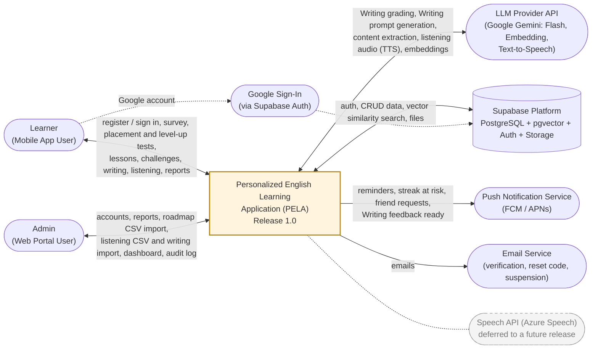

## 2.2 User Classes and Characteristics

| Learner | The primary user of the mobile app: an independent English learner, typically a student, who wants structured, level-appropriate, low-friction daily practice. No technical expertise is assumed. Expected to use the app briefly (5–15 minutes) but frequently (ideally daily) rather than in long sessions. |
|---|---|
| Admin | A project team member or, after handover, a course/content administrator who imports the Vocabulary Roadmap (CSV), imports listening exercises and Writing prompts into the Question Bank with AI assistance, manages learner accounts, handles user and app problem reports, and monitors the system through the web portal dashboard. Comfortable with basic data-entry and dashboard tools; does not require programming knowledge. |

## 2.3 Operating Environment

- **OE-1:** The mobile application shall run on Android 8.0 (API 26) or later and iOS 14 or later, built with React Native.

- **OE-2:** The Admin web portal shall operate correctly on current versions of Google Chrome, Microsoft Edge, and Mozilla Firefox.

- **OE-3:** The backend shall run as a Java service deployable to a Linux-based cloud host (e.g., a container on a managed VM or PaaS).

- **OE-4:** The primary data store is a managed Supabase PostgreSQL instance with the pgvector extension enabled; no self-hosted database is required for Release 1.0.

- **OE-5:** The mobile application shall remain usable (per Section 3.14) when the device has no active internet connection.

## 2.4 Design and Implementation Constraints

- **CO-1:** Both the mobile front end and the Java backend shall follow Clean Architecture layering (presentation / application / domain / data-infrastructure) so that business logic is independent of frameworks, databases and external AI services, and can be unit-tested in isolation (Section 6.2).

- **CO-2:** Local on-device storage shall use SQLite via WatermelonDB to support the offline-first requirements of Section 3.14.

- **CO-3:** Authentication shall be implemented using Supabase Auth rather than a custom-built identity system, to reduce security risk within the project timeline.

- **CO-4:** AI features shall call Google's Gemini API rather than a self-hosted model: a Gemini Flash-class model for Writing grading, Writing prompt generation and content extraction during import; a Gemini text-to-speech model to generate listening audio from Admin-imported transcripts; and gemini-embedding-001 with an output dimensionality of 768 for RAG embeddings. Each stored embedding shall record the model that produced it; changing the embedding model requires re-embedding the Writing prompts in the Question Bank and expiring the RAG question cache. Each listening clip records the text-to-speech model and the voices used to generate its audio.

- **CO-5:** The project shall be completed within the timeline allotted for this capstone project.

- **CO-6:** Social sign-in in Release 1.0 is limited to Google, provided through Supabase Auth.

## 2.5 Assumptions and Dependencies

- **AS-1:** Learners are assumed to have a smartphone with a working speaker (for listening exercises and pronunciation audio); a microphone is only needed for pronunciation features deferred to a future release (DE-3).

- **AS-2:** The Question Bank and Vocabulary Roadmap (Topics/Lessons/Final Tests) are assumed to be seeded with an initial, vetted curriculum spanning all six CEFR levels before user testing begins; content creation and pedagogical design of the exact curriculum are outside the scope of the software itself, but the Admin tooling to enter and maintain that content is in scope (Section 3.15).

- **AS-3:** The exact question set and scoring rubric of the Orientation Survey (Section 3.4) — i.e., which answers map to which of the six CEFR levels — is defined by the Admin/content team, not hard-coded in this SRS; the System only requires that such a mapping table exists and is configurable.

- **AS-4:** The Star-rating scale for accuracy-based sessions (Daily Challenge, Weekly Challenge, Lesson Practice, Listening) follows a linear five-tier mapping (BR-16), extended from the two anchor points of the source business flow (≥80%→4 stars, ≥60%→3 stars, "decreasing proportionally"); Writing uses the score bands of BR-18. These mappings were confirmed by the project team on 15/10/2026 and are stored as configurable system settings.

- **AS-5:** The number of additional Stars a learner must earn to unlock a new Final Test attempt after a 3rd failure (BR-20) is 30 Stars, confirmed by the project team on 15/10/2026 and stored as a configurable system setting. At typical session ratings this corresponds to roughly 6–10 completed sessions (about one study session), long enough to require real review without stalling the learner for several days.

- **AS-6:** The Weekly Challenge bonus star (6th star, BR-17) is assumed to be awarded for a session completed with 100% correct answers. No bonus star applies to the Daily Challenge.

- **AS-7:** The RAG retrieval threshold (BR-8) is set to 0.65, based on a pilot measurement with gemini-embedding-001 at 768 dimensions (12/10/2026): the top-1 similarity of on-topic queries ranged from 0.688 to 0.754 and an off-topic query scored 0.589. The cache-hit threshold (BR-24) starts at 0.92. Both values are configurable system settings and shall be re-calibrated on the full set of Writing prompts before user testing.

- **AS-8:** The "do not repeat a cached question to the same learner" window (BR-24) is assumed to be 14 days; should be confirmed with the supervisor/content team.

- **AS-9:** The cache-entry TTL (BR-25) is assumed to be 30 days from creation.

- **AS-10:** Since the system records only a binary correct/incorrect result (not the 0–5 quality scale used by the original SM-2 algorithm), the quality score used in the EF formula is assumed to map as follows: correct answer → q = 5; incorrect answer → q = 2 (not q = 0, since the current exercise formats — MCQ, listen-and-select, drag-drop — are recognition-based rather than free-recall). This mapping must be confirmed with the supervisor before implementation, consistent with AS-4.

- **AS-11:** Forcing easiness_factor directly to the 1.3 floor upon the 3rd consecutive incorrect review (BR-26), rather than letting it decay gradually under the standard formula, is a deliberate pedagogical intervention; the "3 consecutive" threshold and the floor-forcing behavior should be confirmed with the supervisor, with A/B testing recommended before being finalized for Release 1.0.

- **AS-12:** The Level-Up Test (UC-25) uses a fixed-length, stratified question set rather than computerized adaptive testing, because a calibrated (IRT) item bank is not available for this project. Its default parameters — 20 questions, 20 minutes, pass mark 80%, 7-day wait after a failed attempt — are admin-configurable.

- **AS-13:** When a Topic is passed, vocabulary labeled "weak" (BR-6) receives an Easiness Factor of 2.18, i.e. the default 2.5 reduced by one incorrect review under the AS-10 mapping. The value is admin-configurable.

- **AS-14:** A word counts as "learned" for badges and statistics when its review card is in the review or mastered state.

- **AS-15:** Admin accounts are created, and their passwords reset, by the development team directly in Supabase; the Admin portal provides no password change or recovery in Release 1.0.

- **AS-16:** Listening audio is generated with the prebuilt voices of the Gemini text-to-speech model, which voices at most two speakers per request; a listening clip is therefore a monologue or a two-person dialogue (BR-37). The default transcript limit of 3,000 characters per clip and the speaking style per CEFR level (slower and clearer for A1–A2) are configurable settings (MNT-3).

- **DE-1:** The operation of Sections 3.9, 3.11 and 3.15 (Writing grading, Writing prompt generation and AI-assisted content import, including listening audio generation) depends on continued availability, rate limits, and API compatibility of the Gemini API.

- **DE-2:** The operation of Section 3.11 depends on the Supabase-managed pgvector extension remaining available and performant at the expected data volume.

- **DE-3:** Pronunciation exercises and speaking practice depend on Azure Speech and are deferred to a future release (Section 1.4).

- **DE-4:** The performance of Section 3.11 (RAG), when caching is enabled, additionally depends on the size and performance of the pgvector-indexed RAG_QUESTION_CACHE table, analogous to DE-2.

- **DE-5:** Difficulty tiers within a CEFR level are deferred to a future release. Release 1.0 organises learning content only by topic and CEFR level, and lists listening clips and Writing prompts in the order set by the Admin, without difficulty-based ordering or recommendation.

## 2.6 Business Rules

- **BR-1** — A Learner account is uniquely identified by a verified email address.
- **BR-2** — Passwords are stored using a one-way salted hash (bcrypt/argon2 via Supabase Auth) and are never transmitted or stored in plain text.
- **BR-3** — SM-2 parameters (Easiness Factor, Interval, Repetition Count, Next Review Date) are recalculated after every graded review attempt on a card in the long-term review pool.
- **BR-4** — A vocabulary card's Easiness Factor (EF) shall never fall below 1.3, per the standard SM-2 specification.
- **BR-5** — A Daily Challenge is generated at most once per calendar day per learner, evaluated in the learner's configured time zone.
- **BR-6** — A vocabulary item is considered "weak" if (a) during a Topic's Final Test its error_count for that learner is ≥ 2, or (b) for an item already in the long-term SM-2 pool, its most recent review attempt was incorrect. Weak items are prioritized in Daily Challenge generation and, per BR-20, have their Easiness Factor forced below the 2.5 default on graduation from a Topic.
- **BR-7** — If a new Writing prompt cannot be generated — the Top-1 similarity is below the BR-8 threshold, the LLM times out, or its output is not valid JSON — the system shall serve an existing active Writing prompt of the same topic and CEFR level from the Question Bank that the learner has not attempted, so that the learner always receives a prompt.
- **BR-8** — To generate a new Writing prompt, the RAG pipeline retrieves the Top-5 (K=5) most similar active Writing prompts in the Question Bank by pgvector cosine similarity, restricted to the requested topic and the learner's CEFR level, and shall only call the LLM when the Top-1 similarity is ≥ the configured threshold (AS-7, default 0.65); otherwise BR-7 applies.
- **BR-9** — Any vocabulary flagged as misused in a Writing submission is automatically inserted or promoted in the learner's review queue with next_review_date = today.
- **BR-10** — Stars are the sole reward currency of Release 1.0. They are earned only, never spent: there is no shop, and streak protection does not cost Stars. A Star rating (0–5, or 0–6 for the Weekly Challenge) is computed once per completed session — Daily Challenge, Lesson Practice, Listening session, Writing submission or Weekly Challenge — based on the accuracy or AI-assessed quality of that session (BR-16, BR-17, BR-18). Placement Tests, Topic Final Tests and Level-Up Tests award no Stars.
- **BR-11** — A Streak increments by 1 for each consecutive calendar day on which the learner completes at least one learning session — a Lesson, Daily Challenge, Weekly Challenge, Listening session, or a Writing submission that has been graded — before 00:00 local time; a missed day resets the streak to 0 unless the learner uses a streak restore under BR-27.
- **BR-12** — Leaderboard rankings, scoped to either "Friends" or "Global" (Top 100), are ranked by star_total within the selected period and recalculated at least every 15 minutes. The Weekly period runs from Monday 00:00 to Sunday 23:59 in a single reference time zone (Asia/Ho_Chi_Minh, UTC+7) for all learners, so that every learner on the same leaderboard is measured over the same week; star_total for the period resets to 0 at the start of each week. The Friends scope excludes any learner blocked by, or blocking, the viewer (BR-31).
- **BR-13** — Data created while offline is retained in the local database until the server acknowledges successful synchronization; the local pending copy is purged only after that acknowledgment.
- **BR-14** — Only Admins can create, edit or retire Question Bank items. An item becomes active when the Admin saves it after reviewing the import preview; a Writing prompt is saved together with its embedding vector, which makes it eligible for RAG retrieval immediately, and a listening clip is saved together with the audio generated from its current transcript and voices (BR-37).
- **BR-15** — All AI-generated content shown to a Learner must pass an automated profanity/toxicity filter before being displayed.
- **BR-16** — Star rating for accuracy-based sessions (Daily Challenge, Lesson Practice, Listening session): 100% correct → 5 stars; ≥ 80% → 4 stars; ≥ 60% → 3 stars; ≥ 40% → 2 stars; ≥ 20% → 1 star; < 20% → 0 stars (AS-4).
- **BR-17** — Star rating for the Weekly Challenge: the same five-tier mapping as BR-16 applies for the base 0–5 stars, plus 1 bonus star (for a maximum of 6) when the session is completed with 100% correct answers (AS-6).
- **BR-18** — Star rating for Writing submissions: the AI-assigned 0–100 quality score is mapped to a 0–5 star rating as follows: ≥ 90 → 5 stars; ≥ 75 → 4 stars; ≥ 60 → 3 stars; ≥ 40 → 2 stars; ≥ 20 → 1 star; < 20 → 0 stars (AS-4). The top band starts at 90 rather than 100 because AI graders rarely award a perfect score.
- **BR-19** — A learner may take the CEFR Placement Test for a given orientation result at most once. Passing (≥ 80%) places the learner at the oriented level and automatically marks all lower CEFR levels as "completed." Failing (< 80%) places the learner at a fallback CEFR level determined by a proportional score-tier mapping specific to the tested level, rather than by a fixed one-level drop; the fallback level is always strictly below the tested level. The exact score-tier mapping for each oriented level is defined in Section 3.4.2 (Placement.Test.Fail) and Section 3.2.3 (UC-03 Normal Flow, step 4). A learner may instead choose "Start from the beginning", which places them at A1 without taking the Placement Test.
- **BR-20** — A Topic's Final Test allows at most 3 attempts (1 initial + 2 retries), each drawing a new random 20-question set. Passing (≥ 80%) sets TOPIC_PROGRESS.status = completed, unlocks the next Topic, and migrates all of that Topic's vocabulary into the long-term SM-2 review pool (REVIEW_CARD), forcing the Easiness Factor below 2.5 for any word whose error_count ≥ 2 for that learner (BR-6, AS-13). Failing the 3rd attempt sets TOPIC_PROGRESS.status = locked and locked_at = now(), locking further Final Test attempts and the next Topic; the Lessons of the locked Topic remain open for replay. While the Topic is locked, TOPIC_PROGRESS.stars_earned_since_lock is increased by (a) the Star rating of every completed Daily Challenge, Weekly Challenge and graded Writing submission, (b) the Stars added by Listening sessions under BR-36, and (c) the full Star rating of every completed replay of a Lesson of the locked Topic. When the counter reaches at least 30 (AS-5), one new attempt is granted and the counter resets to 0. Each unlock cycle grants exactly one attempt; failing it locks the Final Test again until another 30 Stars are earned. Final Tests themselves award no Stars (BR-10).
- **BR-21** — Within a Lesson session, an incorrectly answered item is shown with the correct answer and re-queued to the back of the current session's queue for another attempt. After 3 consecutive incorrect attempts on the same item, the system shows the correct answer, marks the item as passed for this session, and increments that vocabulary item's error_count for this learner.
- **BR-22** — A learner may mark at most 3 earned badges as "displayed" at any one time; displayed badges appear on the public profile and on the learner's Leaderboard entry.
- **BR-23** — During offline synchronization, Star totals, streak increments, and Final-Test/Lesson results are recomputed and validated server-side from the underlying raw answer records; client-submitted Star/streak values are never trusted directly, to prevent fraudulent accumulation while offline.
- **BR-24** — Before invoking the LLM to generate a Writing prompt, the system shall look up RAG_QUESTION_CACHE for an active entry of the same topic, CEFR level and prompt type whose query embedding has a cosine similarity ≥ 0.92 (AS-7) with the current query embedding and that has not been served to the current learner within the last 14 days (AS-8); on a hit, the cached prompt is returned and the LLM is not called.
- **BR-25** — Every Writing prompt successfully generated by the LLM (RAG.Generate, after passing the BR-15 content filter) shall be written to RAG_QUESTION_CACHE together with its originating query embedding. A cache entry expires (status = expired) 30 days after creation (AS-9), or immediately when its associated Question Bank template is retired by an Admin (Admin.QuestionBank.Retire); expired entries shall not be eligible for a cache hit but shall be retained for audit and cache-hit-rate reporting (Admin.Analytics). Generated prompts are stored only in RAG_QUESTION_CACHE and are never added to the Question Bank.
- **BR-26** — If a REVIEW_CARD card receives 3 consecutive incorrect review attempts (no intervening correct attempt, measured from last_reviewed_at), the system shall, in addition to the standard SM-2 formula in Section 3.7.2 (SM2.Update): (a) set easiness_factor = 1.3 (the BR-4 floor) directly; (b) set interval_days = 1; (c) set needs_reinforcement = true on the card; (d) from the time the flag is set, prioritize the card above all other "weak" items (BR-6) in Daily Challenge generation (Challenge.Generate.DueList) until the learner answers it correctly once, at which point the flag is cleared and consecutive_incorrect_count resets to 0.
- **BR-27** — Streak restore: a learner may restore a broken streak at most 3 times per calendar month (local time; the counter resets on the 1st). A restore is possible only when exactly one day was missed and must be used before 23:59 of the following day. The missed day is marked "restored"; the learner must still complete an activity today for the streak to increase. Missing two or more days resets the streak to 0.
- **BR-28** — Level change: a learner may move to any higher CEFR level only by passing the Level-Up Test for that level (UC-25, AS-12). Passing marks all intermediate levels as completed but does not add their vocabulary to the review pool. A failed attempt blocks a new attempt for 7 days. Moving to a lower level requires no test.
- **BR-29** — Writing grading quota: a Writing submission consumes one daily grading only when grading succeeds. Submissions that are queued for retry or that finally fail do not consume quota. When the quota is exhausted, the text is kept as a draft.
- **BR-30** — Worth-learning words: after grading, at most three words are suggested per submission. A word qualifies only if it comes from a spelling, word-choice or word-form issue, or is a suggested replacement for a repeated word; is not a function word or proper noun; is at most one CEFR level above the learner's level; and is not already in the learner's review pool. A suggested word already present in the vocabulary catalogue is added to the review queue automatically (BR-9); any other word is added only when the learner confirms, as a private word visible only to that learner.
- **BR-31** — Blocking: blocking a learner removes any friendship and pending request between the two, and hides each from the other's search results, profile view and Friends leaderboard. The blocked learner is not notified.
- **BR-32** — Profile changes: a learner may change their display name at most once every 10 days and their username at most once every 30 days.
- **BR-33** — Account deletion: on a confirmed deletion request (password re-entry by the learner, or an Admin action under UC-16), the account is immediately signed out on all devices and hidden from other learners, and is permanently deleted within 30 days (DI-3). A learner's own request cannot be cancelled.
- **BR-34** — Content import review: content imported by an Admin — a roadmap CSV file, a listening CSV file or a Writing prompt file — is first shown in an editable preview; nothing is visible to learners until the Admin saves (Question Bank) or publishes (roadmap) it. An Admin can retire saved content at any time without deleting the learner history that refers to it.
- **BR-35** — Admin audit: every Admin action that changes learner accounts, roadmap content, the Question Bank or reports shall be recorded in the Admin action log, including the target record and its before/after values. Log entries cannot be modified or deleted.
- **BR-36** — Replaying Lessons and listening clips: a completed Lesson or listening clip may be replayed any number of times. Each replay is rated as usual (BR-16), but only the improvement over the learner's best previous rating for that Lesson or clip is added to star_total and the leaderboards (for example, a replay rated 5 stars after a best of 3 stars adds 2 Stars; a replay that does not beat the best adds 0). The improvement rule also applies to the Final Test unlock counter for listening clips, whereas replays of a locked Topic's Lessons count in full toward that counter (BR-20).
- **BR-37** — Listening content: listening clips are imported by an Admin from a CSV file in the provided template; each clip has a title, topic, CEFR level, at most two speakers, transcript lines with Vietnamese translation, and questions each with four distinct options, exactly one correct answer and an explanation. Its audio is generated once with AI text-to-speech, using the voice assigned to each speaker, and stored with the clip. A clip cannot be saved until its audio matches its current transcript and voices; changing either requires generating the audio again. Learners cannot generate new listening exercises.

# 3 System Features

## 3.1 Use Case Diagram

*Figure 3.1. Use case diagram for Release 1.0.*

Nguồn: `docs/diagrams/chuong-2-4/3.1_flow_use-case-diagram.mmd`

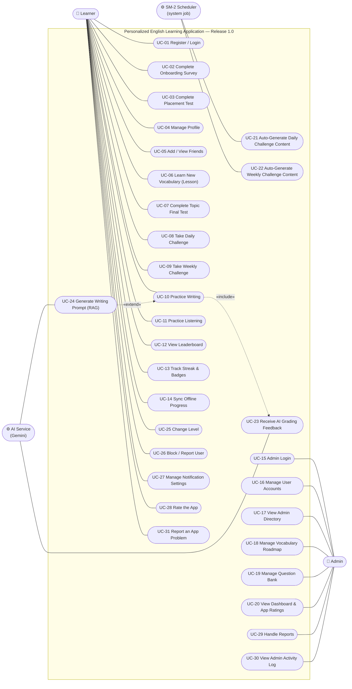

## 3.2 Use Case Specifications

| Primary Actor | Use Cases |
|---|---|
| Learner | Register / Login<br>Complete Onboarding Survey<br>Complete Placement Test<br>Manage Profile<br>Add / View Friends<br>Learn New Vocabulary (Lesson)<br>Complete Topic Final Test<br>Take Daily Challenge<br>Take Weekly Challenge<br>Practice Writing<br>Practice Listening<br>View Leaderboard<br>Track Streak & Badges<br>Sync Offline Progress<br>Change Level<br>Block / Report User<br>Manage Notification Settings<br>Rate the App<br>Report an App Problem |
| Admin | Login<br>Manage User Accounts<br>View Admin Directory<br>Manage Vocabulary Roadmap<br>Manage Question Bank<br>View Dashboard & App Ratings<br>Handle Reports<br>View Admin Activity Log |
| SM-2 Scheduler (Secondary Actor) | Auto-Generate Daily Challenge Content<br>Auto-Generate Weekly Challenge Content |
| AI Service (Secondary Actor) | Receive AI Grading Feedback<br>Generate Writing Prompt (RAG) |

### 3.2.1 UC-01: Register / Login

- **ID and Name:** UC-01 Register / Login
- **Created By:** Tinh Van, Thao Uyen
- **Date Created:** 11/09/2026
- **Primary Actor:** Learner
- **Secondary Actors:** None
- **Description:** A prospective Learner creates a new account, or an existing Learner authenticates to access the mobile app.
- **Trigger:** The Learner opens the mobile app and selects either "Register" or "Login."
- **Preconditions:** PRE-1. Valid email address available.
PRE-2. (Login) Account previously registered and verified.
- **Postconditions:**
  - POST-1. (Register) Account created, role=learner, status=unverified.
  - POST-2. (Login) Session (JWT) issued, redirected to home.
  - POST-3. (Google) Account created or linked, with the email already verified by Google.
- **Normal Flow:**
  - 1.0 Registration
  - 1. Learner enters name, email, password, confirmation.
  - 2. System validates email uniqueness (BR-1) and password strength (Auth.Register.Validate).
  - 3. Account created as unverified.
  - 4. Verification email sent (Auth.Register.Verify).
  - 5. Learner confirms email; status → verified.
  - 2.0 Login
  - 1. Learner enters email/password.
  - 2. The backend authenticates via Supabase Auth and counts failed attempts (Auth.Login.Lockout).
  - 3. Session token (7 days) issued (Auth.Login.Session).
  - 4. Redirect to home.
  - 3.0 Google Sign-In
  - 1. Learner selects "Continue with Google".
  - 2. System authenticates via Supabase Auth (Google provider); a new account is created on first sign-in with an email already verified by Google (Auth.Social.Google).
  - 3. Session token issued; first-time users continue to UC-02.
- **Alternative Flows:**
  - 2.0.A1 Remember Me — session persisted securely on device (Auth.Login.Remember).
  - 2.0.A2 Forgot Password — Learner requests a reset; the system emails a 6-digit one-time code valid for 5 minutes. After a correct code the learner sets a new password (Auth.Recover).
- **Exceptions:**
  - 1.0.E1 Duplicate Email. The email is already registered (BR-1); the system informs the Learner and offers navigation to Login.
  - 2.0.E1 Invalid Credentials. The email or password is incorrect; the system shows a generic error and allows retry.
  - 2.0.E2 Account Locked. After 5 consecutive failed attempts within 15 minutes, the system locks the account for 15 minutes (Auth.Login.Lockout).
  - 2.0.E3 Unverified Email. The account email has not been verified; the system blocks login and offers to resend the verification email.
  - 2.0.E4 Account Suspended. The account has been suspended by an Admin; the system shows the reason and the end date, if any (UC-16).
- **Priority:** High
- **Frequency of Use:** Register: once. Login: multiple times/day.
- **Business Rules:** BR-1, BR-2

### 3.2.2 UC-02: Complete Onboarding Survey

- **ID and Name:** UC-02 Complete Onboarding Survey
- **Created By:** Tinh Van, Thao Uyen
- **Date Created:** 11/09/2026
- **Primary Actor:** Learner
- **Secondary Actors:** None
- **Description:** Immediately after first login, the Learner completes a short survey mapping to a CEFR level.
- **Trigger:** First successful login (UC-01).
- **Preconditions:** PRE-1. First-time login.
- **Postconditions:**
  - POST-1. Oriented CEFR level (A1–C2) recorded.
  - POST-2. Survey answers stored in the learner profile (Onboarding.Profile.Store).
- **Normal Flow:**
  - 1. System presents a five-question survey (Onboarding.Survey.Present): who the learner is (high-school student, university student, working, other), learning goals (up to three), favourite topics, daily study time (5/10/20/30 minutes), and self-assessed English level.
  - 2. Learner answers the survey; answers are stored in the learner profile and used to personalise content (Onboarding.Profile.Store).
  - 3. System maps the answers to one CEFR level using an Admin-configurable table (Onboarding.Survey.Map).
  - 4. If the mapped level is A1, the system places the Learner directly at A1 and UC-03 is skipped (Onboarding.Survey.SkipRule). Otherwise, the system proceeds to UC-03 (Placement Test).
- **Alternative Flows:** None
- **Exceptions:** None
- **Priority:** High
- **Frequency of Use:** Once per Learner.
- **Business Rules:** None

### 3.2.3 UC-03: Complete Placement Test

- **ID and Name:** UC-03 Complete Placement Test
- **Created By:** Tinh Van, Thao Uyen
- **Date Created:** 11/09/2026
- **Primary Actor:** Learner
- **Secondary Actors:** None
- **Description:** A one-time test confirming or adjusting the Learner's starting CEFR level.
- **Trigger:** UC-02 maps to a level ≥ A2.
- **Preconditions:**
  - PRE-1. Oriented level is A2 or above.
  - PRE-2. Device is online (the test is not available offline).
- **Postconditions:** POST-1. Learner's starting CEFR level is finalized; Vocabulary Roadmap unlocked at that level (Placement.Test.Result).
- **Normal Flow:**
  - 1. System generates a 10–15 question test at one CEFR level below the oriented level (Placement.Test.Trigger).
2. Learner completes the test in a single attempt; no retake is offered (Placement.Test.OneShot, BR-19).
3. If the score is 80% or higher, the Learner is placed at the oriented level and all lower levels are marked "completed" (BR-19).
4. If the score is below 80%, the Learner is placed at a fallback CEFR level determined jointly by the tested level and the exact score percentage (BR-19), as follows:
  - If the oriented level is A2 (tested at A1): any score below 80% places the learner at A1.
  - If the oriented level is B1 (tested at A2): any score below 80% places the learner at A1.
  - If the oriented level is B2 (tested at B1): a score below 40% places the learner at A1; a score from 40% up to 79% places the learner at A2.
  - If the oriented level is C1 (tested at B2): a score below 27% places the learner at A1; a score from 27% up to 53% places the learner at A2; a score from 54% up to 79% places the learner at B1.
  - If the oriented level is C2 (tested at C1): a score below 20% places the learner at A1; a score from 20% up to 39% places the learner at A2; a score from 40% up to 59% places the learner at B1; a score from 60% up to 79% places the learner at B2.
- **Alternative Flows:** A1 Start from the Beginning — Instead of taking the test, the learner chooses "Start from the beginning" and is placed at A1 (BR-19, Placement.Test.StartFromBeginning).
- **Exceptions:** None — both outcomes are valid terminal results, not failures; there is no retake.
- **Priority:** High
- **Frequency of Use:** Once per Learner.
- **Business Rules:** BR-19

### 3.2.4 UC-04: Manage Profile

- **ID and Name:** UC-04 Manage Profile
- **Created By:** Tinh Van, Thao Uyen
- **Date Created:** 11/09/2026
- **Primary Actor:** Learner
- **Secondary Actors:** None
- **Description:** Learner views and edits profile information, account settings and the badges displayed publicly, or deletes the account.
- **Trigger:** Learner navigates to Profile.
- **Preconditions:** PRE-1. Logged in (UC-01).
- **Postconditions:**
  - POST-1. Edited fields persisted.
  - POST-2. Displayed-badge selection synced to Leaderboard.
  - POST-3. (Delete) Account marked for deletion and signed out on all devices (BR-33).
- **Normal Flow:**
  - 1. System displays display name, avatar, CEFR level, total Stars, streak, learned-word count, badges (Profile.View.Own).
  - 2. Learner edits display name/avatar (Profile.Edit.Fields); avatar ≤5MB, JPG/PNG, auto-resized (Profile.Edit.Avatar). The display name can be changed at most once every 10 days (BR-32).
  - 3. Learner selects up to 3 earned badges to display (Profile.Badges.Select, BR-22); change syncs immediately to Leaderboard (Profile.Badges.Sync).
  - 4. Learner changes their username, at most once every 30 days (Profile.Edit.Username, BR-32).
  - 5. Learner changes their email; the new address takes effect only after the learner confirms the verification link sent to it (Profile.Edit.Email).
  - 6. Learner changes their password after re-entering the current one (Profile.Edit.Password).
  - 7. Learner deletes their account after confirming with their password (Account.Delete, BR-33).
- **Alternative Flows:** A1 View Another Learner's Profile. The system displays only display name, avatar, CEFR level, streak, and displayed badges (Profile.View.Public); email and Writing submissions are never shown.
- **Exceptions:**
  - E1 Invalid Avatar. The uploaded file exceeds 5MB or is an unsupported format; the system rejects the upload and shows an error.
  - E2 Change Too Soon. The display name or username was changed within the BR-32 period; the system shows the date when the change becomes available.
- **Priority:** Medium
- **Frequency of Use:** Occasional
- **Business Rules:** BR-22, BR-32, BR-33

### 3.2.5 UC-05: Add / View Friends

- **ID and Name:** UC-05 Add / View Friends
- **Created By:** Tinh Van, Thao Uyen
- **Date Created:** 11/09/2026
- **Primary Actor:** Learner
- **Secondary Actors:** None
- **Description:** Learner searches for peers and manages friend connections for the Friends Leaderboard.
- **Trigger:** Learner opens Friends section.
- **Preconditions:** PRE-1. Logged in.
- **Postconditions:** POST-1. Friendship record: accepted / pending / removed.
- **Normal Flow:**
  - 1. Learner searches for another learner by display name or username (Friend.Search.Query).
  - 2. Learner sends a friend request (Friend.Request.Send).
  - 3. The recipient accepts the request (Friend.Respond.Accept); the system creates a bidirectional friendship, and both learners appear on each other's Friends Leaderboard.
- **Alternative Flows:**
  - A1 Reject Request. The recipient rejects the request; it is silently removed (Friend.Respond.Reject).
  - A2 Remove Friendship. Either learner removes the friendship at any time; the removal is silent to the other party (Friend.Remove.Unfriend).
  - A3 Block or Report. From another learner's profile, the learner may block them (BR-31) or report them (UC-26).
- **Exceptions:** E1 Duplicate Request. The Learner attempts to send a second request to someone with a request already pending; the system blocks the action (Friend.Request.Duplicate).
- **Priority:** Medium
- **Frequency of Use:** Occasional.
- **Business Rules:** BR-31

### 3.2.6 UC-06: Learn New Vocabulary (Lesson)

- **ID and Name:** UC-06 Learn New Vocabulary
- **Created By:** Tinh Van, Thao Uyen
- **Date Created:** 11/09/2026
- **Primary Actor:** Learner
- **Secondary Actors:** None
- **Description:** Learner works through a Lesson, introducing new vocabulary interleaved with review of the prior Lesson.
- **Trigger:** Learner opens a Lesson in sequence.
- **Preconditions:**
  - PRE-1. Logged in.
  - PRE-2. Topic/Lesson published by Admin (Admin.Roadmap.Publish).
- **Postconditions:**
  - POST-1. error_count updated per item.
  - POST-2. Lesson marked complete; contributes to Streak (BR-11).
- **Normal Flow:**
  - 1. System introduces new vocabulary via flashcards, interleaved with review items from the previous Lesson, across formats: MCQ, listen-and-select, drag-drop spelling, and fill-in-the-blank (Lesson.Practice.Content).
  - 2. If the Learner answers an item incorrectly, the system shows the correct answer and re-queues the item to the end of the session (Lesson.Practice.Requeue, BR-21).
  - 3. After 3 consecutive incorrect attempts on the same item, the system reveals the answer, marks the item as passed for this session, and increments its error_count (BR-21).
  - 4. On completion, the session is rated 0–5 stars based on accuracy (Lesson.Practice.Stars, BR-16).
  - 5. Answers are recorded locally and submitted as one batch when the Lesson is completed, or later through synchronisation (UC-14); the server recomputes correctness, error counts and Stars (Lesson.Practice.Batch, BR-23).
- **Alternative Flows:** A1 Exit and Resume. The learner may leave mid-lesson; progress is saved and the Lesson resumes from the same item (Lesson.Practice.Resume).
- **Exceptions:** None
- **Priority:** High
- **Frequency of Use:** Multiple times per Topic, once per Lesson.
- **Business Rules:** BR-16, BR-21, BR-23

### 3.2.7 UC-07: Complete Topic Final Test

- **ID and Name:** UC-07 Complete Topic Final Test
- **Created By:** Tinh Van, Thao Uyen
- **Date Created:** 11/09/2026
- **Primary Actor:** Learner
- **Secondary Actors:** None
- **Description:** A comprehensive test over a Topic's full vocabulary; passing graduates the words into SM-2 review and unlocks the next Topic.
- **Trigger:** Learner has completed all Lessons in the Topic.
- **Preconditions:**
  - PRE-1. All Lessons in the Topic completed.
  - PRE-2. Device is online.
- **Postconditions:**
  - POST-1. On a passing result, all Topic vocabulary is migrated into the REVIEW_CARD pool; items with error_count of 2 or more are flagged "weak" and their Easiness Factor is forced below 2.5 (BR-6, BR-20).
  - POST-2. On a passing result, the next Topic is unlocked.
- **Normal Flow:**
  - 1. System generates 20 random questions by rules from the Topic's full vocabulary, using the same exercise formats as the Daily Challenge (FinalTest.Take.Composition).
  - 2. Learner completes the test; answers are graded on the server.
  - 3. If the score is 80% or higher, the test is passed and the system applies POST-1 and POST-2 (BR-6, BR-20). No Stars are awarded (BR-10).
  - 4. If the test is failed, the system lists the Lessons containing the most missed words as recommended review.
- **Alternative Flows:** A1 Retry. If the score is below 80% on attempt 1 or 2, the Learner may retry immediately with a newly randomized question set (FinalTest.Take.Retry, BR-20).
- **Exceptions:** E1 Locked After Third Failure. If the score is below 80% on the 3rd attempt, the Final Test and the next Topic are locked. The Lessons of this Topic stay open for replay, and the Topic screen shows the unlock progress ("x/30 Stars"). The Learner earns Stars from the Daily Challenge, Weekly Challenge, Listening, Writing and replays of this Topic's Lessons; reaching 30 Stars grants exactly one new attempt, and failing that attempt locks the Final Test again (FinalTest.Take.Lock, FinalTest.Unlock, BR-20, BR-36).
- **Priority:** High
- **Frequency of Use:** Once per Topic (plus retries).
- **Business Rules:** BR-6, BR-10, BR-20, BR-36

### 3.2.8 UC-08: Take Daily Challenge

- **ID and Name:** UC-08 Take Daily Challenge
- **Created By:** Tinh Van, Thao Uyen
- **Date Created:** 11/09/2026
- **Primary Actor:** Learner
- **Secondary Actors:** None
- **Description:** A personalized daily set mixing due/weak vocabulary and misused-in-Writing words, generated by rules from vocabulary data and available offline.
- **Trigger:** Learner's first app open of the calendar day; content pre-built by UC-21.
- **Preconditions:**
  - PRE-1. Learner is logged in.
  - PRE-2. A Daily Challenge has been generated for today (UC-21).
- **Postconditions:**
  - POST-1. SM-2 fields updated per reviewed card (BR-3).
  - POST-2. Streak re-evaluated (BR-11).
  - POST-3. Session Star rating computed (BR-16).
- **Normal Flow:**
  - 1. System loads the set of 10–15 items generated for today, sized by the learner's daily study time (5 minutes ≈ 10 items, 20 minutes or more ≈ 15 items), combining due or weak vocabulary with words flagged as misused in Writing (Challenge.Generate, BR-9).
  - 2. For each item, the system presents one exercise format: multiple choice (meaning or word), fill in the blank, spelling (arrange the letters), or listen-and-choose (Challenge.Types).
  - 3. Answers are submitted as one batch on completion; the server grades them and updates SM-2 fields (BR-3, BR-23, AS-10).
  - 4. On completion, the system re-evaluates the streak (BR-11) and computes the session's Star rating (BR-16, Challenge.Complete.Update).
- **Alternative Flows:** None
- **Exceptions:** E1 Already Completed Today. The Learner reopens a completed challenge; the system shows a read-only summary without recomputing the score.
- **Priority:** Medium
- **Frequency of Use:** Daily.
- **Business Rules:** BR-3, BR-5, BR-6, BR-9, BR-11, BR-16, BR-23

### 3.2.9 UC-09: Take Weekly Challenge

- **ID and Name:** UC-09 Take Weekly Challenge
- **Created By:** Tinh Van, Thao Uyen
- **Date Created:** 11/09/2026
- **Primary Actor:** Learner
- **Secondary Actors:** None
- **Description:** Every Sunday, a longer, harder session replaces the Daily Challenge, with a 6-star rating.
- **Trigger:** Sunday, replacing Daily Challenge; content pre-built by UC-22.
- **Preconditions:**
  - PRE-1. Learner is logged in.
  - PRE-2. A Weekly Challenge has been generated for today (UC-22).
- **Postconditions:** POST-1. Session rated 0–6 stars.
- **Normal Flow:**
  - 1. System loads a set of 25–40 items from the due/weak vocabulary pool, generated by the same rules as the Daily Challenge (Weekly.Generate.Size).
  - 2. Learner completes the set; answers are submitted as one batch and graded on the server (BR-23).
  - 3. Session rated: base 0–5 stars by accuracy (BR-16), plus 1 bonus star if 100% correct (Weekly.Complete.Stars, BR-17).
- **Alternative Flows:** None
- **Exceptions:** None
- **Priority:** Medium
- **Frequency of Use:** Weekly (Sundays).
- **Business Rules:** BR-16, BR-17

### 3.2.10 UC-10: Practice Writing

- **ID and Name:** UC-10 Practice Writing
- **Created By:** Tinh Van, Thao Uyen
- **Date Created:** 11/09/2026
- **Primary Actor:** Learner
- **Secondary Actors:** AI Service (via UC-23, UC-24)
- **Description:** Learner writes a short text on a prompt from the Question Bank, an AI-generated prompt, or freely; the text is graded by AI with detailed feedback, and worth-learning words can be added to the SM-2 queue.
- **Trigger:** Learner opens Writing practice.
- **Preconditions:** PRE-1. Logged in.
- **Postconditions:**
  - POST-1. Submission stored with AI feedback and Star rating.
  - POST-2. Misused vocabulary pushed into review queue, next_review_date = today (BR-9).
- **Normal Flow:**
  - 1. System suggests topic-based prompts from the Question Bank matched to the learner's level and favourite topics; each prompt states its word range (Writing.Prompt.Select). The learner may instead choose "Let AI create a new prompt" for a chosen topic (UC-24 extends this step, Writing.Prompt.Generate), or write freely (Writing.Prompt.Freeform).
  - 2. Learner writes and may save a draft at any time (Writing.Draft).
  - 3. Learner submits between 20 and 300 words, or the prompt's narrower range (Writing.Submit.Limit).
  - 4. System includes UC-23 to grade the submission. The learner may leave the screen; they are notified when grading finishes.
  - 5. System shows the score (0–100, displayed out of 10), four criterion scores, highlighted issues by category, rewrite suggestions and up to three worth-learning words (Writing.Grade.Output).
  - 6. Learner may add each suggested word to the review queue (Writing.ReviewIntegration.AddWord, BR-30).
- **Alternative Flows:** A1 View History. Learner views past submissions along with their score trend and most frequent issue categories (Writing.History.List).
- **Exceptions:** E1 Daily Quota Reached. The learner has used today's gradings (BR-29); the text is kept as a draft and can be submitted the next day.
- **Priority:** High
- **Frequency of Use:** Several times/week.
- **Business Rules:** BR-9, BR-18, BR-29, BR-30

### 3.2.11 UC-11: Practice Listening

- **ID and Name:** UC-11 Practice Listening
- **Created By:** Tinh Van, Thao Uyen
- **Date Created:** 11/09/2026
- **Primary Actor:** Learner
- **Secondary Actors:** None
- **Description:** Learner listens to short clips from the Question Bank — audio generated from transcripts imported by Admins — and answers comprehension questions with a detailed explanation.
- **Trigger:** Learner opens Listening practice.
- **Preconditions:** PRE-1. Logged in.
- **Postconditions:** POST-1. Attempt recorded; contributes to Star rating.
- **Normal Flow:**
  - 1. Learner chooses a topic, then a listening clip from the list for their CEFR level, shown in the order set by the Admin without recommendations (Listening.Select.Source). Each clip is a short audio with a transcript and one or more questions.
  - 2. Learner plays and replays the clip (up to 3 replays per question) at 0.5×, 1× or 1.5× speed (Listening.Play.Controls).
  - 3. Learner answers each question: choose the word or phrase heard, fill in the missing word, or answer a question about a dialogue (Listening.Answer.Types).
  - 4. System shows a written explanation regardless of correctness (Listening.Answer.Explain); the transcript, with Vietnamese translation, can be revealed after answering. The session's correct answers produce its Star rating using BR-16 (Listening.Score.Stars, BR-10).
- **Alternative Flows:** None
- **Exceptions:** None
- **Priority:** Medium
- **Frequency of Use:** Several times/week.
- **Business Rules:** BR-10, BR-16, BR-36, BR-37

### 3.2.12 UC-12: View Leaderboard

- **ID and Name:** UC-12 View Leaderboard
- **Created By:** Tinh Van, Thao Uyen
- **Date Created:** 11/09/2026
- **Primary Actor:** Learner
- **Secondary Actors:** None
- **Description:** Learner views Star-based rankings among friends or system-wide.
- **Trigger:** Learner opens Leaderboard.
- **Preconditions:** PRE-1. Logged in.
- **Postconditions:** None (read-only).
- **Normal Flow:**
  - 1. Learner selects scope: Friends (Leaderboard.Scope.Friends) or Global Top 100 (Leaderboard.Scope.Global). Blocked learners are excluded (BR-31).
  - 2. Learner selects period: Weekly, resetting Monday 00:00 (UTC+7, Asia/Ho_Chi_Minh) (Leaderboard.Period.Weekly, BR-12), or All-Time (Leaderboard.Period.AllTime).
  - 3. Rankings recomputed ≥ every 15 min via Supabase Realtime (Leaderboard.Refresh.Realtime, BR-12).
- **Alternative Flows:** A1 No Friends Yet. If the Learner has no accepted friendships and selects the Friends scope, the system shows a prompt inviting the Learner to add friends instead of an empty board, and directs the Learner to UC-05.
- **Exceptions:** None
- **Priority:** Medium
- **Frequency of Use:** Daily to weekly.
- **Business Rules:** BR-12, BR-31

### 3.2.13 UC-13: Track Streak & Badges

- **ID and Name:** UC-13 Track Streak & Badges
- **Created By:** Tinh Van, Thao Uyen
- **Date Created:** 11/09/2026
- **Primary Actor:** Learner
- **Secondary Actors:** None
- **Description:** Learner tracks streak and earned badges; badges auto-award on criteria met.
- **Trigger:** Learner opens Streak & Badges, or a badge is newly earned.
- **Preconditions:** PRE-1. Logged in.
- **Postconditions:** POST-1. (On unlock) Badge record created.
- **Normal Flow:**
  - 1. System displays the current streak, longest streak, and all earned badges.
  - 2. The streak increases by 1 for any calendar day in which the Learner completes at least one Daily Challenge or Lesson Practice before 00:00 local time (Gamify.Streak.Increment, BR-11).
  - 3. Badges are awarded automatically when their criteria are met. Release 1.0 has seven badge groups with four tiers each: First Steps (lessons completed), Streak (consecutive days), Vocabulary (words learned, AS-14), Topic Graduate (Final Tests passed), Writer (submissions graded), Listener (clips completed) and Friends (accepted friends). Tier thresholds are admin-configurable (Gamify.Badges.Criteria). The Learner is notified in-app immediately (Gamify.Badges.Notify).
- **Alternative Flows:** A1 Restore Streak. If the Learner missed exactly one day, the system offers a restore while monthly restores remain (Gamify.Streak.Restore, BR-27).
- **Exceptions:** E1 Streak Reset. If the Learner misses a day and does not restore it, or no restore is available, the system resets the current streak to 0 (Gamify.Streak.Reset, BR-11).
- **Priority:** Medium
- **Frequency of Use:** Daily for streak updates; occasional for badge viewing.
- **Business Rules:** BR-11, BR-22, BR-27

### 3.2.14 UC-14: Sync Offline Progress

- **ID and Name:** UC-14 Sync Offline Progress
- **Created By:** Tinh Van, Thao Uyen
- **Date Created:** 11/09/2026
- **Primary Actor:** Learner
- **Secondary Actors:** None
- **Description:** Progress recorded while offline is automatically synchronized once connectivity is restored, without data loss, duplication, or fraudulent Star or streak accumulation.
- **Trigger:** Connectivity is restored, or a 5-minute sync interval elapses while online.
- **Preconditions:** PRE-1. The app has downloaded lesson content, review cards and vocabulary data on a prior stable connection (Offline.Prefetch.Download).
- **Postconditions:** POST-1. All pending records are acknowledged by the server, and the local pending queue is cleared (BR-13).
- **Normal Flow:**
  - 1. Offline actions written locally as pending_sync (Offline.Local.Store); no interruption except AI-dependent features are queued (Offline.Local.Continue).
  - 2. Sync triggers automatically on reconnect / every 5 min online (Offline.Sync.Trigger).
  - 3. Records sent in batches of 20–50 (Offline.Sync.Batch).
  - 4. Server acknowledges (HTTP 200); local copies purged only after ACK (Offline.Sync.Integrity, BR-13).
  - 5. Server recomputes Star ratings/streak/Final Test outcomes from raw records -never trusts client-submitted values (Offline.Sync.AntiFraud, BR-23).
- **Alternative Flows:** None
- **Exceptions:**
  - E1 Sync Conflict (edited on 2 devices)
  - The same record was edited on two different devices while offline.
  - Upon sync, the system detects the conflict and resolves it using last-write-wins based on the server timestamp.
  - The losing version is retained in an audit log for 30 days before disposal (Offline.Sync.Conflict).
- **Priority:** High
- **Frequency of Use:** Automatic and continuous while online.
- **Business Rules:** BR-13, BR-23

### 3.2.15 UC-15: Admin Login

- **ID and Name:** UC-15 Admin Login
- **Created By:** Tinh Van, Thao Uyen
- **Date Created:** 11/09/2026
- **Primary Actor:** Admin
- **Secondary Actors:** None
- **Description:** An Admin authenticates with a pre-provisioned account. There is no self-service registration for the Admin role.
- **Trigger:** Admin opens the web portal and enters login credentials.
- **Preconditions:** PRE-1. An Admin account has already been provisioned manually in Supabase by the development team.
- **Postconditions:** POST-1. The Admin is authenticated, a session token is issued, and the Admin is redirected to the dashboard.
- **Normal Flow:**
  - 1. Admin enters the email and password provisioned for them; there is no self-registration and no second verification step.
  - 2. The backend authenticates via Supabase Auth, counts failed attempts (SEC-5) and verifies that the role is admin and the status is active.
  - 3. System issues a session token and opens the Dashboard.
- **Alternative Flows:** None
- **Exceptions:**
  - E1 Invalid Credentials. The email or password is incorrect; the system shows a generic error and allows the Admin to retry.
  - E2 Insufficient Role. A valid Learner account attempts to access the Admin portal; the system denies access and displays an "Unauthorized" message.
  - E3 Account Locked. 5 failed attempts within 15 minutes lock the account for 15 minutes.
  - E4 Forgotten Password. The portal offers no password reset; the Admin contacts the development team, who resets it in Supabase (AS-15).
- **Priority:** High
- **Frequency of Use:** Multiple times per week.
- **Business Rules:** BR-2

### 3.2.16 UC-16: Manage User Accounts

- **ID and Name:** UC-16 Manage User Accounts
- **Created By:** Tinh Van, Thao Uyen
- **Date Created:** 11/09/2026
- **Primary Actor:** Admin
- **Secondary Actors:** None
- **Description:** Admin searches, filters, suspends, unsuspends or deletes learner accounts. Admins cannot create learner accounts.
- **Trigger:** Admin opens the User Accounts section.
- **Preconditions:** PRE-1. Admin is logged in (UC-15).
- **Postconditions:**
  - POST-1. The target account's status is updated, or the account is marked for deletion (BR-33).
  - POST-2. Every change is recorded in the Admin action log (BR-35).
- **Normal Flow:**
  - 1. System lists learners with full name, email, registration date, CEFR level, lessons completed and status (Active / Suspended). Admin searches by name or email, filters by registration date, status and CEFR level, chooses a period (Day / Week / Month / Year) and can clear all filters (Admin.Accounts.View).
  - 2. Admin opens a learner's detail, whose Activity tab shows recent learning activity, Stars, streak and report history (Admin.Accounts.Detail).
  - 3. Admin suspends the account for a number of days or permanently, with a reason (Admin.Accounts.Suspend). The learner is signed out on all devices, hidden from other learners and notified by email.
  - 4. Admin unsuspends a suspended account (Admin.Accounts.Unsuspend).
  - 5. Admin deletes one account at a time after confirming; the account is handled as in BR-33 — hidden and signed out immediately, permanently deleted within 30 days (Admin.Accounts.Delete). Bulk deletion is not available.
- **Alternative Flows:**
  - A1 Bulk Action. Admin selects several accounts and suspends or unsuspends them together (Admin.Accounts.Bulk).
  - A2 Automatic Unsuspend. When the suspension period ends, the system restores the account automatically.
- **Exceptions:** E1 Target Is an Admin. The action is denied (UC-17).
- **Priority:** Medium
- **Frequency of Use:** As needed.
- **Business Rules:** BR-33, BR-35

### 3.2.17 UC-17: View Admin Directory

- **ID and Name:** UC-17 View Admin Directory
- **Created By:** Tinh Van, Thao Uyen
- **Date Created:** 11/09/2026
- **Primary Actor:** Admin
- **Secondary Actors:** None
- **Description:** Admin views a read-only directory of other Admin accounts. Release 1.0 uses a single flat Admin role with no tiered management.
- **Trigger:** Admin opens the Admin directory.
- **Preconditions:** PRE-1. Admin is logged in.
- **Postconditions:** None (read-only).
- **Normal Flow:**
  - 1. System lists all Admin accounts with display name, email and status (Admin.AdminAccounts.ViewOnly).
  - 2. Admin selects a row to open a read-only dialog with that Admin's profile and most recent actions from the action log.
  - 3. From the avatar in the top bar, Admin opens My Profile and may change only their own full name and avatar (Admin.AdminAccounts.SelfService); there is no password section.
- **Alternative Flows:** None
- **Exceptions:** E1 Unauthorized Modification Attempt. An Admin attempts to edit, suspend, or delete another Admin's account; the system denies the action, since Release 1.0 has a single flat role with no tiering (Admin.AdminAccounts.FutureTiering).
- **Priority:** Low
- **Frequency of Use:** Occasional.
- **Business Rules:** BR-35

### 3.2.18 UC-18: Manage Vocabulary Roadmap

- **ID and Name:** UC-18 Manage Vocabulary Roadmap
- **Created By:** Tinh Van, Thao Uyen
- **Date Created:** 11/09/2026
- **Primary Actor:** Admin
- **Secondary Actors:** None
- **Description:** Admin imports CEFR-leveled Topics, Lessons and vocabulary from a CSV file, publishes them, and maintains the onboarding survey mapping.
- **Trigger:** Admin opens Roadmap management.
- **Preconditions:** PRE-1. Admin is logged in.
- **Postconditions:** POST-1. Topic or Lesson content is created or updated, and becomes visible to Learners only after publishing.
- **Normal Flow:**
  - 1. Admin downloads the CSV template and uploads a CSV file containing CEFR level, Topic, Lesson order and words (word, part of speech, IPA, meaning, example sentence and its meaning, image and audio links) (Admin.Roadmap.Import).
  - 2. System validates the file and shows a preview grouped by Topic and Lesson, with row errors and duplicate words highlighted; nothing is saved until the Admin confirms (BR-34).
  - 3. Admin corrects or removes rows, then saves; the Topics are created as drafts (Admin.Roadmap.Topic, Admin.Roadmap.Lesson).
  - 4. Admin maintains the mapping table used by UC-02 to convert survey answers into CEFR levels (Admin.Roadmap.SurveyMapping).
  - 5. Admin publishes a draft Topic; its Lessons become visible to learners and learners at that level are notified (Admin.Roadmap.Publish).
- **Alternative Flows:** A1 Edit Published Content. For a published Topic, Admin may edit word content only (meaning, example, IPA, image, audio); words cannot be removed and Lessons cannot be reordered, so learners' progress and review cards stay valid. New Topics are added by importing another CSV file.
- **Exceptions:**
  - E1 Unpublished Content. A Learner attempts to access a Topic or Lesson that has not been published; access is blocked (Admin.Roadmap.Publish).
  - E2 Invalid File. Wrong columns, a file larger than the limit, or a Topic outside 20–30 words; the system lists the errors and saves nothing.
- **Priority:** Medium
- **Frequency of Use:** Ongoing.
- **Business Rules:** BR-34, BR-35

### 3.2.19 UC-19: Manage Question Bank

- **ID and Name:** UC-19 Manage Question Bank
- **Created By:** Tinh Van, Thao Uyen
- **Date Created:** 11/09/2026
- **Primary Actor:** Admin
- **Secondary Actors:** AI Service (Gemini)
- **Description:** Admin imports and maintains listening exercises and Writing prompts. For listening, the Admin imports a CSV file with the transcript, questions and answers, and the AI service generates the audio from the transcript; for Writing, the AI service extracts the prompts from a file. The Admin reviews and edits everything in a preview before saving.
- **Trigger:** Admin opens the Question Bank section.
- **Preconditions:** PRE-1. Admin is logged in.
- **Postconditions:**
  - POST-1. Saved items are active immediately; Writing prompts are stored with an embedding vector and become available to RAG (BR-14).
  - POST-2. A saved listening clip is stored with its generated audio, the voices used and its questions (BR-37).
- **Normal Flow:**
  - 0. The Question Bank list has two tabs, Listening and Writing; Admin selects "+ Add" and uploads a file. Processing runs in the background; the Admin may leave the page and return to the preview (Admin.QuestionBank.Background).
  - Listening:
  - 1. Admin downloads the CSV template and uploads a CSV file; each row is either a transcript line (speaker, English text, Vietnamese translation) or a question (four options, the correct answer and an explanation), grouped into clips by clip code with title, topic and CEFR level (Admin.QuestionBank.ImportListening).
  - 2. System validates the file and shows a preview grouped by clip: at most two speakers per clip, transcript within the length limit, four distinct options and exactly one correct answer per question, and an explanation for each question. Errors are shown by row, and nothing is saved until the Admin confirms (BR-34, BR-37).
  - 3. Admin edits each clip in the preview, checks or changes the voice of each speaker and selects "Generate audio"; the system generates the audio with the AI text-to-speech service, at a slower and clearer pace for A1–A2 (Admin.QuestionBank.Tts).
  - 4. Admin listens to the audio; after any change to the transcript or the voices, the audio must be generated again. Admin saves; the clip, its audio and its questions are active immediately (BR-14, BR-37).
  - Writing:
  - 1. Admin uploads one document (doc, txt or pdf) that may contain several prompts (Admin.QuestionBank.ImportWriting).
  - 2. System splits it into separate prompts, each with prompt text, a scoring note (taken from the file or suggested by the AI), word range, topic and CEFR level, and warns about prompts that are very similar to existing ones (Admin.QuestionBank.Duplicates).
  - 3. On the preview, each prompt is a card edited in place; Admin may delete a card or select "Process again", then selects "Save to Question Bank"; the system computes each prompt's embedding in the same transaction. The scoring note is used only for the task-achievement criterion; the four grading criteria stay fixed (UC-23).
- **Alternative Flows:**
  - A1 Edit. Admin edits a saved item on the same preview screen; a changed Writing prompt is re-embedded, and a listening clip whose transcript or voices change must have its audio generated again before saving (Admin.QuestionBank.Edit).
  - A2 Retire. Admin retires an item without deleting learner history; cached AI prompts generated from it expire (Admin.QuestionBank.Retire, BR-25).
- **Exceptions:**
  - E1 Unauthorized Action. A non-Admin account attempts to modify the Question Bank; the system denies the action (BR-14).
  - E2 Processing Failed. Writing extraction or audio generation fails or returns invalid output; the job or the clip is marked failed and the Admin may retry or enter the content manually.
  - E3 Invalid Listening File. Wrong columns, a file larger than the limit, or rows that break BR-37 (for example three speakers in a clip or a question without a correct answer); the system lists the errors by row, and audio cannot be generated until they are fixed.
- **Priority:** Medium
- **Frequency of Use:** Ongoing.
- **Business Rules:** BR-14, BR-25, BR-34, BR-35, BR-37

### 3.2.20 UC-20: View Dashboard & App Ratings

- **ID and Name:** UC-20 View Dashboard & App Ratings
- **Created By:** Tinh Van, Thao Uyen
- **Date Created:** 11/09/2026
- **Primary Actor:** Admin
- **Secondary Actors:** None
- **Description:** Admin views a summary of the system and learners' ratings of the app.
- **Trigger:** Admin logs in (the Dashboard is the home page) or opens Dashboard.
- **Preconditions:** PRE-1. Admin is logged in.
- **Postconditions:** None (read-only).
- **Normal Flow:**
  - 1. System shows three summary cards: total learners, lessons completed and average app rating (Admin.Dashboard.Cards).
  - 2. System shows two charts with a Week / Month / Year filter: new learners, and learners by CEFR level (A1–C2) (Admin.Dashboard.Charts).
  - 3. System lists recent activity (Admin.Dashboard.Recent).
- **Alternative Flows:** A1 App Ratings. From the average-rating card, Admin opens the Ratings tab: rating distribution, average over time and the latest comments (Admin.Ratings.View). App problem reports are handled in UC-29.
- **Exceptions:** None
- **Priority:** Low
- **Frequency of Use:** Daily to weekly.
- **Business Rules:** None

### 3.2.21 UC-21: Auto-Generate Daily Challenge Content

- **ID and Name:** UC-21 Auto-Generate Daily Challenge Content
- **Created By:** Tinh Van, Thao Uyen
- **Date Created:** 11/09/2026
- **Primary Actor:** SM-2 Scheduler (System Job)
- **Secondary Actors:** None
- **Description:** The Daily Challenge item set is built for each Learner on their first app open of the day, by rules from vocabulary data, without calling an AI service.
- **Trigger:** The Learner's first app open of the calendar day (BR-5).
- **Preconditions:** PRE-1. The Learner has at least one REVIEW_CARD, or is eligible for new vocabulary introduction.
- **Postconditions:** POST-1. A Daily Challenge item set is created and ready for UC-08.
- **Normal Flow:**
  - 1. Scheduler retrieves due review cards through SM2.DueList, prioritized by needs_reinforcement, weak status and days overdue, together with words flagged as misused in Writing (Challenge.Generate.DueList, BR-9, BR-26).
  - 2. Scheduler builds a set of 10–15 items, sized by the learner's daily study time (Challenge.Generate.Size, UC-08).
  - 3. For each selected word, the generator picks one exercise format and builds the item by rules from the word's vocabulary data — meaning, example sentence, audio and distractor words of the same topic and level (Challenge.Generate.Rules). No AI service is called.
  - 4. Scheduler persists the Daily Challenge, unique per Learner per day (BR-5).
- **Alternative Flows:** A1 Offline. If the device is offline, the mobile app runs the same generator on the locally cached review cards and vocabulary; the server re-grades the answers on synchronisation (BR-23).
- **Exceptions:** E1 No Due Vocabulary. The Learner has no due or weak vocabulary, typically on a new account; the scheduler builds the set entirely from new vocabulary.
- **Priority:** High
- **Frequency of Use:** Once per Learner per calendar day.
- **Business Rules:** BR-5, BR-6, BR-9, BR-26

### 3.2.22 UC-22: Auto-Generate Weekly Challenge Content

- **ID and Name:** UC-22 Auto-Generate Weekly Challenge Content
- **Created By:** Tinh Van, Thao Uyen
- **Date Created:** 11/09/2026
- **Primary Actor:** SM-2 Scheduler (System Job)
- **Secondary Actors:** None
- **Description:** A background job builds the larger Sunday Weekly Challenge in place of the Daily Challenge.
- **Trigger:** Sunday, local time, replacing Daily Challenge generation (Weekly.Generate.Trigger).
- **Preconditions:** PRE-1. The Learner has due or weak vocabulary.
- **Postconditions:** POST-1. A Weekly Challenge item set is created and ready for UC-09.
- **Normal Flow:**
  - 1. Scheduler retrieves the due or weak vocabulary pool through SM2.DueList.
  - 2. Scheduler builds a set of 25–40 items (Weekly.Generate.Size).
  - 3. Items are built by the same rules as the Daily Challenge (Challenge.Generate.Rules); no AI service is called.
  - 4. Scheduler persists the Weekly Challenge for the day.
- **Alternative Flows:** None
- **Exceptions:** None
- **Priority:** Medium
- **Frequency of Use:** Once per Learner per week.
- **Business Rules:** BR-17

### 3.2.23 UC-23: Receive AI Grading Feedback

- **ID and Name:** UC-23 Receive AI Grading Feedback
- **Created By:** Tinh Van, Thao Uyen
- **Date Created:** 11/09/2026
- **Primary Actor:** None (include-only; invoked by UC-10)
- **Secondary Actors:** AI Service (Gemini)
- **Description:** The system grades learner-written text with rule-based checks and one call to the Gemini API, returning structured, validated and content-filtered feedback and a Star rating.
- **Trigger:** Included by UC-10 for a Writing submission.
- **Preconditions:** PRE-1. The submitted text is within the applicable word or sentence limit.
- **Postconditions:** POST-1. A structured grading result, including a Star rating (BR-18), is returned to the calling use case.
- **Normal Flow:**
  - 1. System splits the text into sentences and detects repeated content words with deterministic rules.
  - 2. System sends the text, prompt, learner level and detected repetitions to the Gemini API with a versioned rubric prompt and a required JSON schema (Writing.Grade.Pipeline).
  - 3. AI Service returns four criterion scores (task achievement, coherence, vocabulary, grammar; 0–25 each), sentence-level issues with category (grammar, spelling, word choice, repetition, punctuation, style), suggested correction and Vietnamese explanation, rewrite suggestions, candidate worth-learning words, and an overall comment (Writing.Grade.Output).
  - 4. System validates the response: it locates each issue in the original text and discards issues it cannot locate, treats style issues as non-scoring suggestions, and filters worth-learning words by BR-30 (Writing.Grade.Validate).
  - 5. System applies the BR-15 content filter, computes the 0–100 score and Star rating (BR-18), and stores the result.
- **Alternative Flows:** None
- **Exceptions:** E1 Timeout or Invalid JSON. The API does not respond within 8 seconds, or returns invalid JSON. The system retries once. If the retry also fails, a generic acknowledgement is shown and the grading is queued for asynchronous retry (Writing.Grade.Timeout). Gradings that time out or fail do not consume the daily quota (BR-29).
- **Priority:** High
- **Frequency of Use:** Per Writing submission.
- **Business Rules:** BR-15, BR-18, BR-29, BR-30

### 3.2.24 UC-24: Generate Writing Prompt (RAG)

- **ID and Name:** UC-24 Generate Writing Prompt (RAG)
- **Created By:** Tinh Van, Thao Uyen
- **Date Created:** 11/09/2026
- **Primary Actor:** None (extends UC-10)
- **Secondary Actors:** AI Service (Gemini)
- **Description:** Generates a new Writing prompt grounded in curated prompts of the same topic and level retrieved with pgvector, reducing off-topic or off-level prompts.
- **Trigger:** In UC-10 the learner chooses a topic and taps "Let AI create a new prompt".
- **Preconditions:**
  - PRE-1. Device is online.
  - PRE-2. The Question Bank has at least one active Writing prompt of that topic and level.
- **Postconditions:**
  - POST-1. A prompt (generated, cached or curated) is shown in UC-10.
  - POST-2. A generated prompt is stored in RAG_QUESTION_CACHE only (BR-25).
- **Normal Flow:**
  - 1. System builds a query from the topic, the learner's CEFR level and favourite topics, and embeds it with the configured model (RAG.Embed.Input, CO-4).
  - 2. System looks up the semantic cache (RAG.Cache.Lookup, BR-24); on a hit, the cached prompt is returned.
  - 3. System retrieves the Top-5 most similar active Writing prompts of the same topic and level (RAG.Retrieve.Search, BR-8).
  - 4. If the Top-1 similarity is ≥ the threshold, the LLM writes a new prompt that follows the retrieved prompts' structure, task type and word range (RAG.Generate.Prompt).
  - 5. System validates the JSON (prompt text, task type, word range), applies BR-15, stores it in the cache and returns it (RAG.Generate.Validate).
- **Alternative Flows:** None
- **Exceptions:**
  - E1 Fallback. Similarity below threshold, timeout or invalid output: an existing Writing prompt of the same topic and level is served (RAG.Fallback.OnFailure, BR-7).
  - E2 Daily Limit. The learner has used today's AI prompt generations (default 10, configurable); the system offers prompts from the Question Bank instead (RAG.Limit.Daily).
- **Priority:** High
- **Frequency of Use:** When a learner requests an AI-generated Writing prompt.
- **Business Rules:** BR-7, BR-8, BR-15, BR-24, BR-25

### 3.2.25 UC-25: Change Level

- **ID and Name:** UC-25 Change Level
- **Created By:** Tinh Van, Thao Uyen
- **Date Created:** 13/10/2026
- **Primary Actor:** Learner
- **Secondary Actors:** None
- **Description:** The learner moves to a higher CEFR level by passing a Level-Up Test, or to a lower level directly.
- **Trigger:** Learner opens Settings → Change Level.
- **Preconditions:**
  - PRE-1. Logged in.
  - PRE-2. Online.
  - PRE-3. No failed Level-Up attempt in the last 7 days (for moving up).
- **Postconditions:** POST-1. On success, the learner's CEFR level is updated; intermediate levels are marked completed; the roadmap starts at Topic 1 of the new level.
- **Normal Flow:**
  - 1. System shows the current level and the selectable higher levels (LevelChange.Options).
  - 2. Learner selects a target level.
  - 3. System draws a stratified question set, generated by rules from the published Topics of the target level (AS-12), and starts a timer (LevelChange.Test).
  - 4. Learner answers; answered questions cannot be revisited.
  - 5. System grades on the server; with a score ≥ 80% the level is changed (BR-28).
- **Alternative Flows:** A1 Move Down. The learner selects a lower level; it is applied immediately without a test (LevelChange.Down).
- **Exceptions:**
  - E1 Failed. Score < 80%: the level is unchanged and a new attempt is available after 7 days.
  - E2 Time Out. Unanswered questions count as incorrect.
  - E3 Too Soon. A failed attempt occurred within 7 days; the system shows when the next attempt is available.
- **Priority:** Medium
- **Frequency of Use:** Occasional.
- **Business Rules:** BR-10, BR-28

### 3.2.26 UC-26: Block / Report User

- **ID and Name:** UC-26 Block / Report User
- **Created By:** Tinh Van, Thao Uyen
- **Date Created:** 13/10/2026
- **Primary Actor:** Learner
- **Secondary Actors:** None
- **Description:** The learner blocks another learner or reports them to the Admins.
- **Trigger:** Learner opens another learner's profile and selects Block or Report.
- **Preconditions:** PRE-1. Logged in.
- **Postconditions:**
  - POST-1. (Block) A block record exists; any friendship or pending request between the two is removed (BR-31).
  - POST-2. (Report) An open user report is created for UC-29.
- **Normal Flow:**
  - 1. Learner selects Block; the system asks for confirmation and applies BR-31 (Friend.Block).
  - 2. Or learner selects Report and chooses one of five reasons: spam or advertising, offensive name, impersonation, inappropriate avatar, or other with a note of at most 200 characters (Friend.Report).
  - 3. System confirms that the report was sent; reports are reviewed by an Admin (UC-29).
- **Alternative Flows:** A1 Unblock. In Settings → Blocked users, the learner views blocked learners and unblocks them.
- **Exceptions:**
  - E1 Duplicate Report. The learner already has an open report about the same learner; the system informs them that it is being reviewed.
  - E2 Note Missing. "Other" is chosen without a note; sending is disabled.
- **Priority:** Low
- **Frequency of Use:** Rare.
- **Business Rules:** BR-31

### 3.2.27 UC-27: Manage Notification Settings

- **ID and Name:** UC-27 Manage Notification Settings
- **Created By:** Tinh Van, Thao Uyen
- **Date Created:** 13/10/2026
- **Primary Actor:** Learner
- **Secondary Actors:** None
- **Description:** The learner chooses which notifications they receive and when the daily reminder is sent.
- **Trigger:** Learner opens Settings → Notifications.
- **Preconditions:** PRE-1. Logged in.
- **Postconditions:** POST-1. Notification preferences saved; only enabled types are sent (SI-4, CI-2).
- **Normal Flow:**
  - 1. System shows a master switch and one switch per type: daily study reminder (with a reminder time), streak at risk, new lessons and topics, friend requests, friends overtaking the learner on the leaderboard, and Writing feedback ready (Settings.Notifications).
  - 2. Learner changes switches or the reminder time; changes are saved immediately.
- **Alternative Flows:** A1 Master Switch Off. All push notifications are suppressed; in-app notifications remain in the notification inbox.
- **Exceptions:** E1 Permission Denied. The device has blocked notifications for the app; the system explains how to enable them in the device settings.
- **Priority:** Low
- **Frequency of Use:** Occasional.
- **Business Rules:** None

### 3.2.28 UC-28: Rate the App

- **ID and Name:** UC-28 Rate the App
- **Created By:** Tinh Van, Thao Uyen
- **Date Created:** 13/10/2026
- **Primary Actor:** Learner
- **Secondary Actors:** None
- **Description:** The learner rates PELA and optionally leaves a comment.
- **Trigger:** Learner opens Settings → Rate the App, or accepts the in-app rating prompt.
- **Preconditions:** PRE-1. Logged in.
- **Postconditions:** POST-1. An app rating is stored and included in the Dashboard average (UC-20).
- **Normal Flow:**
  - 1. Learner rates PELA from 1 to 5 stars (Settings.Rate).
  - 2. Ratings of 1–3 stars open a comment box (up to 500 characters); ratings of 4–5 stars offer to open the app store.
  - 3. System stores the rating.
- **Alternative Flows:** None
- **Exceptions:** None
- **Priority:** Low
- **Frequency of Use:** Rare.
- **Business Rules:** None

### 3.2.29 UC-29: Handle Reports

- **ID and Name:** UC-29 Handle Reports
- **Created By:** Tinh Van, Thao Uyen
- **Date Created:** 13/10/2026
- **Primary Actor:** Admin
- **Secondary Actors:** None
- **Description:** Admin handles two kinds of report: reports that learners submit about other learners (UC-26), and app problem reports (UC-31).
- **Trigger:** Admin opens the Report section.
- **Preconditions:** PRE-1. Admin is logged in.
- **Postconditions:**
  - POST-1. The report moves from Open to Closed.
  - POST-2. On a ban, the learner is suspended (UC-16) and all their open user reports are closed.
  - POST-3. Every decision is logged (BR-35).
- **Normal Flow:**
  - 1. System shows two tabs, User and App, each with Open and Closed sub-tabs, newest first (Admin.Moderation.Tabs).
  - 2. User tab: Admin opens a report in a side drawer showing the reported learner (name, username, avatar), reason, note and the number of open reports about them (Admin.Moderation.UserReports).
  - 3. Admin selects Ignore, or selects Ban and then enters the period (N days or permanent) and a reason (Admin.Moderation.Ban, Admin.Moderation.Ignore).
- **Alternative Flows:** A1 App Report. In the App tab, Admin opens a report showing the message, category, screen, app version, device, the related question or clip if any, and an optional screenshot; Admin marks it Resolved (optionally with a note) or Dismissed (Admin.Moderation.AppReports). From a report about a question, Admin can open that item in the Question Bank to edit or retire it (UC-19).
- **Exceptions:** E1 Reported Learner Already Deleted. The report is closed automatically.
- **Priority:** Medium
- **Frequency of Use:** As needed.
- **Business Rules:** BR-31, BR-35

### 3.2.30 UC-30: View Admin Activity Log

- **ID and Name:** UC-30 View Admin Activity Log
- **Created By:** Tinh Van, Thao Uyen
- **Date Created:** 13/10/2026
- **Primary Actor:** Admin
- **Secondary Actors:** None
- **Description:** Admin views the read-only log of Admin actions.
- **Trigger:** Admin opens Activity Log.
- **Preconditions:** PRE-1. Admin is logged in.
- **Postconditions:** None (read-only).
- **Normal Flow:**
  - 1. System lists log entries, newest first: time, Admin, action (colour-coded by type), target and a summary of the change.
  - 2. Admin filters by Admin (searchable list that ignores Vietnamese diacritics), action type and date range.
  - 3. Admin opens an entry to see the before/after values (Admin.Audit.View).
- **Alternative Flows:** None
- **Exceptions:** None. Entries cannot be edited or deleted (BR-35).
- **Priority:** Low
- **Frequency of Use:** Occasional.
- **Business Rules:** BR-35

### 3.2.31 UC-31: Report an App Problem

- **ID and Name:** UC-31 Report an App Problem
- **Created By:** Tinh Van, Thao Uyen
- **Date Created:** 13/10/2026
- **Primary Actor:** Learner
- **Secondary Actors:** None
- **Description:** The learner reports a bug or a wrong question to the team, from Settings or by shaking the device.
- **Trigger:** Learner opens Settings → Report a Problem, or shakes the device while "Shake to report" is on.
- **Preconditions:** PRE-1. Logged in.
- **Postconditions:** POST-1. An app report is stored with status Open and appears in the App tab of UC-29.
- **Normal Flow:**
  - 1. System opens the report form with a category (bug, wrong question or answer, suggestion, other) and a message box (up to 1,000 characters) (Settings.ReportProblem).
  - 2. System attaches context automatically: current screen, app version, device model and, during a Listening or Writing activity, the current question or clip.
  - 3. When opened by shaking, the form also offers a screenshot of the current screen, which the learner can remove.
  - 4. Learner sends the report and sees a confirmation.
- **Alternative Flows:**
  - A1 Shake to Report Setting. In Settings, the learner turns "Shake to report" on or off (off by default); the setting is stored on the device (Settings.ShakeToReport).
  - A2 Offline. The report is queued and sent on synchronisation (UC-14).
- **Exceptions:** E1 Empty Message. Sending is disabled until a message is entered.
- **Priority:** Low
- **Frequency of Use:** Rare.
- **Business Rules:** None

## 3.3 Account Registration & Authentication

### 3.3.1 Description

Allows a prospective Learner to create an account, verify their identity, log in and out, and recover a forgotten password. Authentication is built on Supabase Auth with email/password and Google sign-in (CO-6). Admin accounts use the same mechanism with an elevated role flag. Priority = High.

### 3.3.2 Functional Requirements

**Auth.Register: Creating a new account**

- `.Fields` The system shall collect full name, email address, password, and password confirmation.
- `.Validate` The system shall validate that the email is well-formed and not already registered (BR-1), and that the password is at least 8 characters and contains at least one uppercase letter, one lowercase letter, and one digit.
- `.Verify` The system shall send a verification email; the account remains in an “unverified” state with limited feature access until the email is confirmed.
- `.Duplicate` If the email is already registered, the system shall inform the user and offer to proceed to the Login screen.

**Auth.Login: Authenticating an existing user**

- `.Credentials` The system shall authenticate using the registered email and password.
- `.Lockout` After 5 consecutive failed login attempts within 15 minutes, the system shall temporarily lock the account from further login attempts for 15 minutes. Login requests pass through the PELA backend, which counts failures and enforces the lockout (SEC-5).
- `.Session` On successful authentication, the system shall issue a session token (JWT) valid for 7 days, refreshable while the app is in active use.
- `.Remember` The user may enable “Remember me” to persist the session securely on the device (Keychain on iOS, Keystore on Android).
- `.Suspended` A suspended account shall not be able to sign in; the system shows the suspension reason and end date, if any (Admin.Accounts.Suspend).

**Auth.Social: Signing in with a social account**

- `.Google` The system shall allow sign-in with a Google account through Supabase Auth; on first sign-in an account is created with the email verified by Google (CO-6).

**Auth.Recover: Recovering a forgotten password**

- `.Request` The system shall email a 6-digit one-time code to the registered email address.
- `.Expire` The code expires 5 minutes after it is issued.
- `.Reset` After a valid code, the learner sets a new password meeting the rule in Auth.Register.Validate.

**Auth.Logout: Ending a session**

- `.Terminate` The system shall invalidate the current session token on logout.
- `.MultiDevice` Logging out on one device shall not affect active sessions on other devices unless the user explicitly selects “Log out of all devices.”

## 3.4 Onboarding Survey & CEFR Placement Test

### 3.4.1 Description

Immediately after first registration/login, a new Learner completes a short Orientation Survey describing their real-world English background. The System maps the answers to one of six CEFR levels (A1 Newbie to C2 Master) and, for any oriented level above A1, requires a one-time Placement Test before granting access to that level's Vocabulary Roadmap. Priority: High.

### 3.4.2 Functional Requirements

**Onboarding.Survey: Orientation survey**

- `.Present` Immediately after first successful login, the system shall present a five-question survey: who the learner is (high-school student, university student, working, other), learning goals (up to three), favourite topics, daily study time (5/10/20/30 minutes), and self-assessed English level.
- `.Map` Each answer combination maps, via an Admin-configurable rule table, to exactly one oriented CEFR level from A1 to C2.
- `.SkipRule` If the oriented level is A1, the learner is placed directly at A1 with no Placement Test required.

**Onboarding.Profile: Storing survey answers**

- `.Store` Survey answers shall be stored in the learner profile, be editable later, and be used to personalise content (Writing prompts, Daily Challenge size).

**Placement.Test: One-time placement test**

- `.Trigger` If the oriented level is A2 or above, the system shall require a detailed Placement Test composed of 10–15 questions drawn from the CEFR level one step below the oriented level.
- `.OneShot` A learner may attempt the Placement Test for a given orientation result only once; there is no retake (BR-19).
- `.Pass` A score ≥ 80% places the learner at the oriented level and automatically marks every lower CEFR level as "completed" (BR-19).
- `.Fail` A score < 80% invokes a proportional fallback mapping rather than a fixed one-level drop. The fallback CEFR level is computed from the tested level and the exact score percentage, using the tier thresholds defined in UC-03 (Section 3.2.3) and BR-19: lower scores fall back further than near-miss scores, with the fallback level always strictly below the tested level.
- `.Result` After the Placement Test, the system shall unlock the Vocabulary Roadmap starting at the learner's assigned CEFR level.
- `.StartFromBeginning` The learner may choose "Start from the beginning" instead of the test and is placed at A1 (BR-19).
- `.Online` The Placement Test requires a connection; questions are generated by rules from the vocabulary of the tested level and graded on the server.

## 3.5 User Profile & Friend Connections

### 3.5.1 Description

Learners manage their personal profile, choose which earned badges to publicly display, search for other learners, send and respond to friend requests, and view friends' public progress. Priority = Medium.

### 3.5.2 Functional Requirements

**Profile.Edit: Managing personal information**

- `.Fields` The system shall allow editing of display name and avatar image.
- Avatar:	Avatar uploads shall be limited to 5 MB, in JPG or PNG format, and shall be automatically resized
- `.Username` The learner may change their unique username at most once every 30 days; the display name at most once every 10 days (BR-32).
- `.Email` A change of email takes effect only after the learner confirms the verification link sent to the new address.
- `.Password` The learner may change their password after re-entering the current one.

**Profile.View: Viewing profile information**

- `.Own` A learner shall be able to view their own Star total, current streak, mastered-word count, and earned badges.
- Public:	Another learner's public profile shall display only display name, avatar, CEFR level, streak, and displayed badges. Email and Writing submissions shall remain private.

**Profile.Badges: Choosing badges to display**

- `.Select` A learner may mark up to 3 earned badges as "displayed" on their public profile at any one time (BR-22).
- `.Sync` A change to displayed badges is immediately reflected on the learner's Leaderboard entry

**Friend.Search: Finding other learners**

- `.Query` The system shall allow searching for learners by display name or unique username.

**Friend.Request: Sending a friend request**

- `.Send` A learner may send a friend request to any other learner except themselves.
- `.Duplicate` The system shall prevent sending a second pending request to a learner who already has one pending.

**Friend.Respond: Responding to a friend request**

- `.Accept` Accepting a request shall create a bidirectional friendship; both learners shall appear on each other's Friends Leaderboard.
- `.Reject` Rejecting a request shall remove the pending request without notifying the sender that it was specifically rejected.

**Friend.Remove: Ending a friendship**

- `.Unfriend` Either learner in a friendship may remove it at any time; removal is silent to the other party.

**Account.Delete: Deleting the account**

- `.Request` After password confirmation, the account is signed out on all devices, hidden from other learners and permanently deleted within 30 days (BR-33, DI-3).

**Friend.Block: Blocking another learner**

- `.Block` As BR-31.
- `.List` Settings shall list blocked users with an Unblock action.

**Friend.Report: Reporting another learner**

- `.Report` A learner may report another learner with one of five reasons; reports are handled by Admins (UC-26, UC-29).

## 3.6 Vocabulary Roadmap — Topics, Lessons & Final Test

### 3.6.1 Description

Organises vocabulary into CEFR-levelled Topics of 20–30 words, split into Lessons and closed by a Topic Final Test that gates progression to the next Topic. Priority = High.

### 3.6.2 Functional Requirements

**Roadmap.Structure: Content structure**

- `.Topic` A Topic belongs to exactly one CEFR level and contains 20–30 vocabulary items, split into Lessons.
- `.Sequence` Topics and CEFR levels are unlocked strictly in sequence upon passing the previous Final Test.

**Lesson.Practice: Working through a Lesson**

- `.Content` Introduces new vocabulary via flashcards, interleaved with review items from the preceding Lesson across multiple exercise formats.
- `.Requeue` An incorrect answer shows the correct answer and re-queues the item to the back of the session's queue (BR-21).
- `.ErrorCap` After 3 consecutive incorrect attempts on the same item, the system shows the correct answer, marks the item passed for this session, and increments that vocabulary item's error_count (BR-21).
- `.Stars` On completion, the Lesson session is rated 0–5 stars based on accuracy (BR-16). On a replay, only the improvement over the best previous rating is added to star_total (BR-36).
- `.Batch` Answers are recorded locally and submitted as one batch on completion or through synchronisation; the server recomputes correctness, error counts and Stars (BR-23).
- `.Resume` An interrupted Lesson resumes from the last item.
- `.Replay` A completed Lesson can be replayed at any time, including the Lessons of a Topic whose Final Test is locked (BR-20, BR-36).

**FinalTest.Take: Taking a Topic's Final Test**

- `.Composition` Generates 20 random questions by rules from the entire Topic's vocabulary, using the Daily Challenge exercise formats (Challenge.Generate.Rules).
- `.Attempts` At most 3 attempts are allowed per unlock cycle (BR-20).
- `.Pass` Scoring ≥ 80% unlocks the next Topic and migrates every word in the Topic into the learner's REVIEW_CARD pool. Words with error_count ≥ 2 are labeled "weak" and have their Easiness Factor forced below the 2.5 default (BR-6, BR-20).
- `.Retry` Scoring < 80% on attempt 1 or 2 allows an immediate retry with a randomized question set.
- `.Lock` Scoring < 80% on the 3rd attempt locks the Final Test and the next Topic until the learner earns at least 30 additional Stars (AS-5); each unlock grants exactly one attempt (BR-20).
- `.Unlock` While locked, the Stars counted toward unlocking are those of completed Daily Challenges, Weekly Challenges and graded Writing submissions, the Stars added by Listening sessions (BR-36), and the full rating of every replay of the locked Topic's Lessons (BR-20).
- `.Progress` The Topic screen shall display the unlock progress ("x/30 Stars") and suggest replaying the Lessons with the most missed words; the Lessons of a locked Topic remain playable.
- `.NoStars` Final Tests award no Stars (BR-10) and require a connection.

## 3.7 Daily Challenge (Adaptive Practice powered by SM-2)

### 3.7.1 Description

Generates a personalized set of interactive exercises built ONLY from vocabulary flagged as due or weak by the SM-2 scheduler, using rule-based exercise formats that work offline. Priority = High.

### 3.7.2 Functional Requirements

**Challenge.Generate: Building the daily set**

- `.Trigger` A new Daily Challenge shall be generated on the learner's first app open of the calendar day (BR-5).
- `.DueList` The SM-2 Scheduler shall supply ONLY vocabulary cards where next_review_date ≤ today, prioritized by the number of days overdue, and words flagged as misused in Writing (BR-9).
- `.Size` The challenge contains 10–15 items, sized by the learner's daily study time (5 minutes ≈ 10 items, 20 minutes or more ≈ 15 items).
- `.Rules` Items are built by rules from vocabulary data (meaning, example sentence, audio, distractors of the same topic and level) without calling an AI service, so the generator can run on the server and, when offline, on the device.

**Challenge.Types: Exercise formats**

- `.Formats` Multiple choice (meaning or word), fill in the blank, spelling (arrange the letters) and listen-and-choose. Pronunciation is deferred (DE-3).

**SM2.DueList: Retrieving due review cards**

- `.Endpoint` The backend shall expose GET /v1/review-cards/due, returning the authenticated learner's review cards in the review pool whose next review date is on or before the learner's current local date (BR-5).
- `.Order` Cards shall be ordered by needs_reinforcement (BR-26), then weak cards (BR-6), then days overdue (descending).
- `.Paging` The endpoint shall accept page and limit (default 15, maximum 100) and return the total number of due cards.
- `.Reuse` Challenge.Generate.DueList (UC-21, UC-22) shall obtain its card list through the same function.
- `.Access` A learner may retrieve only their own cards (SEC-4).

**SM2.Update: Recalculating Easiness Factor, interval and repetition count**

```text
EF' = EF + (0.1 − (5 − q) × (0.08 + (5 − q) × 0.02))
if EF' < 1.3 then EF' = 1.3        // floor per BR-4
if q < 3:
    repetition_count = 0            // lapse — re-enter short-interval learning
    interval_days = 1
else:
    if repetition_count == 0: interval_days = 1
    elif repetition_count == 1: interval_days = 6
    else: interval_days = round(interval_days_previous × EF')
    repetition_count += 1
```
Under the AS-10 mapping (correct → q = 5, incorrect → q = 2), each incorrect review reduces EF by a fixed amount:
`ΔEF = 0.1 − (5−2) × (0.08 + (5−2)×0.02) = −0.32`

**Challenge.Complete: Finishing the set**

- `.Update` On submission, the system shall update SM-2 fields on every reviewed long-term card (BR-3), re-evaluate the streak (BR-11), and compute the session's Star rating (BR-16).

## 3.8 Weekly Challenge

### 3.8.1 Description

Every Sunday, replaces the Daily Challenge with a longer, harder session that uses a 6-star rating (5 accuracy tiers + 1 bonus star). Priority: Medium.

### 3.8.2 Functional Requirements

**Weekly.Generate: Building the weekly set**

- `.Trigger` On Sunday, the system shall generate a Weekly Challenge in place of the Daily Challenge.
- `.Size` Contains a larger mix of items (25–40 items) from the due/weak vocabulary pool, built by Challenge.Generate.Rules.

**Weekly.Complete: Finishing the set**

- `.Update` As with Challenge.Complete.Update, SM-2 fields are updated and the streak is re-evaluated.
- `.Stars` The session is rated 0–6 stars: a base 0–5 stars from accuracy (BR-16), plus 1 bonus star for a session completed with 100% correct answers (BR-17, AS-6).

## 3.9 Writing Practice & AI Grading

### 3.9.1 Description

Learners write short texts on a curated prompt, an AI-generated prompt (Section 3.11) or freely. Rule-based checks and an LLM grade the text against a fixed rubric, highlight issues sentence by sentence, suggest rewrites and extract worth-learning words that can be added to the SM-2 review queue. Priority = High.

### 3.9.2 Functional Requirements

**Writing.Prompt: Choosing what to write about**

- `.Select` The system shall suggest prompts drawn from the Question Bank, matched to the learner's level and favourite topics, each with a word range.
- `.Generate` The learner may ask for a new AI-generated prompt on a chosen topic (Section 3.11, UC-24).
- `.Freeform` The learner may write without a prompt.

**Writing.Draft: Saving work in progress**

- `.Save` The learner may save and resume drafts, including offline.

**Writing.Submit: Submitting a piece of writing**

- `.Limit` A submission shall contain 20–300 words and respect the prompt's word range.
- `.RateLimit` The number of gradings per learner per day is admin-configurable (default 5); only successful gradings count (BR-29).

**Writing.Grade: AI grading pipeline**

- `.Pipeline` Rule-based checks (sentence splitting, repetition) followed by one call to the LLM with a versioned rubric prompt and a required JSON schema; BR-15 filtering applies before display.
- `.Output` Four criterion scores (task achievement, coherence, vocabulary, grammar; 0–25 each, total 0–100), categorised sentence-level issues with corrections and Vietnamese explanations, rewrite suggestions and candidate worth-learning words.
- `.Validate` The server shall locate every issue in the original text and discard issues it cannot locate; style suggestions shall not reduce the score.
- `.Stars` The 0–100 score is converted to Stars by BR-18 and displayed to the learner out of 10.
- `.Timeout` If the LLM does not respond within 8 seconds or returns invalid JSON, the system retries once; if the retry also fails, grading is queued for asynchronous retry and the learner is notified when it completes.

**Writing.ReviewIntegration: Feeding the SM-2 queue**

- `.PushWeak` Misused words already in the vocabulary catalogue are added to the review queue with next_review_date = today (BR-9, BR-30).
- `.AddWord` Other worth-learning words are added only when the learner taps "Add to review", as private words (BR-30).

**Writing.History: Reviewing past submissions**

- `.List` Past submissions with score trend and the learner's most frequent issue categories.

## 3.10 Listening Practice

### 3.10.1 Description

Learners choose a topic and a listening clip (a short monologue or two-person dialogue imported by Admins from a CSV file and voiced with AI text-to-speech, Section 3.15), answer its questions, and see a detailed explanation after every answer; the transcript can be revealed afterwards. Clips are listed in the order set by the Admin, without recommendations. Learners cannot generate new listening exercises with AI. Priority = Medium.

### 3.10.2 Functional Requirements

**Listening.Select: Choosing content**

- `.Source` Clips are shown exactly as stored in the Question Bank: grouped by topic and CEFR level and listed in the order set by the Admin (order_index). The system does not recommend, filter by difficulty or reorder clips (DE-5). Each clip has audio generated from its transcript (BR-37), a transcript with translation and one or more questions.

**Listening.Play: Audio controls**

- `.Controls` Play, pause and up to 3 replays per question at 0.5×, 1× or 1.5× speed.

**Listening.Answer: Answering a question**

- `.Types` Choose the word or phrase heard, fill in the missing word, or answer a question about a dialogue.
- `.Explain` After answering, an explanation is shown regardless of correctness, and the transcript can be revealed.

**Listening.Score: Awarding Stars**

- `.Stars` One Star rating per completed clip session (BR-16); on a replay of the same clip, only the improvement over the best previous rating is added (BR-36).

## 3.11 Writing Prompt Generation (RAG)

### 3.11.1 Description

A Retrieval-Augmented Generation pipeline generates new Writing prompts on request (UC-24). It uses pgvector (a PostgreSQL extension provided by Supabase) to retrieve the most similar curated Writing prompts of the same topic and CEFR level, then prompts an LLM to write a new prompt that follows their structure. This keeps generated prompts aligned with the curated Question Bank and the learner's level and reduces AI hallucination; if retrieval or generation fails, a curated prompt is served. Priority = Medium.

### 3.11.2 Functional Requirements

**RAG.Embed: Preparing the query**

- `.Input` The query combines the requested topic, the learner's CEFR level and favourite topics, embedded with the configured model (CO-4).

**RAG.Cache: Reusing generated prompts**

- `.Lookup` Before calling the LLM, the system looks up RAG_QUESTION_CACHE; a hit requires the same topic, CEFR level and prompt type, similarity ≥ the cache threshold and no delivery to the same learner within 14 days (BR-24).
- `.Store` Every generated prompt is cached for 30 days and never added to the Question Bank (BR-25).

**RAG.Retrieve: Prompt retrieval**

- `.Search` A pgvector cosine-similarity search returns the Top-K (default K = 5) most similar active Writing prompts.
- `.Filter` Retrieval shall filter by CEFR level and topic; when filtering reduces the result below K, the search shall continue scanning (pgvector iterative scan).
- `.Threshold` Generation proceeds only if the Top-1 similarity is ≥ the configured threshold (AS-7, default 0.65, BR-8); otherwise BR-7 applies.

**RAG.Generate: Prompt synthesis**

- `.Prompt` The retrieved prompts and the learner's level are assembled into a constrained prompt instructing the LLM to write one new prompt that keeps the task type and word range of the retrieved prompts.
- `.Validate` The output must be valid JSON (prompt text, task type, word range) and pass BR-15; any other output is treated as a failure.

**RAG.Fallback: Handling failure**

- `.OnFailure` Any failure (timeout, invalid JSON, similarity below threshold, rejected by the content filter) serves an active curated Writing prompt of the same topic and level (BR-7), within the latency budget of Section 6.2.

**RAG.Limit: Controlling cost**

- `.Daily` A learner may request at most 10 AI-generated prompts per day (configurable); afterwards, curated prompts are offered.

## 3.12 Gamification — Stars, Streak & Badges

### 3.12.1 Description

Rewards consistent practice with Stars, daily streak tracking, and unlockable badges, sustaining motivation and daily engagement without relying solely on static flashcards. Priority = Medium.

### 3.12.2 Functional Requirements

**Gamify.Stars: Star ratings**

- `.Award` A Star rating (0–5, or 0–6 for Weekly Challenge) is computed once per completed session. Stars are NEVER awarded per individual answered item and are never spent (BR-10).

**Gamify.Streak: Daily streak**

- `.Increment` The streak increases by 1 for each consecutive calendar day with at least one completed learning session — Lesson, Daily Challenge, Weekly Challenge, Listening session or graded Writing submission — before 00:00 local time (BR-11).
- `.Reset` A missed day resets the streak to 0 unless the learner restores it (BR-11, BR-27).
- `.Restore` A learner may restore a streak broken by exactly one missed day, at most 3 times per calendar month, before 23:59 of the following day (BR-27).

**Gamify.Badges: Achievement badges**

- `.Criteria` Badges are awarded automatically when their criteria are met. Release 1.0 has seven badge groups with four tiers each: First Steps (lessons completed), Streak (consecutive days), Vocabulary (words learned, AS-14), Topic Graduate (Final Tests passed), Writer (submissions graded), Listener (clips completed) and Friends (accepted friends). Tier thresholds are admin-configurable.
- `.Notify` The learner is notified in-app immediately when a badge is earned.
- `.Display` A learner may choose up to 3 earned badges to display publicly (Section 3.5, BR-22).

## 3.13 Leaderboard

### 3.13.1 Description

Displays Star-based rankings among friends or system-wide, refreshed near real time, to encourage friendly competition. Priority = Medium.

### 3.13.2 Functional Requirements

**Leaderboard.Scope: Ranking scope**

- `.Friends` Ranks the learner among their accepted friends only, excluding blocked learners (BR-31).
- `.Global` Ranks the learner among all learners system-wide, showing the Top 100

**Leaderboard.Period: Ranking period**

- `.Weekly` star_total for this period covers Monday 00:00 to Sunday 23:59 in the reference time zone Asia/Ho_Chi_Minh (UTC+7) and resets to 0 at the start of each week, for all learners (BR-12).
- `.AllTime` Reflects cumulative Stars since account creation.

**Leaderboard.Refresh: Update frequency**

- `.Realtime` Rankings recompute at least every 15 minutes (BR-12), using Supabase Realtime subscriptions where feasible for near-instant updates on the client

## 3.14 Offline-First Mode & Data Synchronization

### 3.14.1 Description

Learners can download challenge and lesson content in advance and continue practicing without a network connection. All local progress is queued and synchronized automatically once connectivity returns, without data loss, duplication, or fraudulent Star/streak accumulation. Priority = High.

### 3.14.2 Functional Requirements

**Offline.Prefetch: Preparing for offline use**

- `.Download` On a stable connection, the app downloads lesson content, the learner's review cards and vocabulary data with audio assets, so that Lessons and Daily Challenges (Challenge.Generate.Rules) can be done offline.

**Offline.Local: Working without a connection**

- `.Store` All learner actions (answers, writing drafts, listening attempts) are written to the local database immediately with status = pending_sync (BR-13).
- `.Continue` The learner experiences no functional interruption while offline, except that AI-dependent features (Writing grading, AI prompt generation) are queued or unavailable until online; Writing drafts can still be written.

**Offline.Sync: Synchronizing with the server**

- `.Trigger` Synchronization runs automatically on connectivity restoration and periodically every 5 minutes while online.
- `.Batch` Pending records are sent in batches of 20-50 to respect payload-size and latency limits.
- `.Conflict` Conflicting records (edited on two devices) are resolved by last-write-wins based on server timestamp; the losing version is retained in an audit log for 30 days.
- `.Integrity` After synchronization, no record shall be duplicated or lost; the local pending queue is cleared only after server acknowledgment (BR-13).
- `.AntiFraud` The server shall recompute Star ratings, streak increments, and Final Test/Lesson outcomes from the raw synced answer records rather than trusting any Star/streak value submitted by the client (BR-23).

**Offline.OnlineOnly: Features that require a connection**

- `.List` The Placement Test, Topic Final Tests, Level-Up Tests, Writing grading and AI prompt generation require a connection.

## 3.15 Admin — User & Content Management

### 3.15.1 Description

Provides a secured web portal for Admins to manage learner accounts, user reports and app problem reports, import and publish the Vocabulary Roadmap, import listening exercises from a CSV file with AI-generated audio, import Writing prompts with AI assistance, view a dashboard with app ratings, and review the Admin activity log. Priority = Medium.

### 3.15.2 Functional Requirements

**Admin.Navigation: Portal structure**

- `.Sidebar` The portal has a fixed sidebar — Dashboard, Learner Accounts, Admin Directory, Roadmap, Question Bank, Report, Activity Log; My Profile opens from the avatar in the top bar.

**Admin.Accounts: Managing learner accounts**

- `.View` List learners (full name, email, registration date, CEFR level, lessons completed, status); search by name or email; filter by registration date, status and CEFR level; select a Day / Week / Month / Year period; clear filters.
- `.Detail` View a learner's profile, progress summary, activity and report history.
- `.Suspend` Suspend for a number of days or permanently with a reason; sessions are revoked and the learner is emailed.
- `.Unsuspend` Manually, or automatically when the period ends.
- `.Bulk` Suspend or unsuspend several accounts at once.
- `.Delete` One account at a time, as BR-33. Admins cannot create learner accounts.

**Admin.AdminAccounts: Visibility of other Admin accounts**

- `.ViewOnly` List Admins (name, email, status); open a read-only profile dialog with recent actions. An Admin cannot create, edit, suspend or delete another Admin account.
- `.SelfService` An Admin may change only their own display name and avatar; password changes and resets are performed by the development team in Supabase (AS-15).
- `.FutureTiering` Release 1.0 uses a single, flat Admin role. A tiered hierarchy is a planned enhancement for a future release and is out of scope here.

**Admin.Roadmap: Curating the Vocabulary Roadmap**

- `.Import` Upload a CSV file using the provided template; the system validates it and shows a preview before saving Topics as drafts (BR-34).
- `.Topic` Topics of 20–30 words within a CEFR level, as defined in the CSV.
- `.Lesson` A Topic's words are split into Lessons as defined in the CSV.
- `.Edit` A published Topic allows word-content edits only (meaning, example, IPA, image, audio); words cannot be removed and Lessons cannot be reordered.
- `.SurveyMapping` Maintain the Orientation Survey's answer-to-CEFR-level mapping table (AS-3).
- `.Publish` A Topic must be explicitly published before it is visible to learners; learners at that level are notified.

**Admin.QuestionBank: Listening exercises and Writing prompts**

- `.ImportListening` Upload a CSV file using the provided template (columns: clip_code, title, topic, cefr_level, row_type (line or question), speaker, voice, text_en, text_vi, question_type, option_a, option_b, option_c, option_d, answer, explanation); rows with the same clip_code form one clip, in file order. The system validates the file against BR-37, shows the errors by row and a preview grouped by clip.
- `.Tts` For each clip, the voice of each speaker is taken from the file or chosen by the Admin from the prebuilt voices, and the audio is generated with the AI text-to-speech service; the speaking style depends on the CEFR level (AS-16). The Admin can listen to the audio before saving and must generate it again after changing the transcript or the voices.
- `.ImportWriting` Upload a prompt document (doc, txt, pdf); the AI service extracts prompts with scoring note, word range, topic and level.
- `.Preview` Imported content is editable in a preview; cards can be deleted or processed again; nothing is visible to learners before it is saved (BR-34).
- `.Save` Saved items are active immediately; Writing prompts are embedded on save, and listening clips are saved with their generated audio (BR-14, BR-37).
- `.Edit` Saved items can be edited on the same preview screen; edited Writing prompts are re-embedded, and listening clips whose transcript or voices change must have their audio generated again before saving.
- `.Retire` Mark an item inactive without deleting history; cached AI prompts generated from it expire (BR-25).
- `.Background` Extraction and audio generation run as background jobs; the Admin can leave and return to the preview.
- `.Limits` Accepted types are CSV for listening exercises and doc, txt and pdf for Writing prompts; a listening clip has at most two speakers and, by default, at most 3,000 transcript characters (AS-16). Maximum sizes are configurable (default 5 MB document, 2 MB CSV).
- `.Duplicates` A Writing prompt very similar to an existing one is flagged in the preview.

**Admin.Moderation: Handling reports**

- `.Tabs` The Report section has User and App tabs, each with Open and Closed sub-tabs.
- `.UserReports` View a user report in a side drawer.
- `.Ban` Ban the reported learner for N days or permanently with a reason (Admin.Accounts.Suspend).
- `.Ignore` Dismiss the report.
- `.AppReports` View app problem reports with their attached context; mark Resolved or Dismissed.

**Admin.Dashboard: Monitoring the system**

- `.Cards` Total learners, lessons completed, average app rating.
- `.Charts` New learners, and learners by CEFR level, each with a Week / Month / Year filter.
- `.Recent` Recent activity.

**Admin.Ratings: Reviewing app ratings**

- `.View` Rating distribution, average over time and latest comments, opened from the average-rating card.

**Admin.Audit: Admin activity log**

- `.Record` As BR-35.
- `.View` Filter by Admin, action type and date range; open an entry to see before/after values (UC-30).

## 3.16 Level Change

### 3.16.1 Description

Learners can move to a higher CEFR level by passing a Level-Up Test, or move down directly (UC-25). Priority = Medium.

### 3.16.2 Functional Requirements

**LevelChange.Options: Choosing a target level**

- `.Show` The system shows the current level, selectable levels and when the next Level-Up attempt is available.

**LevelChange.Test: Taking the Level-Up Test**

- `.Compose` A stratified set (default 20 questions, 20 minutes) generated by rules from the published Topics of the target level (AS-12).
- `.Pass` A score ≥ 80% changes the level and marks intermediate levels completed (BR-28).
- `.Fail` A failed attempt blocks a new attempt for 7 days.
- `.Online` The test requires a connection and is graded on the server.

**LevelChange.Down: Moving to a lower level**

- `.Apply` A lower level is applied immediately without a test.

## 3.17 Notifications & Settings

### 3.17.1 Description

Learners manage notifications, rate the app and report problems from Settings (UC-27, UC-28, UC-31). Dark mode and display language are stored on the device and are not part of the backend requirements. Priority = Low.

### 3.17.2 Functional Requirements

**Settings.Notifications: Choosing notifications**

- `.Types` A master switch and switches for daily study reminder (with a reminder time), streak at risk, new lessons and topics, friend requests, friends overtaking the learner, and Writing feedback ready.
- `.Inbox` In-app notifications are kept in a notification inbox for 90 days (DI-6).

**Settings.Rate: Rating the app**

- `.Rate` 1–5 stars; 1–3 stars open a comment box, 4–5 stars offer to open the app store (UC-28).

**Settings.ReportProblem: Reporting an app problem**

- `.Form` Category, message (up to 1,000 characters) and automatically attached context; an optional screenshot (UC-31).

**Settings.ShakeToReport: Shake to report**

- `.Toggle` The learner can turn "Shake to report" on or off (off by default, stored on the device); when on, shaking the device while the app is open shows the report form with the current context attached.

# 4 Data Requirements

## 4.1 Logical Data Model

*Figure 4.1 Logical entity-relationship diagram for Release 1.0, in five domain views (a–e); attributes are listed in the data dictionary below.*

Sơ đồ ERD (Mermaid) nằm ở: `docs/diagrams/chuong-2-4/4.1a_erd_learning.mmd`, `docs/diagrams/chuong-2-4/4.1b_erd_content-RAG-listening.mmd`, `docs/diagrams/chuong-2-4/4.1c_erd_challenge-writing.mmd`, `docs/diagrams/chuong-2-4/4.1d_erd_gamification-social.mmd`, `docs/diagrams/chuong-2-4/4.1e_erd_notification-sync-admin.mmd`

### 4.1.1 User

| Attribute | Type | Description | Constraints |
|---|---|---|---|
| user_id | UUID (PK, FK → auth.users) | Unique identifier, same as the Supabase Auth user id | Not null |
| full_name | varchar(100) | Display name of the account owner | Not null; changeable once every 10 days (BR-32) |
| username | varchar(30) | Unique handle used in friend search | Unique, nullable; changeable once every 30 days (BR-32) |
| email | varchar(150) | Login email, unique across the system | Not null, unique (BR-1) |
| avatar_url | varchar(255) | Link to the profile picture | Nullable |
| role | varchar(16) | Account role | learner, admin (Release 1.0 uses a single, flat admin tier; a super_admin tier is a future enhancement) |
| status | varchar(16) | Account state | unverified, active, suspended, pending_deletion |
| suspended_until | timestamp | End of a timed suspension | Nullable; null with status = suspended means permanent (UC-16, UC-29) |
| suspend_reason | varchar(255) | Reason shown to the learner | Nullable; only when suspended |
| full_name_changed_at / username_changed_at | timestamp | Last change of display name / username | Nullable (BR-32) |
| deletion_requested_at | timestamp | When account deletion was requested | Nullable (BR-33) |
| native_language | varchar(50) | Learner's native language | Nullable |
| cefr_level | varchar(2) | Learner's current CEFR level | A1, A2, B1, B2, C1, C2 |
| timezone | varchar(50) | Learner's time zone for daily boundaries (BR-5, BR-11, BR-12) | Not null, default Asia/Ho_Chi_Minh |
| failed_login_count / locked_until | int / timestamp | Login lockout counters (Auth.Login.Lockout) | ≥ 0 / nullable |
| created_at | timestamp | Account creation time | Not null, default now() |

### 4.1.2 Level Progress

| Attribute | Type | Description | Constraints |
|---|---|---|---|
| user_id | UUID (FK → USER) | Learner | Not null, part of composite PK |
| cefr_level | varchar(2) | The level being tracked | A1-C2, part of composite PK |
| status | varchar(16) | Progress state | locked, unlocked, completed |

### 4.1.3 Placement test attempt

| Attribute | Type | Description | Constraints |
|---|---|---|---|
| attempt_id | UUID (PK) | Unique identifier | Not null |
| user_id | UUID (FK → USER) | Learner | Not null, unique (BR-19: one attempt only) |
| oriented_level | varchar(2) | Level suggested by the survey | A2-C2 |
| tested_level | varchar(2) | CEFR level the test questions were drawn from (one below oriented level) | A1-C2 |
| score | int | Percentage score, 0-100 | 0-100 |
| passed | boolean | Whether the ≥80% pass threshold was met | Not null |
| placed_level | varchar(2) | Level assigned after the test (BR-19) | A1-C2 |
| attempted_at | timestamp | Time of the attempt | Not null |

### 4.1.4 Friendship

| Attribute | Type | Description | Constraints |
|---|---|---|---|
| friendship_id | UUID (PK) | Unique identifier | Not null |
| user_id | UUID (FK → USER) | Requesting learner | Not null |
| friend_id | UUID (FK → USER) | Requested learner | Not null, ≠ user_id |
| status | varchar(16) | Current state | pending, accepted, rejected |
| created_at | timestamp | Time the request was sent | Not null |

### 4.1.5 Topic

| Attribute | Type | Description | Constraints |
|---|---|---|---|
| topic_id | UUID (PK) | Unique identifier | Not null |
| cefr_level | varchar(2) | Owning CEFR level | A1-C2 |
| name | varchar(100) | Topic name | Not null |
| order_index | int | Position within the level's sequence | Not null, unique per level |
| status | varchar(16) | Publication state | draft, published (BR-14) |

### 4.1.6 Lesson

| Attribute | Type | Description | Constraints |
|---|---|---|---|
| lesson_id | UUID (PK) | Unique identifier | Not null |
| topic_id | UUID (FK → TOPIC) | Parent Topic | Not null |
| order_index | int | Position within the Topic | Not null, unique per topic |
| new_word_count | int | Number of new words introduced in this Lesson | ≥ 1, Admin-configured |
| status | varchar(16) | Publication state | draft, published |

### 4.1.7 Lesson vocab

| Attribute | Type | Description | Constraints |
|---|---|---|---|
| lesson_id | UUID (FK → LESSON) | Parent Lesson | Not null, part of composite PK |
| vocab_id | UUID (FK → VOCABULARY) | Vocabulary item | Not null, part of composite PK |
| is_new_word | boolean | True if newly introduced in this Lesson; false if reviewed from the previous Lesson | Not null |

### 4.1.8 Lesson progress

| Attribute | Type | Description | Constraints |
|---|---|---|---|
| progress_id | UUID (PK) | Unique identifier | Not null |
| user_id | UUID (FK → USER) | Learner | Not null |
| lesson_id | UUID (FK → LESSON) | Lesson | Not null; unique per user and lesson |
| status | varchar(16) | Progress state | not_started, in_progress, completed |
| stars_earned | int | Session Star rating (BR-16) | 0-5 |
| correct_count / total_count | int | Correct answers / questions in the session | ≥ 0 |
| resume_state | json | Position saved when the learner exits mid-lesson (Lesson.Practice.Resume) | Nullable |
| completed_at | timestamp | Completion time | Nullable |

### 4.1.9 Final test attempt

| Attribute | Type | Description | Constraints |
|---|---|---|---|
| attempt_id | UUID (PK) | Unique identifier | Not null |
| user_id | UUID (FK → USER) | Learner | Not null |
| topic_id | UUID (FK → TOPIC) | Topic being tested | Not null |
| unlock_cycle | int | Unlock cycle the attempt belongs to (BR-20) | ≥ 1 |
| attempt_number | int | 1st attempt or 1st/2nd retry | 1-3; unique per user, topic and unlock cycle |
| score | int | Percentage score, 0-100 | 0-100 |
| passed | boolean | Whether the ≥80% pass threshold was met | Not null |
| attempted_at | timestamp | Time of the attempt | Not null |

### 4.1.10 Topic progress

| Attribute | Type | Description | Constraints |
|---|---|---|---|
| user_id | UUID (FK → USER) | Owning learner | Not null, part of composite PK |
| topic_id | UUID (FK → TOPIC) | Topic being tracked | Not null, part of composite PK |
| status | varchar(16) | Current state | available, in_progress, completed, locked |
| stars_earned_since_lock | int | Stars counted toward a new Final Test attempt since this Topic was locked: Daily/Weekly Challenge, graded Writing, Listening improvement (BR-36) and full ratings of replays of this Topic's Lessons (BR-20) | ≥ 0; reset to 0 when a new attempt is granted |
| unlock_cycle | int | Current unlock cycle (BR-20) | ≥ 1, default 1 |
| locked_at | timestamp | When the 3rd Final Test failure locked this Topic | Nullable |
| unlocked_at | timestamp | When this Topic first became available | Nullable |
| completed_at | timestamp | When the Final Test was passed | Nullable |

### 4.1.11 Vocabulary

| Attribute | Type | Description | Constraints |
|---|---|---|---|
| vocab_id | UUID (PK) | Unique identifier | Not null |
| word | varchar(100) | The English word/phrase | Not null |
| meaning | text | Definition (Vietnamese) | Not null |
| part_of_speech | varchar(20) | Part of speech shown on flashcards | Nullable |
| ipa | varchar(100) | IPA pronunciation | Nullable |
| example_sentence / example_meaning | text | Example usage sentence and its translation | Nullable |
| audio_url / image_url | varchar(255) | Pronunciation audio and illustration | Nullable |
| topic | varchar(100) | Associated topic tag | Nullable |
| cefr_level | varchar(2) | CEFR level of the word (BR-30) | A1-C2, nullable |
| source | varchar(10) | Origin of the word | curated, writing (BR-30) |
| owner_user_id | UUID (FK → USER) | Owner of a private word added from Writing | Null for the shared catalogue; required when source = writing |

### 4.1.12 Review card

| Attribute | Type | Description | Constraints |
|---|---|---|---|
| card_id | UUID (PK) | Unique identifier | Not null |
| user_id | UUID (FK → USER) | Owning learner | Not null; unique per user and word |
| vocab_id | UUID (FK → VOCABULARY) | Reviewed vocabulary item | Not null |
| easiness_factor | numeric(4,2) | SM-2 easiness factor (EF) | ≥ 1.3 (BR-4), default 2.5, 2.18 for weak items on graduation (AS-13) |
| interval_days | int | Days until the next review | ≥ 0 |
| repetition_count | int | Consecutive correct reviews | ≥ 0, resets on lapse |
| error_count | int | Number of incorrect attempts recorded for this learner/word, accumulated during Lesson Practice and long-term review (BR-6, BR-21) | ≥ 0 |
| next_review_date | date | Date this card is next due | Not null |
| last_reviewed_at | timestamp | Most recent review time | Nullable |
| status | varchar(10) | Lifecycle state (Appendix A.7) | new, learning, review, lapsed, mastered |
| consecutive_incorrect_count | int | Most recent consecutive incorrect reviews | ≥ 0 |
| needs_reinforcement | boolean | BR-26 flag | Not null, default false |
| origin | varchar(10) | Where the card came from | topic, writing (BR-9, BR-30) |
| in_pool | boolean | Whether the card is in the long-term review pool (only these can be due) | Not null, default false; true after Topic graduation or Writing push |

### 4.1.13 Challenge session

| Attribute | Type | Description | Constraints |
|---|---|---|---|
| challenge_id | UUID (PK) | Unique identifier | Not null |
| user_id | UUID (FK → USER) | Owning learner | Not null |
| challenge_type | varchar(10) | Session type | daily, weekly (Sections 3.7, 3.8) |
| challenge_date | date | Calendar date generated for | Not null, unique per user per day (BR-5) |
| status | varchar(16) | Progress state | in_progress, completed |
| stars_earned | int | Session Star rating | 0-5 for daily (BR-16), 0-6 for weekly (BR-17) |
| generated_at / completed_at | timestamp | Generation and completion time | Not null / nullable |

### 4.1.14 Challenge item

| Attribute | Type | Description | Constraints |
|---|---|---|---|
| item_id | UUID (PK) | Unique identifier | Not null |
| challenge_id | UUID (FK → CHALLENGE_SESSION) | Parent challenge | Not null |
| vocab_id | UUID (FK → VOCABULARY) | Target vocabulary | Not null |
| question_type | varchar(20) | Exercise format (Challenge.Types) | mcq, fill_blank, word_order, spelling, listen_choose |
| source | varchar(12) | Why the word was selected | due_review, weak, new_vocab |
| position | int | Display order | Not null, unique per challenge |
| question_payload | json | Snapshot of the rule-generated question and answer (used offline and for server re-grading) | Not null |
| user_answer | json | Learner answer | Nullable until answered |
| is_correct | boolean | Server-graded result | Nullable until answered |
| answered_at | timestamp | Answer time | Nullable |

### 4.1.15 Question bank

| Attribute | Type | Description | Constraints |
|---|---|---|---|
| question_id | UUID (PK) | Unique identifier | Not null |
| clip_id | UUID (FK → LISTENING_CLIP) | Listening clip the question belongs to | Required when question_purpose = listening |
| question_text | text | Question or Writing prompt text | Not null |
| question_type | varchar(20) | Format, e.g. mcq or paragraph/email/essay | Not null |
| question_purpose | varchar(20) | Assigned automatically by the import screen | writing_prompt, listening, placement, final_test, level_up |
| payload | json | Listening: four options, answer, explanation; Writing: min/max words, scoring note | Not null |
| embedding_vector | vector(768) | pgvector embedding for RAG retrieval and duplicate detection (SI-2.2) | Required for active Writing prompts |
| embedding_model | varchar(60) | Model that produced the embedding (CO-4) | Nullable |
| topic / cefr_level | varchar(100) / varchar(2) | Tags suggested by AI and confirmed by the Admin | Not null |
| status | varchar(10) | Lifecycle | active, retired (BR-14, BR-34) |
| import_job_id | UUID (FK → IMPORT_JOB) | Import that created the item | Nullable |
| created_by | UUID (FK → USER, role=admin) | Admin who saved the item | Not null |
| retired_at / created_at | timestamp | Retirement and creation time | Nullable / not null |

### 4.1.16 Writing submission

| Attribute | Type | Description | Constraints |
|---|---|---|---|
| submission_id | UUID (PK) | Unique identifier | Not null |
| user_id | UUID (FK → USER) | Author | Not null |
| prompt_source | varchar(12) | Where the prompt came from | bank, ai_generated, freeform |
| prompt_question_id | UUID (FK → QUESTION_BANK) | Curated prompt | Required when prompt_source = bank |
| rag_cache_id | UUID (FK → RAG_QUESTION_CACHE) | AI-generated prompt (UC-24) | Nullable |
| prompt_text | text | Snapshot of the prompt | Null for freeform |
| submitted_text | text | Learner's original text | Not null |
| word_count | int | Number of words | 20-300 unless draft |
| grading_status | varchar(12) | Lifecycle (Appendix A.14) | draft, pending, graded, retry_queued, failed |
| score | int | Overall AI-assigned score, 0-100 | Nullable until graded |
| criteria_scores | json | Task achievement, coherence, vocabulary, grammar (0-25 each) | Nullable until graded |
| ai_feedback | json | Validated grading result (comment, rewrites) | Nullable until graded |
| stars_earned | int | Score converted to Stars (BR-18) | 0-5, nullable until graded |
| prompt_version / model | int / varchar(60) | Grading prompt version and model (MNT-4) | Nullable |
| grading_attempts / next_retry_at | int / timestamp | Retry bookkeeping (Writing.Grade.Timeout) | ≥ 0 / nullable |
| submitted_at / graded_at | timestamp | Submission and grading time | Nullable for drafts |

### 4.1.17 Listening session

| Attribute | Type | Description | Constraints |
|---|---|---|---|
| session_id | UUID (PK) | Unique identifier | Not null |
| user_id | UUID (FK → USER) | Learner | Not null |
| clip_id | UUID (FK → LISTENING_CLIP) | Clip practised | Not null |
| total_questions | int | Number of questions in the session | ≥ 1 |
| correct_count | int | Number answered correctly | ≥ 0, ≤ total_questions |
| stars_earned | int | Session Star rating (BR-16) | 0-5 |
| started_at / completed_at | timestamp | Start and completion time | Not null / nullable |

### 4.1.18 Listening attempt

| Attribute | Type | Description | Constraints |
|---|---|---|---|
| attempt_id | UUID (PK) | Unique identifier | Not null |
| session_id | UUID (FK → LISTENING_SESSION) | Parent session | Not null |
| question_id | UUID (FK → QUESTION_BANK) | Listening question | Not null |
| selected_answer | varchar(255) | Option chosen by the learner | Not null |
| is_correct | boolean | Whether the answer was correct | Not null |
| attempted_at | timestamp | Attempt time | Not null |

### 4.1.19 Streak

| Attribute | Type | Description | Constraints |
|---|---|---|---|
| user_id | UUID (PK, FK → USER) | Owning learner | Not null |
| current_streak | int | Consecutive active days | ≥ 0 (BR-11) |
| longest_streak | int | Best streak ever achieved | ≥ 0 |
| restores_used | int | Restores used in the current month (BR-27) | 0-3 |
| restores_month | date | First day of the month being counted | Nullable |
| broken_streak / broken_on | int / date | Streak length and missed day awaiting restore | Nullable |
| last_active_date | date | Last date a learning session was completed (BR-11) | Nullable |

### 4.1.20 Badge

| Attribute | Type | Description | Constraints |
|---|---|---|---|
| badge_id | UUID (PK) | Unique identifier | Not null |
| name | varchar(100) | Badge name | Not null, unique |
| description | varchar(255) | What the badge represents | Not null |
| icon_url | varchar(255) | Badge icon | Not null |
| category | varchar(16) | Badge group | first_steps, streak, vocabulary, topic, writing, listening, social |
| tier | int | Tier within the group | 1-4; unique per category |
| metric / threshold | varchar(32) / int | Counter (USER_STATS) and value that unlock the badge | Not null; threshold > 0 |
| criteria | varchar(255) | Readable unlock rule | Not null |
| is_active | boolean | Whether the badge can be earned | Default true |

### 4.1.21 User badge

| Attribute | Type | Description | Constraints |
|---|---|---|---|
| user_id | UUID (FK → USER) | Learner | Not null |
| badge_id | UUID (FK → BADGE) | Badge earned | Not null |
| is_displayed | boolean | Whether shown on the public profile/leaderboard | Not null, default false; at most 3 true per user (BR-22) |
| earned_at | timestamp | Time earned | Not null |

### 4.1.22 Leaderboard entry

| Attribute | Type | Description | Constraints |
|---|---|---|---|
| user_id | UUID (FK → USER) | Ranked learner | Not null, part of composite PK |
| period | varchar(16) | Ranking window | weekly, all_time |
| period_start | date | Monday of the week (weekly) or 1970-01-01 (all-time) | Part of composite PK |
| star_total | int | Stars accumulated within the period | ≥ 0 |
| rank | int | Computed rank position | ≥ 1 |
| computed_at | timestamp | Last recomputation | Not null |

### 4.1.23 Sync log

| Attribute | Type | Description | Constraints |
|---|---|---|---|
| sync_id | UUID (PK) | Unique identifier | Not null |
| user_id | UUID (FK → USER) | Learner whose device synced | Not null |
| device_id | varchar(100) | Originating device identifier | Not null |
| sync_started_at | timestamp | Start time | Not null |
| sync_completed_at | timestamp | Completion time | Nullable if failed |
| records_synced | int | Count of records processed | ≥ 0 |
| status | varchar(16) | Outcome | success, partial, failed |

### 4.1.24 Admin action log

| Attribute | Type | Description | Constraints |
|---|---|---|---|
| log_id | UUID (PK) | Unique identifier | Not null |
| admin_id | UUID (FK → USER) | Admin who performed the action | Not null, role = admin |
| action_type | varchar(50) | Type of action, e.g. user.suspend, question.retire, report.ban | Not null |
| target_entity | varchar(50) | Entity affected | Not null |
| target_id | varchar(100) | Identifier of the affected record | Nullable |
| detail | json | Before/after values or reason (BR-35) | Nullable |
| acted_at | timestamp | Time of action | Not null; rows cannot be updated or deleted (BR-35) |

### 4.1.25 RAG question cache

| Attribute | Type | Description | Constraints |
|---|---|---|---|
| cache_id | UUID (PK) | Unique identifier | Not null |
| query_embedding | vector(768) | Embedding of the original query (topic + level + interests) | Not null, pgvector-indexed |
| topic / cefr_level | varchar(100) / varchar(2) | Cache key with question_type (BR-24) | Not null |
| question_type | varchar(20) | Prompt type | Default writing_prompt |
| generated_question | json | Generated Writing prompt (already passed BR-15) | Not null |
| source_template_id | UUID (FK → QUESTION_BANK) | Top-1 prompt that seeded this generation (BR-25 invalidation) | Nullable |
| hit_count | int | Number of reuses | ≥ 0, default 0 |
| created_at / last_hit_at | timestamp | Creation and most recent reuse | Not null / nullable |
| expires_at | timestamp | created_at + 30 days (AS-9) | Not null |
| status | varchar(10) | active, expired (BR-25) | Not null |

### 4.1.26 Learner profile

| Attribute | Type | Description | Constraints |
|---|---|---|---|
| user_id | UUID (PK, FK → USER) | Learner | Not null |
| occupation / occupation_other | varchar | Who the learner is (survey question 1) | high_school, university, working, other |
| learning_goals | text[] | Learning goals | At most 3 |
| interests | text[] | Favourite topics, used to personalise content | Nullable |
| daily_goal_minutes | int | Daily study time | 5, 10, 20, 30 |
| self_assessed_level | varchar | Self-assessed English level | Nullable |
| updated_at | timestamp | Last update | Not null |

### 4.1.27 Level-up attempt

| Attribute | Type | Description | Constraints |
|---|---|---|---|
| attempt_id | UUID (PK) | Unique identifier | Not null |
| user_id | UUID (FK → USER) | Learner | Not null |
| from_level / target_level | varchar(2) | Current and target level | target_level higher than from_level |
| question_ids | UUID[] | Generated question set | Not null |
| status | varchar | in_progress, submitted, expired | At most one in progress per learner |
| score / passed | int / boolean | Result (BR-28) | Nullable until submitted |
| started_at / deadline_at / submitted_at | timestamp | Timing (AS-12) | Not null / not null / nullable |

### 4.1.28 Listening clip

| Attribute | Type | Description | Constraints |
|---|---|---|---|
| clip_id | UUID (PK) | Unique identifier | Not null |
| topic / title | varchar | Topic and clip title | Not null |
| cefr_level | varchar(2) | CEFR level of the clip | Not null |
| order_index | int | Display order within topic and level, set by the Admin (DE-5) | Unique per level and topic |
| audio_url / duration_sec | varchar(255) / int | Audio generated by AI text-to-speech (Supabase Storage) and its length | Not null / nullable |
| transcript | json | Speaker lines with English text and translation | Not null; shown after answering |
| voice_config | json | Prebuilt voice assigned to each speaker | Not null; at most two speakers (BR-37) |
| tts_model / audio_format | varchar(60) / varchar(10) | Text-to-speech model and audio format used to generate the audio (CO-4) | Nullable |
| status | varchar(16) | published, retired | Default published (BR-34) |
| import_job_id | UUID (FK → IMPORT_JOB) | Import that created the clip | Nullable |
| created_by / created_at / retired_at | UUID / timestamp | Admin and timestamps | — |

### 4.1.29 Writing issue

| Attribute | Type | Description | Constraints |
|---|---|---|---|
| issue_id | UUID (PK) | Unique identifier | Not null |
| submission_id | UUID (FK → WRITING_SUBMISSION) | Parent submission | Not null |
| sentence_index | int | Sentence position | ≥ 0 |
| start_offset / end_offset | int | Character range located by the server | end > start (Writing.Grade.Validate) |
| original / suggestion | text | Original text and suggested correction | Not null |
| category | varchar | Issue category | grammar, spelling, word_choice, repetition, punctuation, style |
| severity | varchar | error or suggestion | style issues are always suggestions |
| explanation_vi | text | Vietnamese explanation | Nullable |
| detected_by | varchar(6) | llm or rule | Default llm |

### 4.1.30 Writing vocab suggestion

| Attribute | Type | Description | Constraints |
|---|---|---|---|
| suggestion_id | UUID (PK) | Unique identifier | Not null |
| submission_id | UUID (FK → WRITING_SUBMISSION) | Parent submission | Not null; at most 3 per submission (BR-30) |
| user_id | UUID (FK → USER) | Learner | Not null |
| issue_id | UUID (FK → WRITING_ISSUE) | Issue that produced the suggestion | Nullable |
| learner_form / word | varchar(100) | What the learner wrote and the word worth learning | Not null; unique per submission |
| reason | varchar(16) | misspelled, misused, wrong_form, better_alternative | Not null |
| meaning_vi / example_sentence / cefr_level | text / text / varchar(2) | Learning data for the card | — |
| vocab_id | UUID (FK → VOCABULARY) | Matched catalogue or private word | Nullable |
| status | varchar(10) | suggested, added, dismissed, auto_added | Not null |
| review_card_id | UUID (FK → REVIEW_CARD) | Card created when added | Nullable |

### 4.1.31 Streak day

| Attribute | Type | Description | Constraints |
|---|---|---|---|
| user_id | UUID (FK → USER) | Learner | Part of composite PK |
| local_date | date | Day in the learner's time zone | Part of composite PK |
| kind | varchar(8) | active or restored (BR-27) | Not null |

### 4.1.32 User stats

| Attribute | Type | Description | Constraints |
|---|---|---|---|
| user_id | UUID (PK, FK → USER) | Learner | Not null |
| lessons_completed, words_mastered, final_tests_passed, writings_submitted, listening_completed, daily_challenges_done, friends_count | int | Counters used for badges and profile (AS-14) | ≥ 0 |
| star_total | int | Total Stars earned (never spent, BR-10) | ≥ 0 |
| updated_at | timestamp | Last update | Not null |

### 4.1.33 User block

| Attribute | Type | Description | Constraints |
|---|---|---|---|
| blocker_id | UUID (FK → USER) | Learner who blocks | Part of composite PK |
| blocked_id | UUID (FK → USER) | Blocked learner | Part of composite PK; ≠ blocker_id |
| created_at | timestamp | Time of the block (BR-31) | Not null |

### 4.1.34 User report

| Attribute | Type | Description | Constraints |
|---|---|---|---|
| report_id | UUID (PK) | Unique identifier | Not null |
| reporter_id / target_id | UUID (FK → USER) | Reporting and reported learner | target not null |
| reason | varchar(24) | spam, offensive_name, impersonation, inappropriate_avatar, other | Note required for other |
| note | varchar(200) | Free-text note | Nullable |
| status | varchar(12) | open, actioned, dismissed | One open report per reporter and target |
| action / ban_days | varchar(14) / int | ban_temporary or ban_permanent, and ban length | Required when actioned (UC-29) |
| resolved_by / resolved_at | UUID / timestamp | Admin decision | Nullable |
| created_at | timestamp | Report time | Not null |

### 4.1.35 Notification preference

| Attribute | Type | Description | Constraints |
|---|---|---|---|
| user_id | UUID (PK, FK → USER) | Learner | Not null |
| master_enabled | boolean | Master switch | Default true |
| daily_reminder / remind_time | boolean / time | Daily reminder and local time | Default true / 20:00 |
| streak_at_risk, new_content, friend_request, friend_overtake, writing_feedback | boolean | Per-type switches (UC-27) | Default true |
| updated_at | timestamp | Last update | Not null |

### 4.1.36 Notification

| Attribute | Type | Description | Constraints |
|---|---|---|---|
| notification_id | UUID (PK) | Unique identifier | Not null |
| user_id | UUID (FK → USER) | Recipient | Not null |
| type | varchar(24) | e.g. badge_earned, friend_request, writing_graded, streak_at_risk | Not null |
| payload | json | Notification data | Not null |
| read_at / created_at | timestamp | Read and creation time | Retained 90 days (DI-6) |

### 4.1.37 App rating

| Attribute | Type | Description | Constraints |
|---|---|---|---|
| rating_id | UUID (PK) | Unique identifier | Not null |
| user_id | UUID (FK → USER) | Learner | Nullable |
| stars | int | Rating | 1-5 (UC-28) |
| comment | varchar(500) | Comment for 1-3 stars | Nullable |
| app_version / created_at | varchar(20) / timestamp | App version and time | — |

### 4.1.38 Import job

| Attribute | Type | Description | Constraints |
|---|---|---|---|
| job_id | UUID (PK) | Unique identifier | Not null |
| kind | varchar(16) | roadmap_csv, listening_csv, writing_file | Not null |
| files / total_bytes | json / int | Uploaded files in private Supabase Storage and total size | Size limits are configurable |
| status | varchar(16) | queued, processing, preview_ready, saved, failed, cancelled | Not null |
| preview / warnings / error | json / json / text | Editable preview (including draft listening audio), row errors and duplicates, failure reason | Nullable |
| attempts | int | "Process again" count | ≥ 0 |
| created_by | UUID (FK → USER, role=admin) | Admin | Not null |
| created_at / finished_at | timestamp | Start and end time | — |

### 4.1.39 RAG cache serve

| Attribute | Type | Description | Constraints |
|---|---|---|---|
| cache_id | UUID (FK → RAG_QUESTION_CACHE) | Cached prompt delivered | Part of composite PK |
| user_id | UUID (FK → USER) | Learner who received it | Part of composite PK |
| served_at | timestamp | Delivery time, used for the 14-day rule (BR-24) | Part of composite PK |

### 4.1.40 App report

| Attribute | Type | Description | Constraints |
|---|---|---|---|
| report_id | UUID (PK) | Client-generated identifier (safe to resend offline) | Not null |
| user_id | UUID (FK → USER) | Reporting learner | Nullable |
| category | varchar(16) | bug, wrong_content, suggestion, other | Not null |
| message | varchar(1000) | Report text | Not empty |
| source | varchar(8) | settings or shake | Not null |
| context | json | Screen, app version, device, OS | Not null |
| question_id / clip_id | UUID (FK) | Question or clip being used, if any | Nullable |
| screenshot_path | varchar(255) | Optional screenshot in private storage | Deleted when the report is closed (DI-7) |
| status | varchar(10) | open, resolved, dismissed | Not null |
| resolution_note / resolved_by / resolved_at | varchar(500) / UUID / timestamp | Admin decision (UC-29) | Required when not open (resolved_at) |
| created_at | timestamp | Report time | Not null |

### 4.1.41 Supporting entities

| Entity | Key | Purpose | Requirement |
|---|---|---|---|
| SURVEY_QUESTION | question_id | Survey questions and options (UC-02) | Onboarding.Survey |
| SURVEY_LEVEL_RULE | rule_id | Answer pattern → CEFR level mapping (AS-3) | Admin.Roadmap.SurveyMapping |
| SURVEY_RESPONSE | response_id | Learner answers and oriented level | UC-02 |
| ANSWER_LOG | answer_id (client-generated) | Raw answers for server re-grading of lessons and tests | BR-23 |
| STAR_EVENT | event_id | Ledger of Stars per session (unique per source) | BR-10, BR-12, PELA-RPT-1 |
| USER_DAILY_ACTIVITY | user_id + activity_date | Active days for dashboard counts | UC-20 |
| USER_DEVICE | device_id | Device and push token | SI-4, SYNC_LOG |
| SYNC_CONFLICT | conflict_id | Losing version of a conflicting record, kept 30 days | Offline.Sync.Conflict, DI-4 |
| SYSTEM_SETTING | setting_key | Configurable values (thresholds, limits, Star bands) | MNT-3 |
| PROMPT_TEMPLATE | template_id | Versioned AI prompt templates | MNT-4 |

## 4.2 Reports

### 4.2.1 Learning Progress Report

| Report ID: | PELA-RPT-1 |
|---|---|
| Report Title: | Learning Progress Report |
| Report Purpose: | A Learner wants to see a summary of vocabulary mastered, Stars earned, and streak history over a specified time period, so they can track their own improvement and stay motivated. |
| Priority: | Medium |
| Report Users: | Learners |
| Data Sources: | REVIEW_CARD, LESSON_PROGRESS, FINAL_TEST_ATTEMPT, CHALLENGE_SESSION, WRITING_SUBMISSION, |
| Frequency and Disposition; | Report is generated on demand by a Learner from the Profile screen. Data in the report is static once generated. Report is displayed on the learner's mobile screen; it is not intended for printing or export. |
| Latency: | Complete report must be displayed to the Learner within 3 seconds after it is requested. |
| Visual Layout: | Portrait mode, mobile card layout (summary stat cards followed by a scrollable chronological list; not a dense data table). |
| Header and Footer: | Report header shall show the Learner's display name, current CEFR level, and the selected date range. There is no footer, since the report is not paginated or printed. |
| Report Body: | Fields shown and column headings:<br>Date range (start/end)<br>CEFR level and current Topic<br>Words mastered in period<br>Words still weak (currently due/lapsed, or with error_count ≥ 2)<br>Average Writing score in period<br>Stars earned in period (by source: Daily, Weekly, Writing, Listening, Lesson)<br>Longest streak achieved in period<br>Badges earned in period<br>Top issue categories in Writing (period)<br>Selection Criteria: date range chosen by the Learner (default: last 30 days).<br>Sort Criteria: the chronological activity list is sorted most recent first. |
| End-of-Report Indicator: | None |
| Interactivity: | The Learner may tap any day in the activity list to drill down into that day's Daily/Weekly Challenge detail or Writing submission and AI feedback. |
| Security Access Restrictions: | A Learner may retrieve only their own progress report; no learner may view another learner's report, including friends. |

### 4.2.2 System Usage Analytics Report

| Report ID: | PELA-RPT-2 |
|---|---|
| Report Title: | System Usage Analytics Report |
| Report Purpose: | An Admin wants to see aggregate usage and AI-quality metrics for a specified period, to monitor system health and content quality (Admin.Dashboard, Section 3.15). In Release 1.0 only the Dashboard summary (UC-20) is built; the full report below is out of scope for Release 1.0 (Section 1.4), but its underlying data is recorded so it can be produced with database queries for project evaluation. |
| Priority: | Low (future release) |
| Report Users: | Admins |
| Data Sources: | CHALLENGE_SESSION, LESSON_PROGRESS, FINAL_TEST_ATTEMPT, WRITING_SUBMISSION, RAG_QUESTION_CACHE, USER_DAILY_ACTIVITY, SYNC_LOG, APP_RATING |
| Frequency and Disposition; | Report is generated on demand from the Admin web dashboard. Data is refreshed each time the report is requested. Report is displayed on-screen and may be exported as a CSV file (Admin.Analytics.Export); the on-screen view is not intended for printing. |
| Latency: | Complete report must be displayed to the Admin within 5 seconds after it is requested. |
| Visual Layout: | Landscape-oriented web dashboard: summary metric cards across the top, with trend charts and a sortable detail table below. |
| Header and Footer: | Report header shall show the report title, the selected date range, and the generation timestamp. When exported as CSV, each row is self-describing (column headers repeated); no page footer applies to CSV export. |
| Report Body: | Fields shown and column headings:<br>Date<br>Daily Active Users (DAU)<br>Daily/Weekly Challenge completion rate<br>Average Writing score<br>Writing prompts: AI-generated vs. curated fallback rate (WRITING_SUBMISSION.prompt_source)<br>Offline-sync failure rate<br>RAG cache-hit rate<br>Selection Criteria: chronological, oldest<br>Sort Criteria: chronological, oldest to newest, to support trend reading left-to-right. |
| End-of-Report Indicator: | A "— End of Report —" marker is appended when the report is exported as CSV. |
| Interactivity: | The Admin may click any metric card or chart series to drill down into the underlying list of records (e.g., clicking the fallback rate shows the specific challenge items that triggered a Question Bank fallback). |
| Security Access Restrictions: | Accessible only to accounts with role = admin; no learner-identifying information beyond an internal user_id is shown in the drill-down detail. |

### 4.2.3 Home Skill Progress

The Home screen shows progress within the learner's current CEFR level: Vocabulary = words of the level in the review pool ÷ words of the level's published Topics; Listening = distinct clips completed ÷ published clips of the level; Writing = prompts of the level with a graded submission ÷ active prompts of the level; overall = Topics completed ÷ Topics of the level. A skill with no content at the level is hidden. Data sources: REVIEW_CARD, LISTENING_SESSION, WRITING_SUBMISSION, TOPIC_PROGRESS.

## 4.3 Data Integrity, Retention, and Disposal

- **DI-1:** The System shall retain Writing submissions and their AI feedback for 12 months following submission.

- **DI-2:** The System shall retain SYNC_LOG entries for 90 days for troubleshooting, after which they may be purged.

- **DI-3:** Upon a verified account-deletion request (BR-33), all personally identifiable data shall be deleted or anonymized within 30 days; aggregate, de-identified analytics may be retained.

- **DI-4:** Conflict-losing sync records shall be retained in an audit log for 30 days before disposal.

- **DI-5:** PLACEMENT_TEST_ATTEMPT and FINAL_TEST_ATTEMPT records are retained for the lifetime of the account, since they gate future progression (BR-19, BR-20) and are needed to enforce the one-time/three-attempt rules.

- **DI-6:** In-app notifications are retained for 90 days.

- **DI-7:** Closed user reports and app problem reports are retained for 12 months, then deleted; screenshots attached to app reports are deleted when the report is closed.

- **DI-8:** Private words added from Writing are deleted together with the learner's account.

- **DI-9:** Imported source files (CSV, documents) are kept in private storage for 90 days after the import is saved; draft audio that was never saved is deleted with its import, and the audio of published Listening clips is kept while the clip exists.

# 5 External Interface Requirements

## 5.1 User Interfaces

- **UI-1:** The mobile application screens shall follow a single, consistent design system (typography, color palette, spacing) defined in Figma.

- **UI-2:** Every screen with a data-entry form shall provide inline validation messages rather than only a generic error on submission.

- **UI-3:** All primary navigation and question-answering actions shall be operable via touch alone, with accessible tap targets of at least 44x44 dp.

- **UI-4:** The Admin web portal shall be usable at desktop resolutions of 1366x768 and above; mobile-responsive layout for the Admin portal is out of scope for Release 1.0.

## 5.2 Software Interfaces

- **SI-1:** LLM Provider API (Google Gemini)

- **SI-1.1:** The backend shall send Writing grading prompts, Writing prompt generation prompts, content-extraction requests and text-to-speech requests for listening audio (Section 3.15) to the Gemini API over HTTPS.

- **SI-1.2:** The backend shall enforce an 8-second response timeout on grading calls and a 4-second P95 budget on Writing prompt generation calls, applying the fallback of BR-7 on failure. Content-import and audio-generation calls run in background jobs without a user-facing timeout.

- **SI-1.3:** Embeddings are requested from gemini-embedding-001 with an output dimensionality of 768 (CO-4).

- **SI-1.4:** Listening audio is requested from a Gemini text-to-speech model with prebuilt voices, at most two speakers per request (AS-16); the model name is a configurable setting (MNT-3).

- **SI-2:** Supabase Platform (PostgreSQL, pgvector, Auth)

The backend shall communicate with the Supabase Platform through a programmatic interface for the following operations:

- **SI-2.1:** The backend shall perform all persistent data CRUD operations against the Supabase PostgreSQL database.

- **SI-2.2:** The backend shall perform Top-K cosine-similarity queries against pgvector-indexed columns for RAG retrieval.

- **SI-2.3:** The mobile app and Admin portal shall authenticate end users via Supabase Auth (email/password and Google), receiving a JWT used on subsequent API calls.

- **SI-2.4:** The backend shall store imported documents, generated listening audio and app-report screenshots in private Supabase Storage buckets and serve published audio through signed or public URLs.

- **SI-3:** Speech API (Azure Speech)

Deferred to a future release (DE-3). When enabled, the backend shall submit recorded audio to the Speech API for pronunciation scoring and receive a similarity/accuracy score in return.

- **SI-4:** Push Notification Service (FCM / APNs)

The backend shall send push notifications for daily reminders, streaks at risk, friend requests, friends overtaking the learner, new content and Writing feedback through FCM (Android) and APNs (iOS); notifications are sent only for types the learner has enabled (UC-27).

## 5.3 Hardware Interfaces

No hardware interfaces have been identified.

## 5.4 Communications Interfaces

- **CI-1:** The System shall send a verification email to confirm a new account, a 6-digit password-reset code on request, and a notification email when an account is suspended (UC-16).

- **CI-2:** The System shall send push notifications according to the learner's notification settings (UC-27), including a daily study reminder at the learner's chosen time, a warning when the streak is at risk of resetting, and an alert when a friend request is received.

- **CI-3:** All client-server communication shall use HTTPS (TLS 1.2 or later); no plaintext HTTP endpoint shall be exposed in production.

# 6 Quality Attributes

## 6.1 Usability Requirements

- **USE-1:** 95% of first-time users shall be able to complete the Onboarding Survey and reach either their first Lesson (A1) or Placement Test (A2+) without external help, measured during usability testing.

- **USE-2:** A Learner shall be able to reach the Daily Challenge screen from app launch in no more than 2 taps.

## 6.2 Performance Requirements

- **PER-1:** The SM-2 calculation (Easiness Factor, Interval, Next Review Date) shall produce results matching the reference implementation for 100% of test cases.

- **PER-2:** AI grading of Writing submissions shall achieve grammar-error detection Precision/Recall ≥ 85% on a held-out test set of 100–150 reference-annotated sentences, with ≥ 98% of responses being valid, correctly formatted JSON. Precision and recall shall be reported per issue category (grammar, spelling, word choice, repetition, punctuation).

- **PER-3:** A new Writing prompt (UC-24) shall be returned within 4 seconds at P95, including the fallback of BR-7; ≥ 90% of generated prompts shall be judged on-topic and at the learner's level in a manual review of a 50-prompt sample.

- **PER-4:** The Question Bank fallback (BR-7) shall activate successfully 100% of the time the AI pipeline errors or times out.

- **PER-5:** Synchronizing one offline session (20–50 pending records) shall complete in under 3 seconds under simulated 4G conditions, with 100% data integrity.

- **PER-6:** Backend API endpoints that do not depend on an external AI call shall respond in under 500 ms under test conditions.

- **PER-7:** Unit test coverage of the Domain and Application layers of both the mobile app and the backend shall be ≥ 70%.

- **PER-8:** Star-rating computation (BR-16/17/18) shall produce results matching the reference mapping table for 100% of test cases.

- **PER-9:** The cache-hit path (RAG.Cache) shall respond in under 300ms at P95, excluding the initial query-embedding step.

## 6.3 Security Requirements

- **SEC-1:** All network traffic carrying credentials or personal data shall be encrypted in transit and passwords hashed at rest (BR-2).

- **SEC-2:** Users shall be authenticated for all operations except viewing publicly available marketing/onboarding screens.

- **SEC-3:** Only accounts with role = admin and status = active may access Admin.* functions, enforced server-side on every request. An Admin cannot suspend, delete or edit another Admin account, nor change their own role (UC-17).

- **SEC-4:** A Learner may view or modify only their own profile, review cards, submissions, and sync data.

- **SEC-5:** Account lockout and password-reset code expiry shall be enforced server-side.

- **SEC-6:** Admin action log entries cannot be modified or deleted (BR-35).

- **SEC-7:** Imported files and app-report screenshots are stored in private storage, accessible only to Admins and the backend.

## 6.4 Safety Requirements

- **SAF-1:** All AI-generated content shall pass an automated profanity/toxicity filter before being shown to a Learner (BR-15).

- **SAF-2:** The System shall not display a Learner's personally identifiable information on any public-facing profile or leaderboard. Blocked learners cannot view each other's profiles (BR-31), and suspended learners are hidden from other learners.

## 6.5 Availability Requirements

- **AVL-1:** Core learning features (Lessons, Daily and Weekly Challenges, review) shall remain available even during a backend or AI-provider outage, via offline-first mode; only Writing grading, AI prompt generation and online-only tests are deferred.

- **AVL-2:** The backend API shall target 98% uptime, excluding scheduled maintenance.

## 6.6 Robustness Requirements

- **ROB-1:** If connectivity is lost mid-activity, the System shall preserve in-progress work locally and allow the Learner to resume without data loss.

- **ROB-2:** If the LLM Provider API or Speech API is unreachable, the affected feature shall degrade gracefully rather than blocking the rest of the application.

- **ROB-3:** If a client submits an implausible Star or streak delta during sync (e.g., exceeding the maximum possible for the number of records synced), the server shall reject the client-submitted value and use only its own server-side recomputation (BR-23).

## 6.7 Maintainability Requirements

- **MNT-1:** The front end and the backend shall follow Clean Architecture (CO-1) so that business logic can be modified or unit-tested independently of the UI framework, database or AI provider.

- **MNT-2:** All backend REST endpoints shall be versioned under a /v1/ path prefix, so breaking changes can later ship under /v2/ without disrupting mobile app installations still on the previous contract.

- **MNT-3:** Values likely to be re-tuned after user testing — the Final Test unlock Star threshold (AS-5), streak restores per month, Star-rating percentage bands (BR-16/17/18), Level-Up Test parameters, Writing daily gradings, worth-learning word limit, AI prompt daily limit, profile-change periods, import file size limits, AI model names and listening transcript limits — shall be stored in the SYSTEM_SETTING table, maintained by the development team (Release 1.0 has no settings screen), rather than hard-coded constants.

- **MNT-4:** Every AI-facing prompt template (Writing grading rubric, Writing prompt generation and content extraction) shall be stored as versioned configuration in the PROMPT_TEMPLATE table outside the compiled application, so prompt tuning does not require a new app release.

- **MNT-5:** The RAG retrieval threshold, cache similarity threshold (AS-7), per-learner dedupe window (AS-8), and cache TTL (AS-9) shall be stored as configurable settings, consistent with MNT-3.

## 6.8 Portability Requirements

- **POR-1:** The mobile application shall be built with React Native so a single codebase targets both Android 8.0+ and iOS 14+ (OE-1), with no platform-specific business logic outside the data layer's platform adapters.

- **POR-2:** The local offline database schema (SQLite via WatermelonDB, CO-2) shall be defined once and shared identically across the Android and iOS builds.

- **POR-3:** Beyond the Supabase (PostgreSQL-compatible), Gemini, and Azure Speech APIs, the Java backend shall avoid dependencies on a specific cloud provider, so the service can be redeployed to any container-capable host (OE-3).

## 6.9 Compatibility & Scalability Requirements

- **COM-1:** The data model shall support adding new CEFR levels, Topics, Lessons, or exercise formats without schema migrations that break existing REVIEW_CARD or CHALLENGE_SESSION history.

- **COM-2:** The Supabase PostgreSQL schema shall use UUID primary keys throughout (Section 4.1) to allow future horizontal partitioning or read-replica scaling without primary-key collisions.

- **COM-3:** The pgvector similarity search (RAG.Retrieve) shall remain within the PER-3 latency budget with at least 10,000 Writing prompts, and the cache lookup within PER-9 as the cache grows (its size is bounded by the 30-day TTL in BR-25). HNSW recall@5 shall be ≥ 0.90 against exact search (verified by the project's pgvector test script).

# Appendix A: Analysis Models

The diagrams below are rendered from Mermaid and Graphviz sources kept with the project design documents (design document v1.3), so they remain versioned with the requirements text. Figures A-3, A-4, A-5 and A-10 were updated in Version 4.0; Figures A-11 to A-17 were added. Figures A-1, A-2, A-6 and A-10 were updated in Version 4.1. Figures 2.1, 4.1 (a–c) and A-13 were updated in Version 4.2.

## A.1 Sequence Diagram — Onboarding & CEFR Placement Test

*Figure A- 1. Sequence diagram for Onboarding and the CEFR Placement Test.*

Nguồn: `docs/diagrams/01_seq_onboarding-placement.mmd`

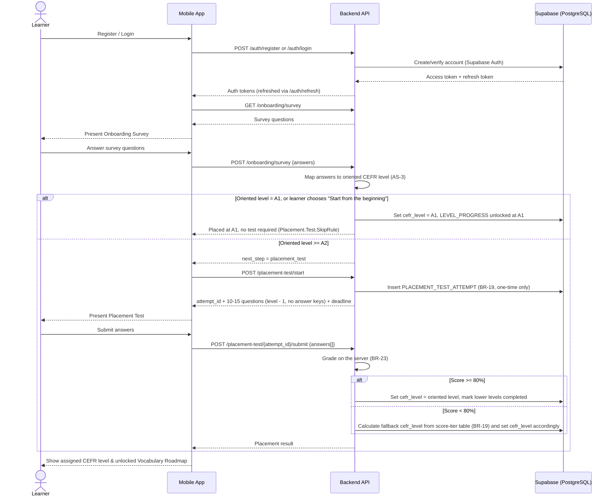

## A.2 Sequence Diagram — Lesson Practice & Topic Final Test

*Figure A- 2. Sequence diagram for Lesson Practice and the Topic Final Test.*

Nguồn: `docs/diagrams/02_seq_lesson-final-test.mmd`

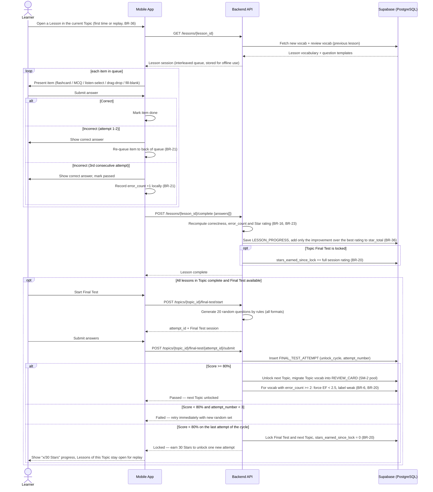

## A.3 Sequence Diagram — Daily Challenge Generation (SM-2, rule-based)

*Figure A- 3. Sequence diagram for Daily Challenge generation (rule-based, also available offline).*

Nguồn: `docs/diagrams/03_seq_daily-challenge.mmd`

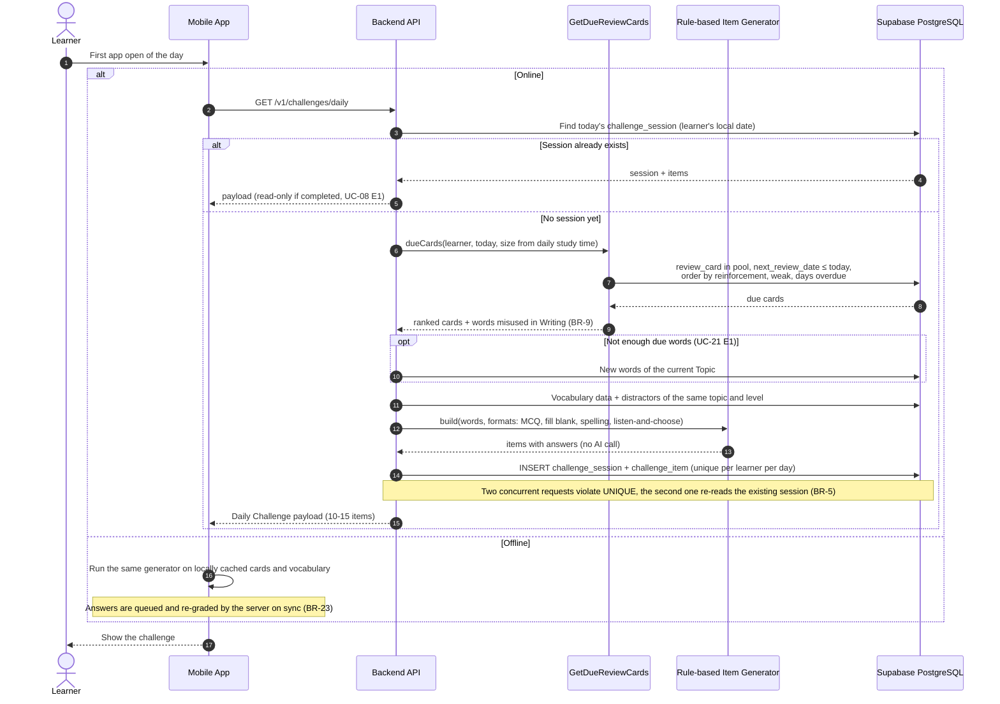

## A.4 Sequence Diagram — Weekly Challenge (Sunday)

*Figure A- 4. Sequence diagram for the Weekly Challenge, highlighting differences from the Daily Challenge.*

Nguồn: `docs/diagrams/04_seq_weekly-challenge.mmd`

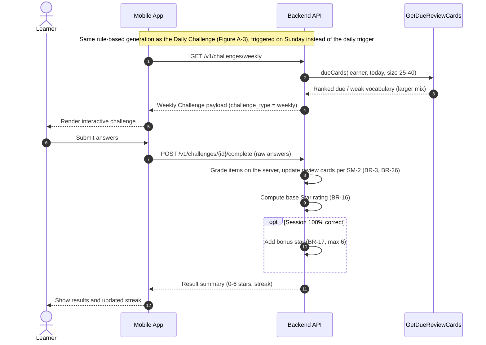

## A.5 Sequence Diagram — Writing Submission & AI Grading

*Figure A- 5. Sequence diagram for Writing submission and AI grading.*

Nguồn: `docs/diagrams/05_seq_writing-grading.mmd`

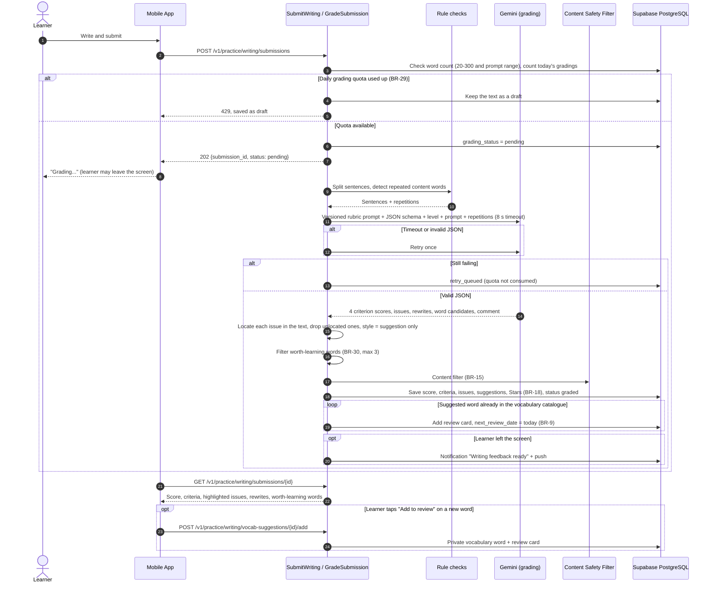

## A.6 Sequence Diagram — Offline-First Synchronization

*Figure A- 6. Sequence diagram for offline-first data synchronization, including server-side Star/streak revalidation (BR-23).*

Nguồn: `docs/diagrams/06_seq_offline-sync.mmd`

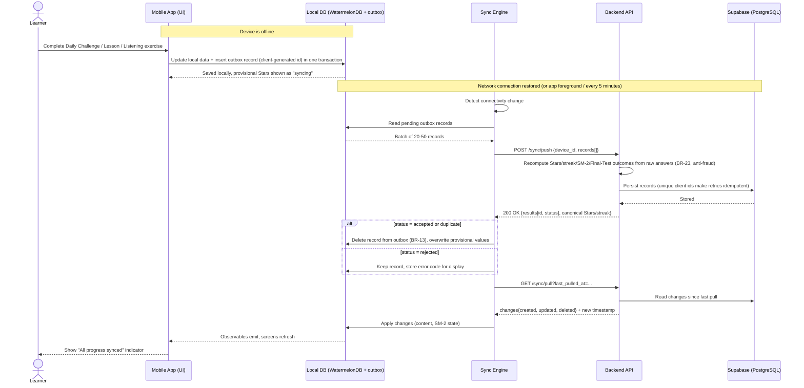

## A.7 State Diagram — Vocabulary Review Card Lifecycle (Long-Term SM-2 Pool)

*Figure A- 7. State diagram for the vocabulary review card lifecycle in the long-term SM-2 pool.*

Nguồn: `docs/diagrams/07_state_review-card-lifecycle.mmd`

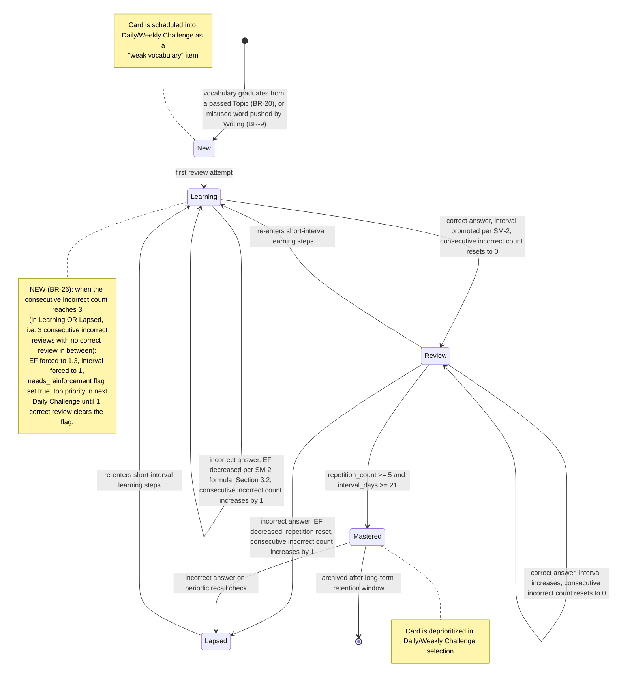

## A.8 State Diagram — In-Lesson Question Queue (Short-Term Repetition)

*Figure A- 8. State diagram for the short-term, in-Lesson question queue, distinct from the long-term SM-2 review card lifecycle (Figure A-7).*

Nguồn: `docs/diagrams/08_state_lesson-question-queue.mmd`

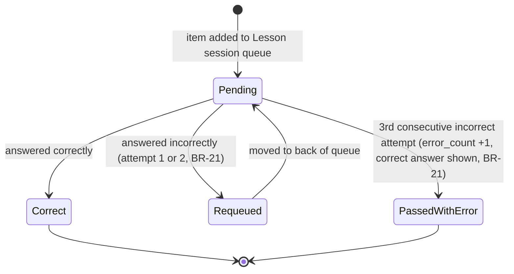

## A.9 State Diagram — CEFR Level / Topic Progression

*Figure A- 9. State diagram for CEFR level and Topic progression through the Vocabulary Roadmap.*

Nguồn: `docs/diagrams/09_state_level-topic-progression.mmd`

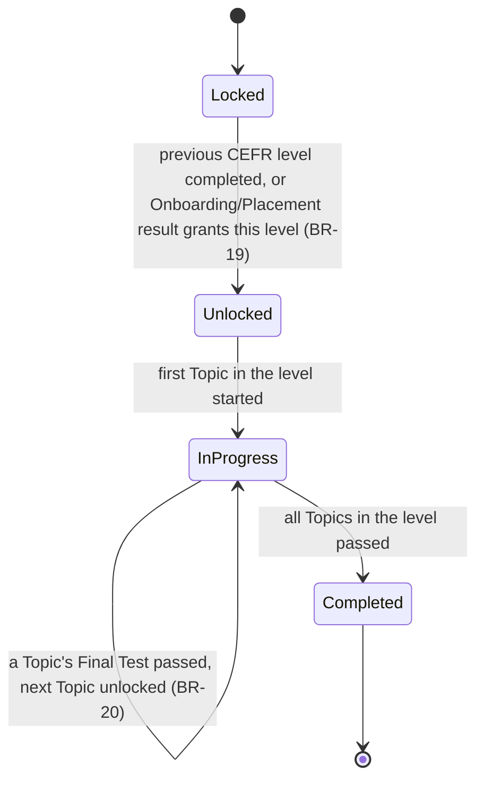

## A.10 State Diagram — Topic Attempt & Lock Cycle

*Figure A- 10. State diagram for the per-Topic Final Test attempt and lock cycle (BR-20, one attempt per unlock cycle), tracked by TOPIC_PROGRESS.*

Nguồn: `docs/diagrams/10_state_topic-attempt-lock.mmd`

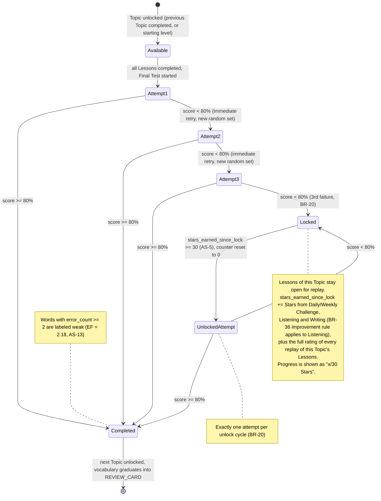

## A.11 Sequence Diagram — Challenge Submission, SM-2, Stars & Streak

*Figure A- 11. Sequence diagram for submitting a Daily or Weekly Challenge: server grading, SM-2 update, Stars and streak (BR-3, BR-10, BR-11, BR-23).*

Nguồn: `docs/diagrams/11_seq_challenge-submission.mmd`

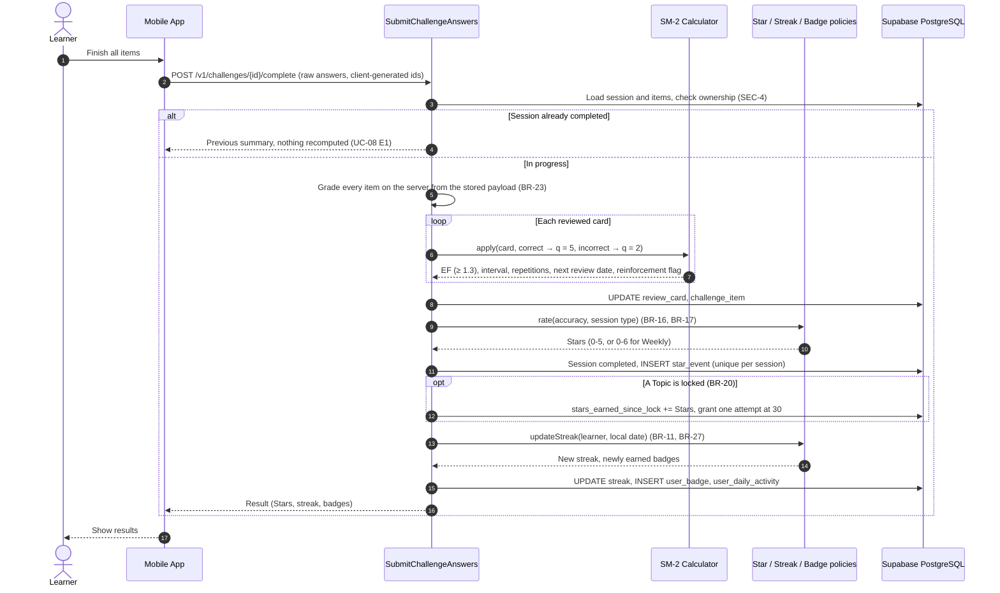

## A.12 Sequence Diagram — Topic Final Test & Graduation into the SM-2 Pool

*Figure A- 12. Sequence diagram for the Topic Final Test and graduation of its vocabulary into the SM-2 pool (BR-6, BR-20).*

Nguồn: `docs/diagrams/12_seq_final-test.mmd`

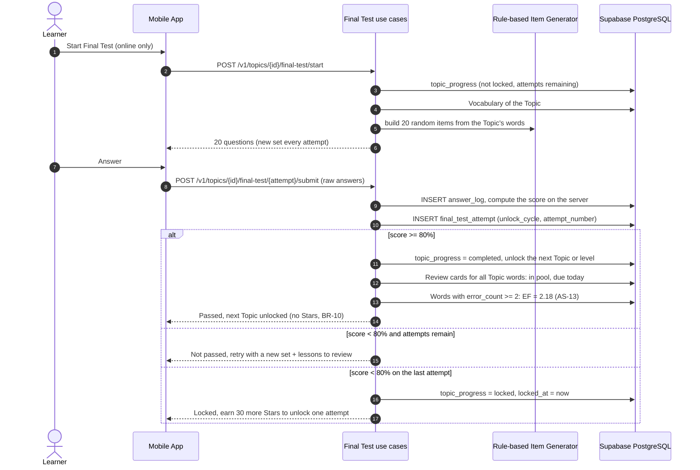

## A.13 Sequence Diagram — Admin Content Import (Listening & Writing)

*Figure A- 13. Sequence diagram for importing listening exercises and Writing prompts with AI assistance, preview and save (UC-19, BR-14, BR-25, BR-34).*

Nguồn: `docs/diagrams/13_seq_admin-content-import.mmd`

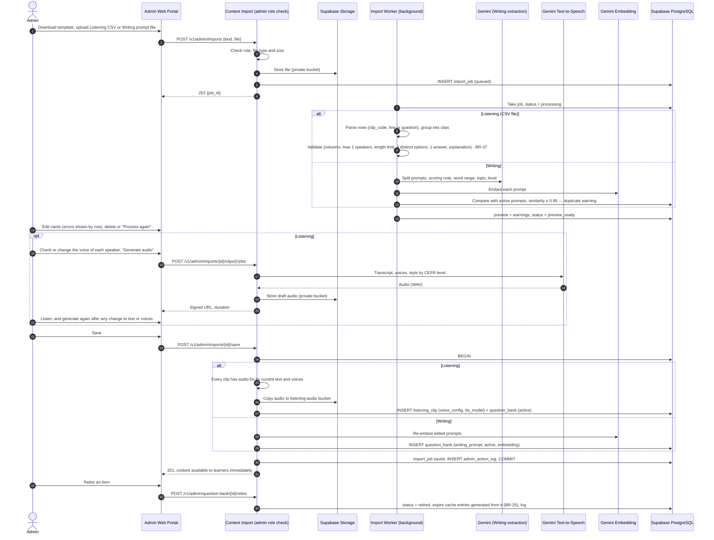

## A.14 State Diagram — Writing Submission Lifecycle

*Figure A- 14. State diagram for a Writing submission (BR-29).*

Nguồn: `docs/diagrams/14_state_writing-lifecycle.mmd`

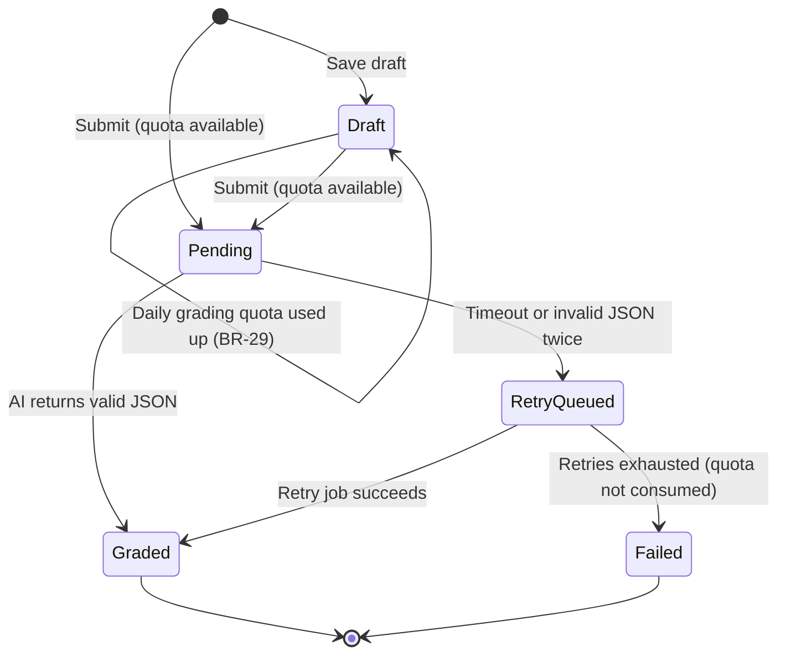

## A.15 State Diagram — Streak & Restore

*Figure A- 15. State diagram for the streak and streak restore (BR-11, BR-27).*

Nguồn: `docs/diagrams/15_state_streak-restore.mmd`

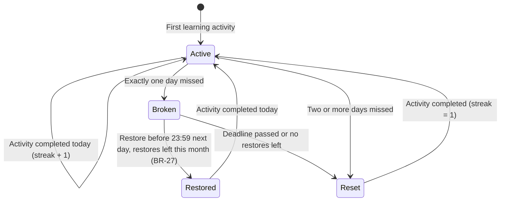

## A.16 Sequence Diagram — Writing Prompt Generation (RAG)

*Figure A- 16. Sequence diagram for "Let AI create a new prompt": cache, Top-5 retrieval, generation and fallback (UC-24, BR-7, BR-8, BR-24, BR-25).*

Nguồn: `docs/diagrams/16_seq_writing-prompt-RAG.mmd`

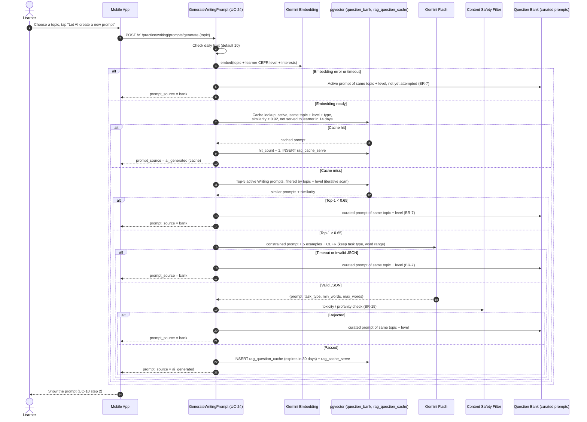

## A.17 Sequence Diagram — Handling Reports

*Figure A- 17. Sequence diagram for handling user reports (ban or ignore) and app problem reports (UC-29).*

Nguồn: `docs/diagrams/17_seq_handling-reports.mmd`

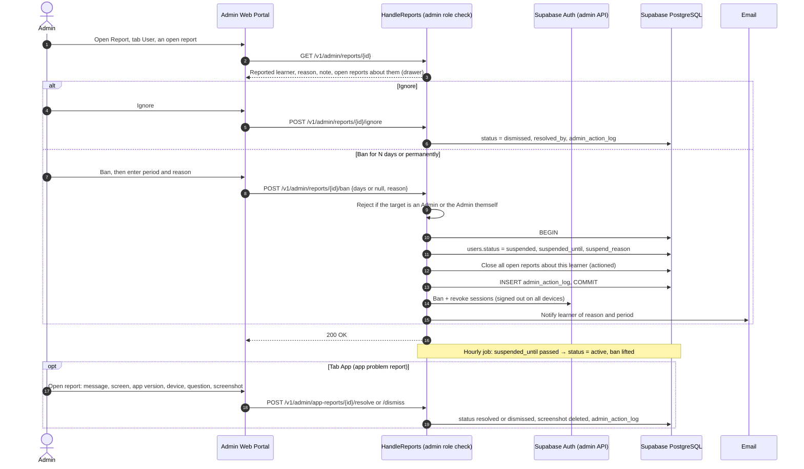
