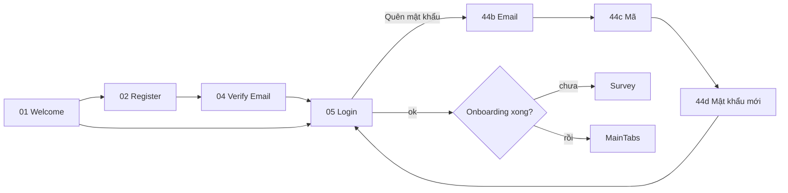
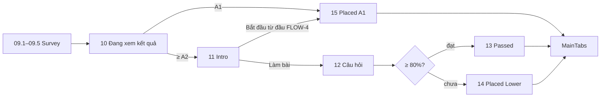
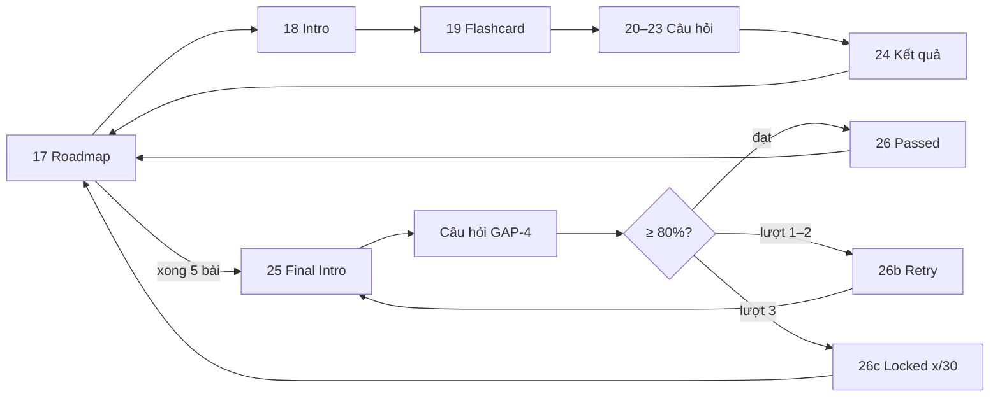
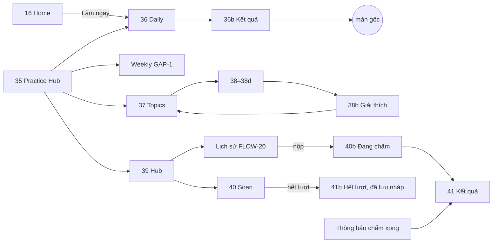
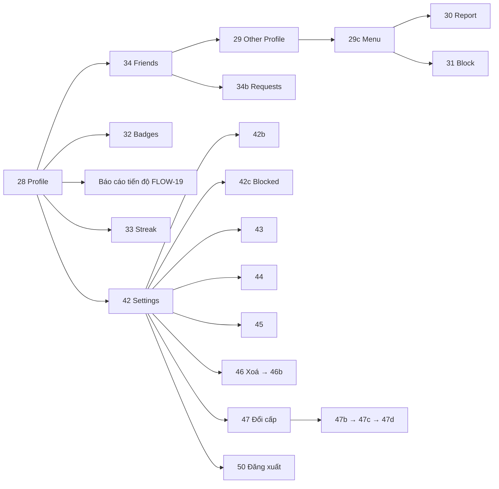

# Rà soát luồng màn mobile (Figma ↔ SRS v4.3)

Lập 17/11/2026, chỉ đọc Figma (file `1lvmT8y6aAhsOYil7blaXE`). Điểm trùng [design-gaps.md](design-gaps.md) chỉ dẫn chiếu GAP, không ghi lặp. Trạng thái mỗi mục: `cần duyệt` → `đã duyệt` / `bỏ`. Màn chưa chụp khi rà (Lesson 19–23, Listening 38*, Profile/Social 29*, 34*, Overlays): đối chiếu SRS khi dựng từng màn và bổ sung FLOW nếu phát hiện.

Xử lý ở đâu: **Figma** = nhờ chỉnh thiết kế · **Code** = làm trong app (không đổi Figma) · **Backend** = hỏi API/đặc tả ([api-requests.md](../api-requests.md)).

## Tóm tắt
- USE-2 đạt: Daily Challenge ≤ 2 chạm (Home → thẻ "Thử thách hôm nay" · Làm ngay = 1 chạm; tab Luyện tập → thẻ = 2 chạm).
- 5 lỗi mức **cao** đều là số/quy tắc cố định trái SRS (sao, ngưỡng mở khoá, thời gian chờ đổi cấp, thiếu lựa chọn bắt buộc).
- Thiếu màn/trạng thái đã ghi ở GAP-1…GAP-14; mục mới chủ yếu là điều hướng sau màn kết quả và mở từ thông báo.

## Phát hiện

| Mã | Luồng | Màn | Vấn đề | Căn cứ SRS | Mức | Đề xuất | Xử lý ở | Trạng thái |
|---|---|---|---|---|---|---|---|---|
| FLOW-1 | Final Test | [26c Locked](https://www.figma.com/design/1lvmT8y6aAhsOYil7blaXE/Personalized-English-Learning?node-id=628-16680) | Thẻ mở khoá ghi "Sao để mở khoá 32/50", "Kiếm thêm 18 sao" | BR-20, AS-5 (30 sao, cấu hình), UC-07 E1 ("x/30 Stars") | cao | Đổi mẫu thành x/30; code lấy ngưỡng từ server (MNT-3), không hard-code | Figma + Code | đã duyệt |
| FLOW-2 | Daily, Lesson | [16 Home](https://www.figma.com/design/1lvmT8y6aAhsOYil7blaXE/Personalized-English-Learning?node-id=619-15230), [35 Practice Hub](https://www.figma.com/design/1lvmT8y6aAhsOYil7blaXE/Personalized-English-Learning?node-id=629-16622), [36b Daily Result](https://www.figma.com/design/1lvmT8y6aAhsOYil7blaXE/Personalized-English-Learning?node-id=629-17036), [24 Lesson Result](https://www.figma.com/design/1lvmT8y6aAhsOYil7blaXE/Personalized-English-Learning?node-id=627-16225) | "Thưởng +20 sao", "+20 Sao nhận được", "+24" — một phiên chỉ được 0–5 sao (Weekly 0–6); màn kết quả không hiện số sao 0–5 | BR-16, BR-17, BR-36 | cao | Màn kết quả hiện StarRating 0–5 (Weekly 6) + dòng "+n sao vào tổng" (phần tăng khi làm lại); thẻ Daily bỏ "+20 sao" hoặc ghi "tối đa 5 sao" | Figma | đã duyệt |
| FLOW-3 | Đổi cấp | [47 Change Rank](https://www.figma.com/design/1lvmT8y6aAhsOYil7blaXE/Personalized-English-Learning?node-id=669-27950) | "Mỗi 30 ngày chỉ làm lại 1 lần" | BR-28, UC-25 PRE-3/E3: chờ **7 ngày sau lượt trượt** | cao | Sửa chữ: "Trượt thì chờ 7 ngày mới thi lại"; số ngày lấy từ server | Figma + Code | đã duyệt |
| FLOW-4 | Placement | [11 Placement Intro](https://www.figma.com/design/1lvmT8y6aAhsOYil7blaXE/Personalized-English-Learning?node-id=614-14683) | Không có lựa chọn "Bắt đầu từ đầu (A1)" thay cho làm bài | UC-03 A1, BR-19 (Placement.Test.StartFromBeginning) | cao | Thêm nút phụ (ghost) "Bắt đầu từ đầu" dưới "Bắt đầu làm bài", có xác nhận (chọn rồi không thi được nữa) | Figma | đã duyệt |
| FLOW-5 | Đổi cấp | [47](https://www.figma.com/design/1lvmT8y6aAhsOYil7blaXE/Personalized-English-Learning?node-id=669-27950), [47d Result](https://www.figma.com/design/1lvmT8y6aAhsOYil7blaXE/Personalized-English-Learning?node-id=669-29247) | Chỉ có "Cấp muốn lên": thiếu xuống cấp không cần thi; thiếu trạng thái "Chưa thi lại được, mở lúc …"; thiếu kết quả trượt; 47d ghi 13/15 câu | UC-25 A1, E1, E3; AS-12 (20 câu, 20 phút, đạt 80%) | cao | Select gồm cả cấp thấp hơn (chọn thấp → ConfirmDialog, áp ngay); thêm trạng thái E3 và 47d bản trượt; số câu/thời gian lấy từ server | Figma | đã duyệt |
| FLOW-6 | Writing | [39 Hub](https://www.figma.com/design/1lvmT8y6aAhsOYil7blaXE/Personalized-English-Learning?node-id=631-17361), [40 Compose](https://www.figma.com/design/1lvmT8y6aAhsOYil7blaXE/Personalized-English-Learning?node-id=631-17474) | Cùng đề "Describe your family": Hub ghi "80–120 từ", Compose ghi "50–120 từ" | Writing.Prompt.Select, Writing.Submit.Limit (20–300 hoặc khoảng của đề) | trung | Thống nhất mẫu; code hiện `minWords–maxWords` từ API, mặc định 20–300 | Figma + Code | đã duyệt |
| FLOW-7 | Writing | [41 Writing Result](https://www.figma.com/design/1lvmT8y6aAhsOYil7blaXE/Personalized-English-Learning?node-id=633-17495) | Không thấy mục "Từ đáng học" (≤ 3, nút thêm vào ôn) và số sao của bài | UC-10 bước 5–6, BR-18, BR-30 | trung | Thêm thẻ từ gợi ý (Thêm / Bỏ qua) và StarRating dưới ScoreScale | Figma (+ Backend API-5) | đã duyệt |
| FLOW-8 | Writing | 39 Hub | Không có lối vào bài nháp đang viết dở | UC-10 bước 2, Writing.Draft, BR-29 | trung | Mục "Bản nháp" trên Hub (nháp do hết lượt cũng hiện ở đây) | Figma + Backend (API-4) | đã duyệt |
| FLOW-9 | Writing | [40b Grading](https://www.figma.com/design/1lvmT8y6aAhsOYil7blaXE/Personalized-English-Learning?node-id=631-17539) | Cho rời màn nhưng không rõ quay lại kết quả bằng đường nào | UC-10 bước 4 ("notified when grading finishes"), UC-23 | trung | Thông báo "Đã chấm xong" mở thẳng WritingResult; lịch sử ở Hub hiện bài "Đang chấm" bấm vào được | Code | đã duyệt |
| FLOW-10 | Placement, Final Test | 11, [25 Final Test Intro](https://www.figma.com/design/1lvmT8y6aAhsOYil7blaXE/Personalized-English-Learning?node-id=628-16300) | Có đồng hồ "Làm trong 20 phút" / "15 phút" — SRS không quy định thời gian cho Placement và Final Test (chỉ Level-Up Test có, AS-12) | UC-03, UC-07, AS-12 | trung | **Đã chốt:** Placement giữ đồng hồ, thời lượng tính từ `deadline` server trả (Hình A-1); Final Test bỏ đồng hồ (SRS không quy định) | Figma (bỏ dòng "15 phút" ở 25) + Code | đã duyệt |
| FLOW-11 | Xếp hạng | [27 Leaderboard](https://www.figma.com/design/1lvmT8y6aAhsOYil7blaXE/Personalized-English-Learning?node-id=659-18521) | Chỉ có Bạn bè / Toàn cầu, thiếu chọn kỳ Tuần / Mọi lúc | BR-12, SRS 4.1.22 (period weekly, all_time) | trung | Thêm Tabs thứ hai (Tuần · Mọi lúc) hoặc Select kỳ | Figma | đã duyệt |
| FLOW-12 | Thông báo | (không có frame) | Chưa định nghĩa thông báo đẩy mở tới đâu | UC-10 b4, UC-27, UC-05, UC-18 (publish) | trung | Bảng deep link: nhắc học → ChallengeSession (daily); chấm xong → WritingResult; lời mời kết bạn → FriendRequests; topic mới → Roadmap; mở khoá Final Test → FinalTestIntro; sắp mất streak → Streak; bạn bè vượt hạng → Leaderboard. Hộp thư xem GAP-14 | Code | đã duyệt |
| FLOW-13 | Placement, Final Test, Đổi cấp | 11, 25, 47b | Không có trạng thái "cần mạng" (các bài này không làm offline) | UC-03 PRE-2, UC-07 PRE-2, UC-25 PRE-2 | trung | Xem GAP-2, GAP-12; nút bắt đầu bị khoá + banner offline | Code | đã duyệt |
| FLOW-14 | Kết quả phiên | 36b, 24, 26, 47d | Nút cuối dẫn cứng ("Về Luyện tập", "Tiếp tục lộ trình") dù vào từ Home | Điều hướng (USE-2) | thấp | Nút chính quay về nơi đã mở phiên (goBack tới màn gốc); Daily vào từ Home thì về Home | Code | đã duyệt |
| FLOW-15 | Daily | 16 Home, 35 Practice Hub | Số câu Daily không thống nhất ("Ôn 15 từ trong 5 phút" vs "10 câu"); SRS: 5 phút ≈ 10 câu, ≥ 20 phút ≈ 15 câu | UC-08 bước 1 | thấp | Code hiện số câu từ dữ liệu; Figma sửa mẫu cho khớp | Code (+ Figma) | đã duyệt |
| FLOW-16 | Thuật ngữ cấp bậc | [09.5 Survey · Trình độ](https://www.figma.com/design/1lvmT8y6aAhsOYil7blaXE/Personalized-English-Learning?node-id=703-30807), [14 Placed Lower](https://www.figma.com/design/1lvmT8y6aAhsOYil7blaXE/Personalized-English-Learning?node-id=615-15060), [28 Profile](https://www.figma.com/design/1lvmT8y6aAhsOYil7blaXE/Personalized-English-Learning?node-id=659-18734) | Bậc 1 lúc là "Tập sự" (09.5), lúc là "Học việc" (14); 09.5 có 5 lựa chọn trong khi Profile ghi "Bậc 3/6"; SRS chỉ dùng CEFR A1–C2 | SRS 4.1.1 (cefr_level), BR-19 | thấp | **Đã chốt:** 6 tên bậc ứng A1–C2 trong i18n, dùng thống nhất ở Profile, Placement, Đổi cấp; câu tự đánh giá 09.5 giữ 5 lựa chọn nhưng mô tả khả năng, không dùng tên bậc | Figma (sửa chữ) + Code (i18n) | đã duyệt |
| FLOW-17 | Streak | [33d Restore · Before](https://www.figma.com/design/1lvmT8y6aAhsOYil7blaXE/Personalized-English-Learning?node-id=667-28062) | "Bắt đầu lại từ 0" bỏ lượt khôi phục, không thể hoàn tác, không có xác nhận | Quy tắc UI (thao tác phá huỷ), BR-27 | thấp | ConfirmDialog trước khi bỏ khôi phục | Code (cần duyệt) | đã duyệt |
| FLOW-18 | Lesson | 20b Incorrect | Không có thông báo khi sai 3 lần liên tiếp (máy coi như qua, hiện đáp án) | BR-21 | thấp | Dùng AnswerExplanationSheet sẵn có với chữ riêng cho lần thứ 3 | Code | đã duyệt |
| FLOW-19 | Báo cáo tiến độ | [28 Profile](https://www.figma.com/design/1lvmT8y6aAhsOYil7blaXE/Personalized-English-Learning?node-id=659-18734) | Không có màn báo cáo tiến độ học: chọn khoảng ngày, thẻ tóm tắt (từ đã thuộc, từ còn yếu, điểm Writing TB, sao, streak), danh sách theo ngày bấm vào xem chi tiết | PELA-RPT-1 (mở từ Profile, hiện ≤ 3 giây, chỉ xem của mình) | B | Thêm màn "Báo cáo tiến độ" mở từ 28 Profile, bố cục thẻ + danh sách cuộn theo PELA-RPT-1 | Figma | đã duyệt |
| FLOW-20 | Writing | [39 Hub](https://www.figma.com/design/1lvmT8y6aAhsOYil7blaXE/Personalized-English-Learning?node-id=631-17361) | Hub chỉ có 3 bài gần nhất ("Lịch sử bài đã nộp" kèm điểm); chưa có màn lịch sử đầy đủ, xu hướng điểm và các loại lỗi hay gặp | UC-10 A1, Writing.History.List (OpenAPI đã có `GET /practice/writing/submissions`) | trung | Thêm route WritingHistory (danh sách + biểu đồ xu hướng + ≤ 3 loại lỗi), mở từ "Xem tất cả" ở Hub | Figma + Code | đã duyệt |

Đã có ở design-gaps (không ghi lặp): Weekly Challenge GAP-1 · offline/đồng bộ GAP-2 · báo lỗi app GAP-3 · màn câu hỏi Final Test GAP-4 · quên mật khẩu từ Login GAP-5 · khoá đăng nhập/chờ xoá GAP-6 · OTP hết hạn GAP-7 · nút Apple GAP-8 · Daily đã làm hôm nay GAP-9 · Writing chờ chấm lại GAP-10 · AI tạo đề GAP-11 · loading/rỗng/lỗi GAP-12 · hộp thư GAP-14.

## Sơ đồ luồng

### Xác thực

### Khảo sát & Placement

### Lộ trình, Lesson, Final Test

### Luyện tập: Daily, Weekly, Listening, Writing

### Hồ sơ, Bạn bè, Cài đặt

## Route đề xuất cho bước (d)

Params có kiểu; id do server/client cấp. Màn kết quả nằm trong route phiên (state nội bộ), trừ khi mở được từ ngoài (WritingResult).

| Route | Params | Stack | Figma |
|---|---|---|---|
| Welcome | – | AuthStack | 01 |
| Login | – | AuthStack | 05, 06 |
| Register | – | AuthStack | 02, 03 |
| VerifyEmail | `{ email }` | AuthStack | 04 |
| ForgotPassword | `{ email? }` | AuthStack (cũng mở từ Settings) | 44b |
| ForgotPasswordOtp | `{ email }` | AuthStack | 44c |
| ResetPassword | `{ resetToken }` | AuthStack | 44d |
| Survey | – (bước 1–5 là state trong màn) | OnboardingStack | 09.1–09.5 |
| SurveyAnalyzing | – | OnboardingStack | 10 |
| PlacementIntro | `{ orientedLevel }` | OnboardingStack | 11 |
| PlacementTest | `{ orientedLevel }` | OnboardingStack | 12 |
| PlacementResult | `{ placedLevel, passed, correct, total }` | OnboardingStack | 13, 14, 15 |
| Home | – | MainTabs | 16 |
| Roadmap | – | MainTabs ("Bài học") | 17 |
| Practice | – | MainTabs ("Luyện tập") | 35 |
| Leaderboard | – | MainTabs ("Xếp hạng", mở từ thông báo) | 27 |
| Profile | – | MainTabs ("Hồ sơ") | 28 |
| LessonSession | `{ lessonId }` | Root (toàn màn) | 18–24 |
| FinalTestIntro | `{ topicId }` | Root | 25 |
| FinalTestSession | `{ topicId, attemptId }` | Root | GAP-4, 26/26b/26c |
| ChallengeSession | `{ type: 'daily' \| 'weekly' }` | Root | 36, 36b, GAP-1 |
| ListeningTopics | – | Root (push từ Practice) | 37 |
| ListeningSession | `{ clipId }` | Root | 38–38d, 38b |
| WritingHub | – | Root (push từ Practice) | 39 |
| WritingCompose | `{ promptSource, promptQuestionId?, ragCacheId?, draftId? }` | Root | 40 |
| WritingGrading | `{ submissionId }` | Root | 40b, 41b |
| WritingResult | `{ submissionId }` | Root (mở từ thông báo) | 41 |
| WritingHistory | – | Root | FLOW-20 (chưa có frame) |
| Streak | – | Root (mở từ thông báo) | 33, 33c, 33d |
| Badges | – | Root | 32 |
| ProgressReport | `{ from?, to? }` | Root | FLOW-19 (chưa có frame) |
| Friends | – | Root | 34 |
| FriendRequests | – | Root (mở từ thông báo) | 34b |
| UserProfile | `{ userId }` | Root | 29, 29b, 29c |
| ReportUser | `{ userId }` | Root (modal) | 30, 30b |
| Settings | – | Root | 42 |
| NotificationSettings | – | Root | 42b |
| NotificationInbox | – | Root | GAP-14 |
| BlockedUsers | – | Root | 42c |
| EditProfile | – | Root | 43 |
| ChangePassword | – | Root | 44 |
| ChangeEmail | – | Root | 45 |
| DeleteAccount | – | Root | 46, 46b |
| ChangeLevel | – | Root | 47 |
| LevelUpTest | `{ targetLevel, attemptId }` | Root | 47b, 47c, 47d |
| RateApp | – | Root (modal/sheet) | 49 |
| ReportProblem | `{ questionId?, clipId? }` | Root (modal) | GAP-3 |
| DevUiKit, DevUiKitActions, DevUiKitDisplay, DevDbCheck | – | Root, chỉ `__DEV__` | – |

Dialog/overlay (Logout 50, Block 31, Huỷ kết bạn, Bỏ chặn) không phải route — dùng Dialog/ConfirmDialog trong màn.
